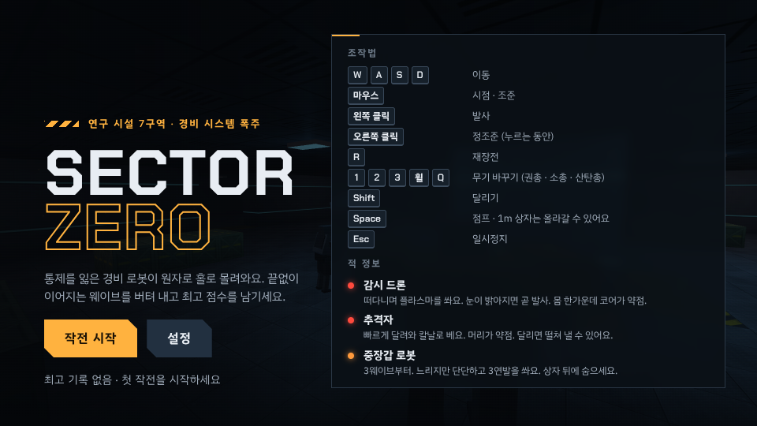
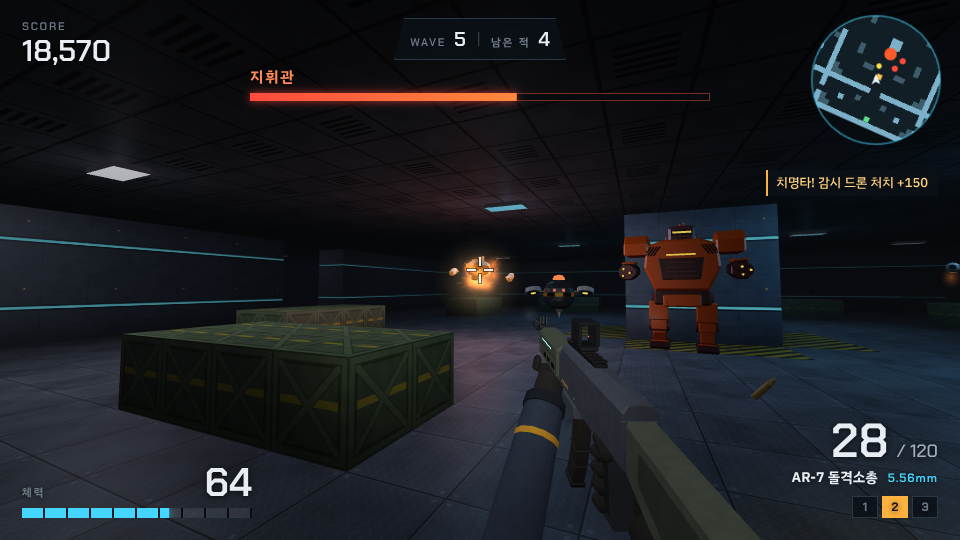

# SAVE CITY

**돈을 아끼는 행동을 할수록 게임 속 도시가 성장하는 게임**
절약 습관 + 도시 경영 + 수집 + 성장 + 게임화

현실에서 참은 소비를 기록하면 TOKEN을 받고, 그 TOKEN으로 나만의 도시를 짓는 절약 습관 게임이에요.
설치 없이 브라우저에서 바로 실행되고, 모바일(320px)부터 PC까지 같은 화면으로 쓸 수 있어요.

> 이 저장소에는 1인칭 슈팅 게임 **SECTOR ZERO**(`fps/`)도 들어 있어요. → [SECTOR ZERO](#sector-zero--1인칭-슈팅-게임)

<p>


</p>

## 바로 실행하기

| 방법 | 하는 일 |
| --- | --- |
| 파일로 열기 | `index.html`을 더블클릭해서 브라우저로 열면 바로 플레이할 수 있어요. |
| 로컬 서버 | `npm start` 후 <http://localhost:8080> 접속. 모바일 브라우저에서 "홈 화면에 추가"하면 앱처럼 쓸 수 있고, 한 번 열면 오프라인에서도 동작해요. |
| 한 파일 버전 | `npm run build` → `dist/save-city.html` 파일 하나에 모든 코드가 들어가요. 메신저로 보내거나 USB에 담아도 열려요. (SECTOR ZERO는 `dist/sector-zero.html`) |
| GitHub Pages | 저장소 Settings → Pages → *Deploy from a branch* → 이 브랜치의 `/ (root)`를 고르면 인터넷 주소로 공개돼요. |

별도 라이브러리나 빌드 과정이 필요 없어요. (폰트만 Google Fonts에서 불러오고, 인터넷이 없으면 기본 글꼴로 보여요.)

## 게임 방법

1. **현실에서 절약해요** — 사고 싶던 걸 참거나 더 싸게 해결했나요?
2. **SAVE에 기록해요** — 무엇을, 얼마를, 왜 사지 않았는지 적으면 TOKEN을 받아요.
3. **TOKEN으로 건물을 지어요** — 빈 땅을 눌러 건물을 짓고, 건물을 눌러 업그레이드해요.
4. **업적과 새 지역** — 도시 LEVEL이 오르면 새 건물과 새 지역이 열려요. 매일 기록하면 STREAK 보상도 받아요.

## 핵심 규칙

| 규칙 | 내용 |
| --- | --- |
| TOKEN 계산 | `1,000원 = 10 TOKEN`. `token = floor(인정 금액 / 1000) × 10` (999원 → 0, 1,999원 → 10, 49,900원 → 490) |
| 하루 제한 | 하루 최대 인정 금액 50,000원, 절약 TOKEN 최대 500. 20,000원을 세 번 기록하면 200 → 200 → 100 TOKEN |
| 입력 오류 | 빈 값, 문자, 음수, 소수, 0원, 1억 원 초과는 기록되지 않고 이유를 알려 줘요. 50,000원 초과는 50,000원까지만 인정돼요. |
| STREAK | 하루에 여러 번 기록해도 +1. 7일 → +100 TOKEN, 14일 → +250 TOKEN, 30일 → 특별 장식품(황금 저금통) |
| 0원 기록 | 절약한 게 없는 날은 "0원으로 오늘 기록하기"로 STREAK을 지켜요. (TOKEN 없음) |
| 기록 보너스 | 그날 첫 TOKEN 기록 뒤 **LUCKY BONUS +20 TOKEN** 또는 **CITY DISCOUNT 다음 건물 -10%** 중 하나를 직접 골라요. 무작위 뽑기가 아니에요. |
| 수정·삭제 | 기록을 고치거나 지우면 그날 인정 금액을 다시 계산해서 TOKEN을 돌려받아요. 이미 TOKEN을 써서 돌려받을 수 없으면 이유를 알려 주고 막아요. |
| 도시 LEVEL | 건물 수, 업그레이드, 도시 가치, 해금 지역, 업적으로 올라가요. LV 5 상업 건물, LV 10 상업 지구, LV 20 대형 건물, LV 30 미래 도시 |

보너스·업적·STREAK 보상 TOKEN은 하루 500 TOKEN(절약 TOKEN) 한도와 따로 계산돼요.
TOKEN은 게임 속 포인트일 뿐이며 실제 돈으로 바꾸거나 충전할 수 없어요.

## 화면

| 화면 | 내용 |
| --- | --- |
| HOME | 현재 TOKEN, 오늘 획득 TOKEN, 오늘·이번 달·누적 절약 금액, STREAK, 도시 LEVEL·VALUE, 움직이는 도시 미리보기, 다음 목표 |
| SAVE | 기록 폼, 빠른 입력 예시, 예상 보상 미리보기, 하루 인정 한도 막대, 사진 첨부, 0원 기록 |
| CITY | 아이소메트릭 도시 지도 5개 지역, 건설·업그레이드(Lv.1~5 모습 변화)·이동·보관함, 지역 해금, 달리는 탈것 |
| SHOP | BUILDINGS · DECORATIONS · VEHICLES · LANDMARKS · SKINS, 잠금 조건과 할인 쿠폰 표시 |
| HISTORY | 날짜별 기록, 검색, 상세(항목·금액·인정 금액·획득 TOKEN·이유·메모·날짜·사진), 수정·삭제, TOKEN 내역 |
| ACHIEVEMENTS | 업적 40개(배지·TOKEN·특별 장식·칭호 보상), 도감 완성률 |
| STATS | 요약 숫자, 최근 7일·6개월 절약 금액 그래프, 종류별 절약 금액 |
| SETTINGS | 사운드(배경 음악), 효과음, 애니메이션, 다크 모드, 데이터 초기화 |
| PROFILE | 닉네임·캐릭터·칭호 편집, 메뉴 |
| RANKING | 이번 주·누적 절약, 도시 LEVEL, STREAK 순위, 참가·나가기 (공유된 게임에서만) |
| ADMIN | 게시자 전용 관리자 모드: 참가자 기록 확인, 부정 사용 자동 검사, 경고·랭킹 제외 |

모바일은 하단 탭(HOME, CITY, SAVE, SHOP, PROFILE), 920px 이상 화면은 왼쪽 메뉴로 바뀌어요.


## 랭킹과 관리자 모드

Claude 아티팩트로 공유한 SAVE CITY에서는 **랭킹**이 열려요. 공유 데이터베이스가 필요해서, 파일로 열거나 GitHub Pages로 연 버전에는 랭킹 메뉴가 나타나지 않아요. (게임은 그대로 할 수 있어요)

| 순위 | 기준 |
| --- | --- |
| 이번 주 | 이번 주(월~일) 인정된 절약 금액. 월요일에 새로 시작 |
| 누적 | 지금까지 인정된 절약 금액 |
| 도시 | 도시 LEVEL, 같으면 도시 가치 |
| STREAK | 지금 이어지는 연속 기록 일수 (끊기면 0) |

모든 금액 순위는 **인정 금액**(하루 최대 50,000원) 기준이라, 큰 금액을 적어도 순위가 더 오르지 않아요.

**참가할 때 공유되는 것** — 랭킹 화면의 *랭킹 참가하기*를 누르고 동의하면 올라가요. 언제든 *랭킹 나가기*로 지울 수 있어요.

| 누가 보나요 | 내용 |
| --- | --- |
| 게임을 함께 보는 모든 사람 | 닉네임, 캐릭터, 칭호, 도시 LEVEL·가치, STREAK, 이번 주·누적 인정 금액 |
| 관리자(게시자)만 | 최근 절약 기록 60개(항목·종류·금액·날짜·시각), 날짜별 합계, 기기 시계 기록 |
| 보내지 않음 | 절약 이유, 메모, 사진 |

### 부정 사용 막기

1. **저장 데이터 확인값** — 저장할 때마다 내용으로 만든 확인값을 붙여 둬요. 브라우저 개발자 도구 등으로 저장 데이터를 직접 고치면 확인값이 맞지 않아 "변조 흔적"으로 기록돼요.
2. **기기 시계 확인** — 마지막으로 본 시각보다 시계가 5분 넘게 뒤로 가면 기록해요. (날짜를 바꿔 하루 한도나 STREAK을 늘리는 방법을 막기 위해) 기록 순서와 시각이 거꾸로 된 것, 미래 날짜도 찾아요.
3. **게임 규칙 검사** — 하루 한도로 나올 수 없는 금액, 받을 수 없는 보너스 TOKEN, 쓴 TOKEN으로 만들 수 없는 도시 가치·LEVEL, 기록 일수보다 긴 STREAK 등을 계산으로 확인해요.
4. 위 항목이 하나라도 걸리면 그 사람은 **랭킹에서 자동으로 숨겨지고**, 본인 화면에 이유가 보이며, 관리자가 확인해요.

**관리자 모드**(게시자에게만 보여요): 참가자를 위험도 순으로 보고, 한 사람씩 랭킹 숫자·최근 14일 그래프·최근 기록·시계 되돌림·반영 기록을 확인해요.

| 버튼 | 하는 일 |
| --- | --- |
| 정상 확인 | 지금 보이는 의심 항목을 허용해요. 새 흔적이 생기면 다시 표시돼요. |
| 경고 | 순위는 그대로 두고, 본인에게 사유와 메시지를 보여 줘요. |
| 랭킹 제외 / 제외 풀기 | 다른 사람에게 순위를 숨기거나 다시 보여 줘요. |
| 모두 제외 | 자동 검사에 걸린 사람을 한 번에 제외해요. |
| 랭킹 기록 삭제 | 그만둔 사람의 기록을 정리해요. |

> 모든 계산은 각자의 기기에서 이뤄지기 때문에 마음먹고 코드를 고치는 치트까지 100% 막을 수는 없어요. 그래서 자동 검사로 걸러 내고, 관리자가 기록을 보고 최종 판단하는 구조예요.

**공유 데이터 구조와 권한** (아티팩트에 선언한 규칙)

| 경로 | 읽기 | 쓰기 |
| --- | --- | --- |
| `ranking/<사용자 id>` 랭킹 카드 | 모두 | 본인(참여 권한 이상), 관리자 |
| `proofs/<사용자 id>` 상세 기록 | 본인, 관리자 | 본인(참여 권한 이상), 관리자 |
| `mod/<사용자 id>` 관리자 판정 | 모두 | 관리자만 |

랭킹에 **참가**하려면 Claude에 로그인한 상태에서 *참여(Contributor)* 이상 권한으로 공유받아야 해요. *보기(Viewer)* 권한은 순위를 볼 수만 있어요.

## 데이터 저장

- 게임 데이터는 브라우저의 **localStorage**(`savecity.v1`)에, 기록 사진은 **IndexedDB**에 저장돼요. 앱을 닫았다 열어도 그대로 남아요.
- 저장 항목: `user, token, totalSaved, todaySaved, streak, longestStreak, cityLevel, cityValue, buildings, buildingLevels, regions, achievements, history, settings` 외에 TOKEN 내역 등.
- 저장된 값이 손상되면 따로 보관한 뒤 새로 시작하고, 개인정보 보호 모드처럼 저장이 막힌 환경에서는 화면 위에 경고를 띄워요.
- 저장할 때마다 확인값(`_seal`)을 붙여서, 게임 밖에서 바뀐 데이터를 알아봐요. (랭킹 부정 사용 확인용)
- 데이터는 이 기기 안에만 있어요. 랭킹에 참가했을 때만 위 표의 내용이 공유 데이터베이스로 올라가요. 다른 기기로는 자동으로 옮겨지지 않아요.

## 개발

```
index.html            앱 화면 틀
css/style.css         스타일 (라이트/다크 테마 토큰)
js/util.js            날짜·숫자·문자열 도우미
js/data.js            규칙 상수, 아이템·지역·업적·칭호 데이터
js/engine.js          게임 규칙 엔진 (DOM 없는 순수 로직)
js/rank-rules.js      랭킹 점수와 부정 사용 검사 (DOM 없는 순수 로직)
js/ranking.js         공유 랭킹 연결 (Claude 아티팩트의 db·user 기능)
js/storage.js         localStorage / IndexedDB 저장
js/render-city.js     아이소메트릭 도시 그림 (SVG)
js/audio.js           Web Audio 효과음·배경 음악
js/ui.js, view.js     모달·시트·토스트, 공통 HTML 조각
js/app.js             화면 전환, 저장, 축하 연출
js/screens/*.js       화면별 코드 (ranking.js 랭킹, admin.js 관리자 모드)
sw.js                 오프라인 캐시
tests/engine.test.js  규칙 단위 테스트
tests/ranking.test.js 랭킹·부정 사용 검사 테스트 (규칙대로 한 가상 플레이 여러 판이 오탐 없이 통과하는지 포함)
```

- 테스트: `npm test` (Node 20 이상, 추가 설치 없음) — TOKEN 계산표, 하루 제한, STREAK, 보너스, 상점, 업그레이드, 수정·삭제, 저장 데이터 복구, 랭킹 순위·부정 사용 검사·저장 확인값을 확인해요.
- 그림 파일 없이 모든 건물·장식·탈것을 코드(SVG)로 그려요.

## SECTOR ZERO — 1인칭 슈팅 게임

통제를 잃은 경비 로봇이 연구 시설 원자로 홀로 몰려와요. 끝없이 이어지는 웨이브를 버텨 내고 최고 점수를 남기는 1인칭 슈팅(FPS) 게임이에요.
라이브러리 없이 WebGL을 직접 다뤄서 만들었고, 총·로봇 3D 모델과 질감·소리도 모두 코드로 만들어요. (이미지·음원 파일 없음)

<p>


</p>

### 실행하기

| 방법 | 하는 일 |
| --- | --- |
| 파일로 열기 | `fps/index.html`을 브라우저로 열어요. |
| 로컬 서버 | `npm start` 후 <http://localhost:8080/fps/> 접속 |
| 한 파일 버전 | `npm run build` → `dist/sector-zero.html` 하나만 있으면 어디서든 열려요. |

### 조작법

| 키 | 동작 |
| --- | --- |
| `W` `A` `S` `D` | 이동 (`Shift` 누르면 달리기) |
| 마우스 | 시점 돌리기. 화면을 클릭하면 마우스가 잠겨요. 잠글 수 없는 곳에서는 마우스를 누른 채 끌어서 둘러봐요. 방향키로도 돌릴 수 있어요. |
| 왼쪽 클릭 | 발사 |
| 오른쪽 클릭 | 정조준 (확대 + 탄 퍼짐 감소, 누르는 동안) |
| `R` | 재장전 (탄창이 비면 저절로) |
| `1` `2` `3` · 휠 · `Q` | 무기 바꾸기 (`Q`는 바로 전 무기) |
| `Y` · `F` | 총 살펴보기 (쏘기·조준·재장전·무기 바꾸기를 하면 멈춰요) |
| `Space` | 점프 — 1m 상자 위로 올라가고, 1m 상자를 딛고 2m 상자에도 올라가요 |
| `Esc` · `P` | 일시정지 |

휴대폰·태블릿은 화면을 터치하면 터치 조작으로 바뀌어요. 왼쪽 화면을 끌어 이동(끝까지 밀면 달리기), 오른쪽 화면을 끌어 시점, 발사 버튼은 누른 채 끌면 조준까지 같이 돼요. 왼쪽 위 **살펴보기** 버튼으로 총을 돌려 볼 수 있어요.

**가로 화면**: 휴대폰을 세워 든 상태에서는 게임 화면 전체가 90° 돌아가요. 휴대폰 윗부분을 왼쪽으로 눕혀 잡으면 가로로 할 수 있어요. 앱이 세로로 고정돼 있어도 돼요.
반대로 보이면 첫 화면의 **화면 뒤집기**나 설정의 **가로 화면**에서 방향을 바꾸거나 끌 수 있어요. 전체 화면이 되는 브라우저에서는 가로 고정도 시도하고, 기기를 실제로 눕혀 화면이 가로가 되면 돌리지 않아요.

### 무기

| 무기 | 탄 | 재장전 | 특징 |
| --- | --- | --- | --- |
| 1 · P-9 권총 | 9mm · 12발, 예비 무제한 | 1.4초 | 빠르게 누를수록 빨리 쏴요. 머리 피해 ×2.2 |
| 2 · AR-7 돌격소총 | 5.56mm · 30발, 예비 최대 270 | 2.1초 | 연사. 오래 쏘면 탄이 퍼지고 반동이 쌓여요. 손을 떼면 반동이 대부분 돌아와요 |
| 3 · SG-12 산탄총 | 12G · 6발, 예비 최대 42 | 한 발 0.5초 | 9알이 퍼져요. 9m 넘으면 피해가 줄어요. 한 발씩 장전하고, 장전 중에도 바로 쏠 수 있어요 |

움직이거나 공중에 있으면 탄이 더 퍼지고, 정조준하면 덜 퍼져요. 조준선이 벌어진 만큼이 실제 퍼짐이에요.

### 총 애니메이션

손에 든 총은 발로란트처럼 크고 묵직하게 움직여요. 모든 동작은 `fps/js/anim.js`의 키프레임 표로 정해져 있어요.

| 동작 | 권총 | 돌격소총 | 산탄총 |
| --- | --- | --- | --- |
| 꺼내기 (0.55~0.72초, 그동안은 못 쏴요) | 아래에서 올라오며 손가락에 걸고 한 바퀴 돌리기 | 오른쪽 아래에서 굴리듯 올라와 장전 손잡이 철컥 | 기울여 올라와 펌프 철컥 |
| 재장전 | 총을 들어 기울이고 → 탄창이 빠져 바닥에 떨어지고 → 왼손이 새 탄창을 꽂아 툭 치고 → 슬라이드 놓기 | 윗면을 크게 눕혀 탄창 구멍을 보이고 → 빈 탄창 떨어뜨리기 → 새 탄창 꽂고 치기 → 왼손으로 오른쪽 장전 손잡이 당기기 | 총을 눕혀 아래 구멍을 보이고, 왼손이 허리에서 빨간 탄을 한 발씩 꺼내 밀어 넣고, 다 넣으면 세우며 펌프 |
| 살펴보기 (`Y`) | 왼쪽 면을 보여 주고 손가락에 걸어 한 바퀴 돌려 받기 | 왼쪽 면 → 뒤집어 오른쪽 면과 윗면 | 옆면을 보여 주고 펌프 철컥 |
| 쏘기 | 슬라이드가 뒤로 튀고 크게 들려요 | 노리쇠가 움직이고 연사마다 반동이 쌓여요 | 아주 크게 튀고, 펌프질하며 탄피를 튕겨 내요 |

- 반동은 스프링이라 크게 튀었다가 살짝 넘치며 제자리로 돌아와요. 정조준 중에는 반만 튀어요.
- 탄피는 총 오른쪽에서 튀어나와 바닥에서 짤랑거리고, 빼낸 탄창은 바닥에 떨어져 몇 초 남아 있어요.
- 총구 불꽃은 별 모양으로 크게 번지고 연기가 피어올라요.
- 숨쉬기, 걷기·달리기 흔들림(8자), 옆걸음 기울기, 마우스를 따라 늦게 오는 흔들림, 점프·착지 출렁임도 있어요.
- 탄창 빼기·꽂기·치기, 장전 손잡이, 펌프, 꺼낼 때 옷 스치는 소리가 동작에 맞춰 나요.

### 적

| 적 | 체력 | 공격 | 약점 |
| --- | --- | --- | --- |
| 감시 드론 | 42 | 떠다니며 플라스마 1발 (눈이 밝아지면 곧 발사) | 몸 한가운데 코어 |
| 추격자 | 60 | 빠르게 달려와 칼날로 베기. 칼날을 뒤로 들며 눈이 번쩍이면 0.3초 뒤에 베요 (물러나면 피해요) | 머리 |
| 중장갑 로봇 (3웨이브부터) | 260 | 움직임을 예측해서 3연발 | 머리 |

- 적은 네 모서리 격납고와 바깥 홀 네 곳에서 나타나요 (가까운 곳에서 더 자주). 플레이어가 있는 칸을 향해 길을 찾아 오고, 플레이어가 안 보이면 서둘러 와요. 상자 너머로도 보고 쏘지만, 상자에 탄이 막혀요.
- 드론·중장갑은 플레이어를 새로 발견하면 1초쯤 뒤에 쏘고, 움직이는 쪽을 예측해서 쏴요. 탄은 날아오는 게 보이는 속도라서 방향을 바꾸면 피할 수 있어요. 맞으면 화면 가운데 빨간 표시가 맞은 방향을 가리켜요.
- 웨이브에 적이 3기 이하로 남으면 거리와 상관없이 레이더에 깜빡이며 표시돼요.

### 3D 모델

총 3자루, 손, 탄피, 로봇 3종은 진짜 3D 모델(GLB 파일, glTF 2.0)이에요. `scripts/make-assets.mjs`가 코드로 깎아서 만들고, Blender 같은 3D 프로그램에서도 열려요.

| 모델 | 파일 | 삼각형 | 움직이는 부품 (노드 이름) |
| --- | --- | --- | --- |
| P-9 권총 | `fps/assets/guns/pistol.glb` | 1,300 | `slide` 슬라이드, `magazine` 탄창 |
| AR-7 돌격소총 | `fps/assets/guns/rifle.glb` | 2,706 | `bolt` 장전 손잡이, `magazine` 휜 탄창 |
| SG-12 산탄총 | `fps/assets/guns/shotgun.glb` | 2,158 | `pump` 펌프 (옆에 빨간 예비 탄 6발) |
| 손 | `fps/assets/guns/hands.glb` | 1,676 | `hand_r` `hand_l` 장갑 낀 손, `arm_r` `arm_l` 소매 |
| 탄피 | `fps/assets/props/casings.glb` | 344 | `casing_9mm` `casing_556` `shell_12g` |
| 감시 드론 | `fps/assets/robots/drone.glb` | 1,680 | `eye` 눈(빛남), `pod_l` `pod_r` 추진기, `antenna` |
| 추격자 | `fps/assets/robots/runner.glb` | 2,768 | `hips` → `torso` → `head`, `arm` → `fore`(칼날), `thigh` → `shin` → `foot` (`_l` `_r`) |
| 중장갑 로봇 | `fps/assets/robots/brute.glb` | 3,120 | `hips` → `torso` → `head`, `shoulder` → `cannon` → `barrels`(3연장 포신), `thigh` → `shin` → `foot` (`_l` `_r`) |

- 게임은 노드 이름으로 부품을 움직여요. 쏘면 슬라이드·장전 손잡이가 뒤로 가고, 재장전하면 `magazine` 노드가 빠져서 바닥에 떨어지고, 펌프는 앞뒤로 움직여요.
- 로봇은 관절마다 따로 돌아서 걷고, 추격자는 칼날을 휘두르고, 중장갑은 포신이 돌며 끝이 달아올라요. 부서지면 머리·팔·다리 같은 진짜 부품이 뜨겁게 빛나며 흩어져 바닥에 남아요.
- 총의 `muzzle`(총구)·`eject`(탄피 나오는 곳) 빈 노드 자리와 `magazine` 자리는 `fps/js/anim.js`의 `GEOM` 값과 같아야 해요. 테스트가 확인해요.
- 모델은 `fps/js/assets-data.js`에 글자(base64)로 묶여 들어가요. 그래서 `index.html`을 파일로 열어도, 한 파일 버전에서도 인터넷 없이 보여요. 모델이 없거나 깨지면 예전 상자 모델로 그려요.

| 명령 | 하는 일 |
| --- | --- |
| `npm run assets` | 코드로 모델을 새로 만들어 `fps/assets/`에 저장하고 `assets-data.js`로 묶어요 |
| `npm run assets:pack` | `fps/assets/`의 GLB 파일만 다시 묶어요 (직접 만든 모델로 바꿨을 때) |

**내 모델로 바꾸기**: 같은 이름의 GLB 파일을 `fps/assets/`에 덮어쓰고 `npm run assets:pack` → `npm run build` 하면 돼요. (`npm run assets`는 덮어쓰니 쓰지 마세요.)
단위는 미터, 위쪽이 +Y, 앞(총구·로봇 얼굴)이 −Z예요. 로봇은 발바닥이 y = 0이고, 총은 손잡이를 쥐는 자리가 원점 근처예요. 위 표의 노드 이름을 그대로 쓰면 움직임이 붙어요.
꼭짓점 색(COLOR_0), 재질 색, 금속·거칠기, 빛(emissive), GLB 안에 든 그림(baseColorTexture)을 읽어요. 뼈대(스킨)와 애니메이션 트랙은 쓰지 않고 노드를 직접 돌려요.

### 강화

웨이브를 클리어하면 강화 카드 3장 중 하나를 골라요 (`1` `2` `3` 키·클릭·터치). 같은 강화를 다시 고르면 단계가 올라가요. 고르는 동안 게임은 멈춰요.

| 강화 | 효과 (한 단계마다) | 최대 |
| --- | --- | --- |
| 강화 탄두 | 모든 무기 피해 +15% | 4 |
| 가속 기관 | 연사 속도 +12% | 3 |
| 약점 분석 | 치명타 추가 피해 +30% | 3 |
| 산탄 확장 | 산탄총 한 발에 알 +3개 | 2 |
| 빠른 손 | 재장전 25% 빠르게 | 3 |
| 확장 탄창 | 탄창 크기 +35% | 2 |
| 반동 제어 | 반동과 탄 퍼짐 -30% | 2 |
| 탄약 회수 | 처치하면 소총 탄 +5 · 산탄 +1 | 2 |
| 강화 장갑 | 최대 체력 +25, 체력이 다 차요 | 3 |
| 회수 회로 | 처치할 때마다 체력 +4 | 3 |
| 경량 부츠 | 이동 속도 +10% | 2 |

고른 강화는 일시정지 화면과 결과 화면에 나와요.

### 규칙

| 규칙 | 내용 |
| --- | --- |
| 웨이브 | n번째 웨이브의 적 수 = `5 + 3n`. 동시에 나오는 적은 최대 `5 + n`(14 이하). 웨이브마다 적 체력 +7%, 공격력 +5% |
| 웨이브 클리어 | `250 × n`점, 체력 +20, 소총·산탄총 예비 탄약 반 탄창씩, 그리고 강화 하나 고르기 |
| 점수 | 드론 100, 추격자 120, 중장갑 400. 치명타 처치 ×1.5 |
| 콤보 | 4초 안에 다음 처치를 하면 콤보 배율이 0.25씩 올라요 (최대 ×3) |
| 아이템 | 구급상자 체력 +35, 탄약 상자 소총 +45·산탄 +8. 맵의 정해진 곳에서 다시 생기고, 적이 떨어뜨리기도 해요 (20초 뒤 사라짐) |
| 기록 | 최고 점수와 설정(감도, 음량, 시야각, 화질, 상하 반전, 가로 화면)은 브라우저 localStorage(`sectorzero.v1`)에 저장돼요 |

화질이 `자동`이면 프레임이 계속 느릴 때 해상도를 조금씩 낮춰요.

### 파일

```
fps/index.html        화면 틀 (HUD, 터치 버튼, 메뉴)
fps/css/fps.css       스타일
fps/js/math.js        4x4 행렬, 보간, 난수
fps/js/level.js       맵 격자, 충돌, 광선 판정(DDA), 적 길찾기 (DOM 없는 순수 로직)
fps/js/rules.js       무기·적·웨이브·점수 규칙 (DOM 없는 순수 로직)
fps/js/textures.js    콘크리트·패널·바닥·상자 질감을 픽셀 단위로 계산
fps/js/renderer.js    WebGL 셰이더(점광원 12개 + 손전등 + 안개), 맵 메시, 빛 효과
fps/js/anim.js        총 애니메이션: 꺼내기·재장전·살펴보기·펌프 키프레임, 반동 스프링, 흔들림 (DOM 없는 순수 로직)
fps/js/gltf.js        GLB(glTF 2.0) 읽기: 노드·메시·재질·그림 (DOM 없는 순수 로직)
fps/js/assets-data.js 3D 모델 묶음 (npm run assets:pack이 만들어요)
fps/assets/           총·손·탄피·로봇 GLB 파일
fps/js/models.js      GLB 모델 그리기: 총 부품(슬라이드·장전 손잡이·펌프·탄창)과 로봇 관절 자세, 부서진 부품. 모델이 없으면 상자 모델
scripts/make-assets.mjs  3D 모델을 코드로 만들어 GLB로 저장 (scripts/assets/: geom 모양 도구, glb 파일 쓰기, kit 재질·색, guns·robots 모델)
scripts/pack-assets.mjs  fps/assets/*.glb → fps/js/assets-data.js
fps/js/audio.js       Web Audio 효과음 (방향·거리에 따라 들려요)
fps/js/input.js       키보드·마우스(포인터 잠금)·터치
fps/js/hud.js         체력·탄약·레이더·피격 방향·알림
fps/js/game.js        플레이어, 무기, 적 AI, 웨이브, 그리기 순서
fps/js/main.js        메뉴·설정·결과 화면 연결, 휴대폰 가로 화면(화면 돌리기)
tests/fps.test.js     맵 연결, 충돌, 광선, 길찾기, 웨이브·점수 규칙, 총 애니메이션(끊김 없이 이어지는지, 탄창 위치, 사건 순서, 반동), 3D 모델(부품 이름, 총구·탄창 자리, 로봇 크기, GLB 읽고 쓰기) 테스트
```
