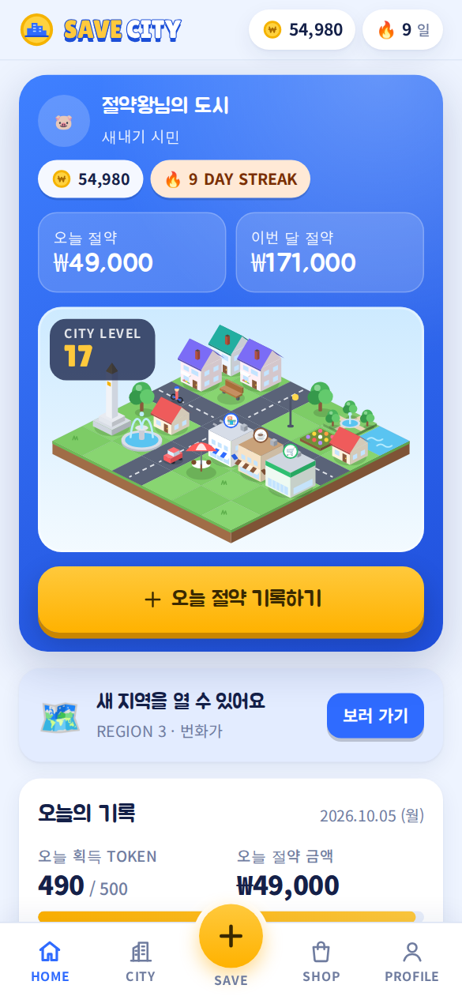
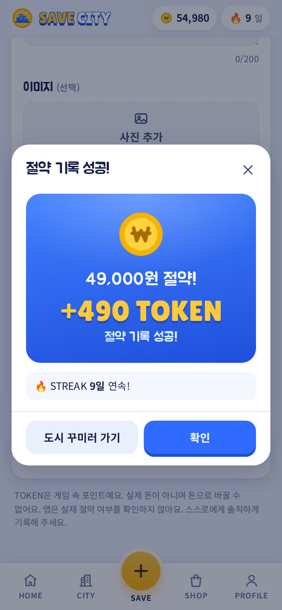
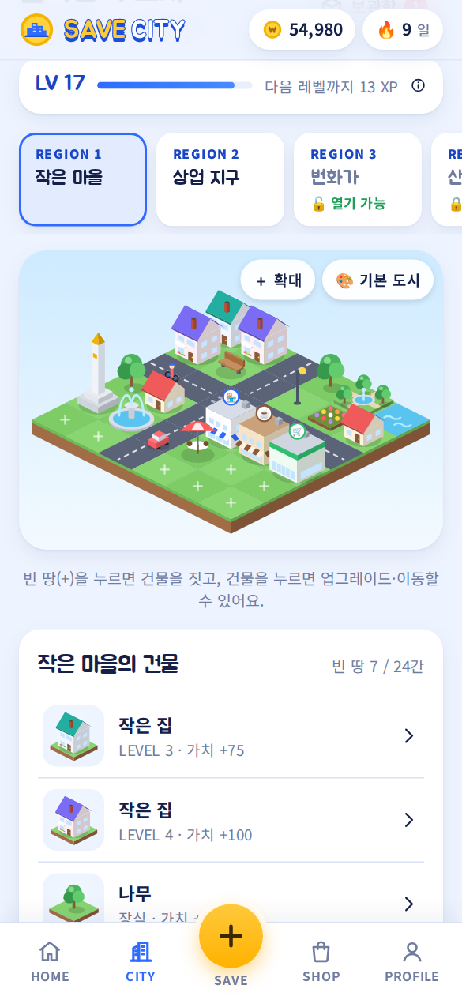
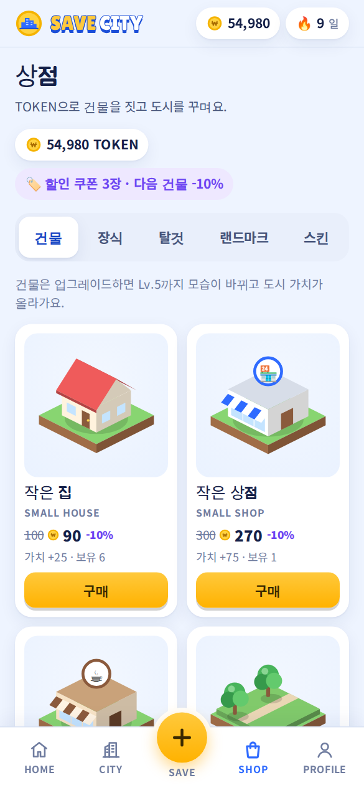
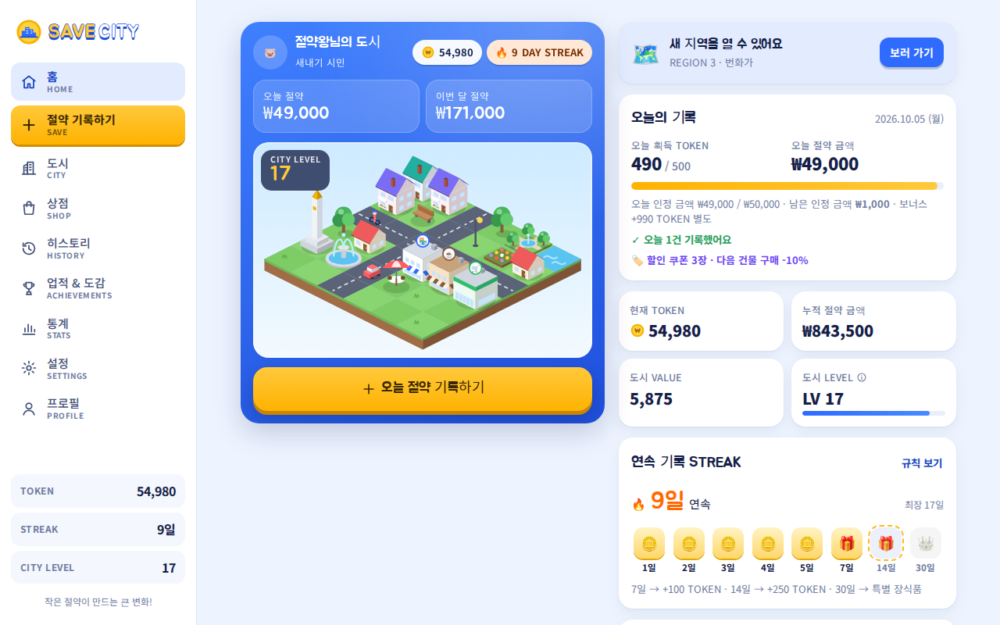

# SAVE CITY

**돈을 아끼는 행동을 할수록 게임 속 도시가 성장하는 게임**
절약 습관 + 도시 경영 + 수집 + 성장 + 게임화

현실에서 참은 소비를 기록하면 TOKEN을 받고, 그 TOKEN으로 나만의 도시를 짓는 절약 습관 게임이에요.
설치 없이 브라우저에서 바로 실행되고, 모바일(320px)부터 PC까지 같은 화면으로 쓸 수 있어요.

<p>




</p>

## 바로 실행하기

| 방법 | 하는 일 |
| --- | --- |
| 파일로 열기 | `index.html`을 더블클릭해서 브라우저로 열면 바로 플레이할 수 있어요. |
| 로컬 서버 | `npm start` 후 <http://localhost:8080> 접속. 모바일 브라우저에서 "홈 화면에 추가"하면 앱처럼 쓸 수 있고, 한 번 열면 오프라인에서도 동작해요. |
| 한 파일 버전 | `npm run build` → `dist/save-city.html` 파일 하나에 모든 코드가 들어가요. 메신저로 보내거나 USB에 담아도 열려요. |
| GitHub Pages | 저장소 Settings → Pages → *Deploy from a branch* → 이 브랜치의 `/ (root)`를 고르면 인터넷 주소로 공개돼요. |

별도 라이브러리나 빌드 과정이 필요 없어요. (폰트만 Google Fonts에서 불러오고, 인터넷이 없으면 기본 글꼴로 보여요.)

## 게임 방법

1. **현실에서 절약해요** — 사고 싶던 걸 참거나 더 싸게 해결했나요?
2. **SAVE에 기록해요** — 무엇을, 얼마를, 왜 사지 않았는지 적으면 TOKEN을 받아요.
3. **TOKEN으로 건물을 지어요** — 빈 땅을 눌러 건물을 짓고, 건물을 눌러 업그레이드해요.
4. **업적과 새 지역** — 도시 LEVEL이 오르면 새 건물과 새 지역이 열려요. 매일 기록하면 STREAK 보상도 받아요.

## 핵심 규칙

| 규칙 | 내용 |
| --- | --- |
| TOKEN 계산 | `1,000원 = 10 TOKEN`. `token = floor(인정 금액 / 1000) × 10` (999원 → 0, 1,999원 → 10, 49,900원 → 490) |
| 하루 제한 | 하루 최대 인정 금액 50,000원, 절약 TOKEN 최대 500. 20,000원을 세 번 기록하면 200 → 200 → 100 TOKEN |
| 입력 오류 | 빈 값, 문자, 음수, 소수, 0원, 1억 원 초과는 기록되지 않고 이유를 알려 줘요. 50,000원 초과는 50,000원까지만 인정돼요. |
| STREAK | 하루에 여러 번 기록해도 +1. 7일 → +100 TOKEN, 14일 → +250 TOKEN, 30일 → 특별 장식품(황금 저금통) |
| 0원 기록 | 절약한 게 없는 날은 "0원으로 오늘 기록하기"로 STREAK을 지켜요. (TOKEN 없음) |
| 기록 보너스 | 그날 첫 TOKEN 기록 뒤 **LUCKY BONUS +20 TOKEN** 또는 **CITY DISCOUNT 다음 건물 -10%** 중 하나를 직접 골라요. 무작위 뽑기가 아니에요. |
| 수정·삭제 | 기록을 고치거나 지우면 그날 인정 금액을 다시 계산해서 TOKEN을 돌려받아요. 이미 TOKEN을 써서 돌려받을 수 없으면 이유를 알려 주고 막아요. |
| 도시 LEVEL | 건물 수, 업그레이드, 도시 가치, 해금 지역, 업적으로 올라가요. LV 5 상업 건물, LV 10 상업 지구, LV 20 대형 건물, LV 30 미래 도시 |

보너스·업적·STREAK 보상 TOKEN은 하루 500 TOKEN(절약 TOKEN) 한도와 따로 계산돼요.
TOKEN은 게임 속 포인트일 뿐이며 실제 돈으로 바꾸거나 충전할 수 없어요.

## 화면

| 화면 | 내용 |
| --- | --- |
| HOME | 현재 TOKEN, 오늘 획득 TOKEN, 오늘·이번 달·누적 절약 금액, STREAK, 도시 LEVEL·VALUE, 움직이는 도시 미리보기, 다음 목표 |
| SAVE | 기록 폼, 빠른 입력 예시, 예상 보상 미리보기, 하루 인정 한도 막대, 사진 첨부, 0원 기록 |
| CITY | 아이소메트릭 도시 지도 5개 지역, 건설·업그레이드(Lv.1~5 모습 변화)·이동·보관함, 지역 해금, 달리는 탈것 |
| SHOP | BUILDINGS · DECORATIONS · VEHICLES · LANDMARKS · SKINS, 잠금 조건과 할인 쿠폰 표시 |
| HISTORY | 날짜별 기록, 검색, 상세(항목·금액·인정 금액·획득 TOKEN·이유·메모·날짜·사진), 수정·삭제, TOKEN 내역 |
| ACHIEVEMENTS | 업적 40개(배지·TOKEN·특별 장식·칭호 보상), 도감 완성률 |
| STATS | 요약 숫자, 최근 7일·6개월 절약 금액 그래프, 종류별 절약 금액 |
| SETTINGS | 사운드(배경 음악), 효과음, 애니메이션, 다크 모드, 데이터 초기화 |
| PROFILE | 닉네임·캐릭터·칭호 편집, 메뉴 |
| RANKING | 이번 주·누적 절약, 도시 LEVEL, STREAK 순위, 참가·나가기 (공유된 게임에서만) |
| ADMIN | 게시자 전용 관리자 모드: 참가자 기록 확인, 부정 사용 자동 검사, 경고·랭킹 제외 |

모바일은 하단 탭(HOME, CITY, SAVE, SHOP, PROFILE), 920px 이상 화면은 왼쪽 메뉴로 바뀌어요.



## 랭킹과 관리자 모드

Claude 아티팩트로 공유한 SAVE CITY에서는 **랭킹**이 열려요. 공유 데이터베이스가 필요해서, 파일로 열거나 GitHub Pages로 연 버전에는 랭킹 메뉴가 나타나지 않아요. (게임은 그대로 할 수 있어요)

| 순위 | 기준 |
| --- | --- |
| 이번 주 | 이번 주(월~일) 인정된 절약 금액. 월요일에 새로 시작 |
| 누적 | 지금까지 인정된 절약 금액 |
| 도시 | 도시 LEVEL, 같으면 도시 가치 |
| STREAK | 지금 이어지는 연속 기록 일수 (끊기면 0) |

모든 금액 순위는 **인정 금액**(하루 최대 50,000원) 기준이라, 큰 금액을 적어도 순위가 더 오르지 않아요.

**참가할 때 공유되는 것** — 랭킹 화면의 *랭킹 참가하기*를 누르고 동의하면 올라가요. 언제든 *랭킹 나가기*로 지울 수 있어요.

| 누가 보나요 | 내용 |
| --- | --- |
| 게임을 함께 보는 모든 사람 | 닉네임, 캐릭터, 칭호, 도시 LEVEL·가치, STREAK, 이번 주·누적 인정 금액 |
| 관리자(게시자)만 | 최근 절약 기록 60개(항목·종류·금액·날짜·시각), 날짜별 합계, 기기 시계 기록 |
| 보내지 않음 | 절약 이유, 메모, 사진 |

### 부정 사용 막기

1. **저장 데이터 확인값** — 저장할 때마다 내용으로 만든 확인값을 붙여 둬요. 브라우저 개발자 도구 등으로 저장 데이터를 직접 고치면 확인값이 맞지 않아 "변조 흔적"으로 기록돼요.
2. **기기 시계 확인** — 마지막으로 본 시각보다 시계가 5분 넘게 뒤로 가면 기록해요. (날짜를 바꿔 하루 한도나 STREAK을 늘리는 방법을 막기 위해) 기록 순서와 시각이 거꾸로 된 것, 미래 날짜도 찾아요.
3. **게임 규칙 검사** — 하루 한도로 나올 수 없는 금액, 받을 수 없는 보너스 TOKEN, 쓴 TOKEN으로 만들 수 없는 도시 가치·LEVEL, 기록 일수보다 긴 STREAK 등을 계산으로 확인해요.
4. 위 항목이 하나라도 걸리면 그 사람은 **랭킹에서 자동으로 숨겨지고**, 본인 화면에 이유가 보이며, 관리자가 확인해요.

**관리자 모드**(게시자에게만 보여요): 참가자를 위험도 순으로 보고, 한 사람씩 랭킹 숫자·최근 14일 그래프·최근 기록·시계 되돌림·반영 기록을 확인해요.

| 버튼 | 하는 일 |
| --- | --- |
| 정상 확인 | 지금 보이는 의심 항목을 허용해요. 새 흔적이 생기면 다시 표시돼요. |
| 경고 | 순위는 그대로 두고, 본인에게 사유와 메시지를 보여 줘요. |
| 랭킹 제외 / 제외 풀기 | 다른 사람에게 순위를 숨기거나 다시 보여 줘요. |
| 모두 제외 | 자동 검사에 걸린 사람을 한 번에 제외해요. |
| 랭킹 기록 삭제 | 그만둔 사람의 기록을 정리해요. |

> 모든 계산은 각자의 기기에서 이뤄지기 때문에 마음먹고 코드를 고치는 치트까지 100% 막을 수는 없어요. 그래서 자동 검사로 걸러 내고, 관리자가 기록을 보고 최종 판단하는 구조예요.

**공유 데이터 구조와 권한** (아티팩트에 선언한 규칙)

| 경로 | 읽기 | 쓰기 |
| --- | --- | --- |
| `ranking/<사용자 id>` 랭킹 카드 | 모두 | 본인(참여 권한 이상), 관리자 |
| `proofs/<사용자 id>` 상세 기록 | 본인, 관리자 | 본인(참여 권한 이상), 관리자 |
| `mod/<사용자 id>` 관리자 판정 | 모두 | 관리자만 |

랭킹에 **참가**하려면 Claude에 로그인한 상태에서 *참여(Contributor)* 이상 권한으로 공유받아야 해요. *보기(Viewer)* 권한은 순위를 볼 수만 있어요.

## 데이터 저장

- 게임 데이터는 브라우저의 **localStorage**(`savecity.v1`)에, 기록 사진은 **IndexedDB**에 저장돼요. 앱을 닫았다 열어도 그대로 남아요.
- 저장 항목: `user, token, totalSaved, todaySaved, streak, longestStreak, cityLevel, cityValue, buildings, buildingLevels, regions, achievements, history, settings` 외에 TOKEN 내역 등.
- 저장된 값이 손상되면 따로 보관한 뒤 새로 시작하고, 개인정보 보호 모드처럼 저장이 막힌 환경에서는 화면 위에 경고를 띄워요.
- 저장할 때마다 확인값(`_seal`)을 붙여서, 게임 밖에서 바뀐 데이터를 알아봐요. (랭킹 부정 사용 확인용)
- 데이터는 이 기기 안에만 있어요. 랭킹에 참가했을 때만 위 표의 내용이 공유 데이터베이스로 올라가요. 다른 기기로는 자동으로 옮겨지지 않아요.

## 개발

```
index.html            앱 화면 틀
css/style.css         스타일 (라이트/다크 테마 토큰)
js/util.js            날짜·숫자·문자열 도우미
js/data.js            규칙 상수, 아이템·지역·업적·칭호 데이터
js/engine.js          게임 규칙 엔진 (DOM 없는 순수 로직)
js/rank-rules.js      랭킹 점수와 부정 사용 검사 (DOM 없는 순수 로직)
js/ranking.js         공유 랭킹 연결 (Claude 아티팩트의 db·user 기능)
js/storage.js         localStorage / IndexedDB 저장
js/render-city.js     아이소메트릭 도시 그림 (SVG)
js/audio.js           Web Audio 효과음·배경 음악
js/ui.js, view.js     모달·시트·토스트, 공통 HTML 조각
js/app.js             화면 전환, 저장, 축하 연출
js/screens/*.js       화면별 코드 (ranking.js 랭킹, admin.js 관리자 모드)
sw.js                 오프라인 캐시
tests/engine.test.js  규칙 단위 테스트
tests/ranking.test.js 랭킹·부정 사용 검사 테스트 (규칙대로 한 가상 플레이 여러 판이 오탐 없이 통과하는지 포함)
```

- 테스트: `npm test` (Node 20 이상, 추가 설치 없음) — TOKEN 계산표, 하루 제한, STREAK, 보너스, 상점, 업그레이드, 수정·삭제, 저장 데이터 복구, 랭킹 순위·부정 사용 검사·저장 확인값을 확인해요.
- 그림 파일 없이 모든 건물·장식·탈것을 코드(SVG)로 그려요.
