# CHRONICLE: THE LOST WORLD

Android용 가로 화면 픽셀 아트 액션 RPG (Godot 4 · GDScript).
시간의 핵이 부서져 떠다니는 섬들로 갈라진 세계에서, 기억을 잃은 검사가 핵 조각을 모읍니다.

**현재 상태: Phase 3 완료 (3-1 · 3-2 · 3-3)** — 지역 3개(잊혀진 숲 · 무너진 시계 도시 · 하늘의 폐허)와 보스 3종
(베르단 · 크로노스 · 템페스타), 허브 마을 '루멘'(NPC 8명·퀘스트 27개·재건 6곳·펫 5종·도감), 지역마다 숨겨진 보물까지
1부 이야기를 처음부터 끝까지 플레이할 수 있습니다. 다음은 Phase 4(무기·유물·전직·사운드·그래픽).
상세: [3-3](docs/PHASE3_3_REPORT.md) · [3-2](docs/PHASE3_2_REPORT.md) · [3-1](docs/PHASE3_REPORT.md) · [Phase 2](docs/PHASE2_REPORT.md) · [Phase 1](docs/PHASE1_REPORT.md)

<p>
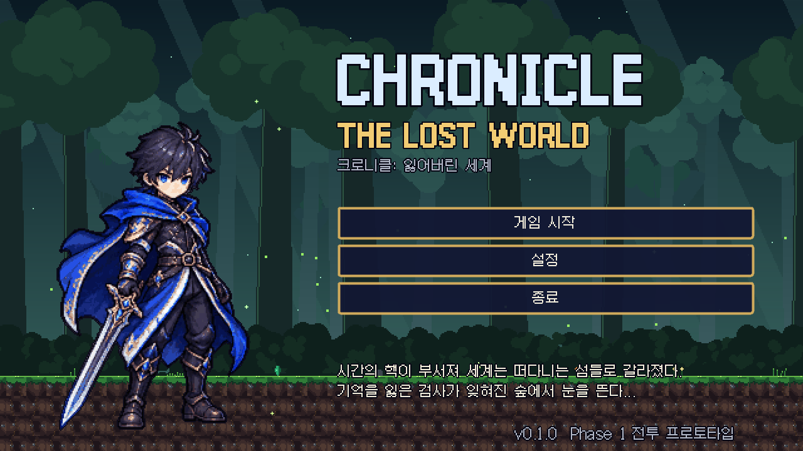
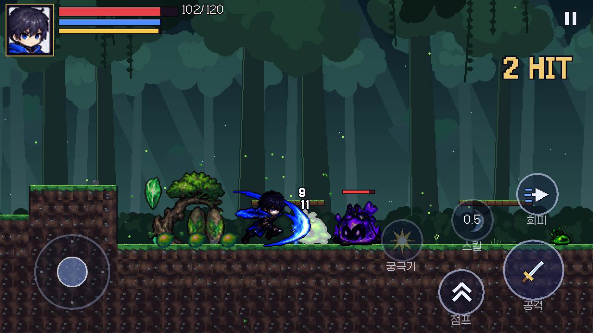
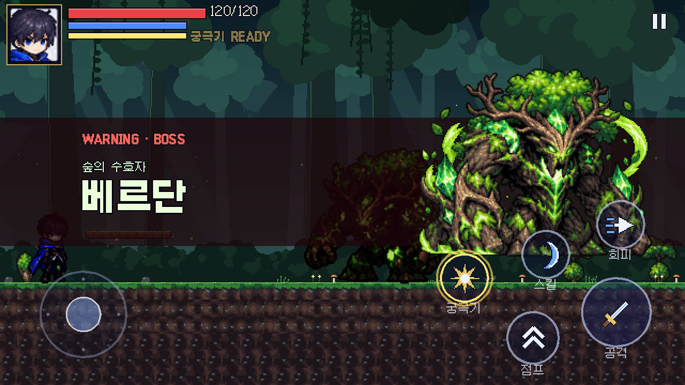
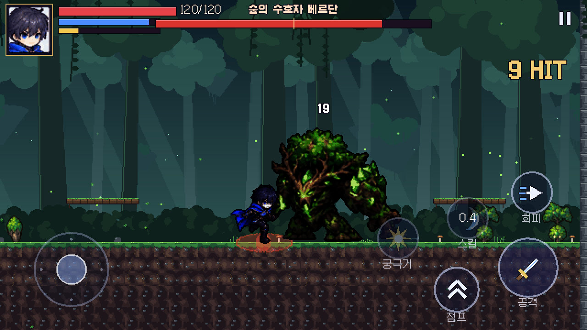
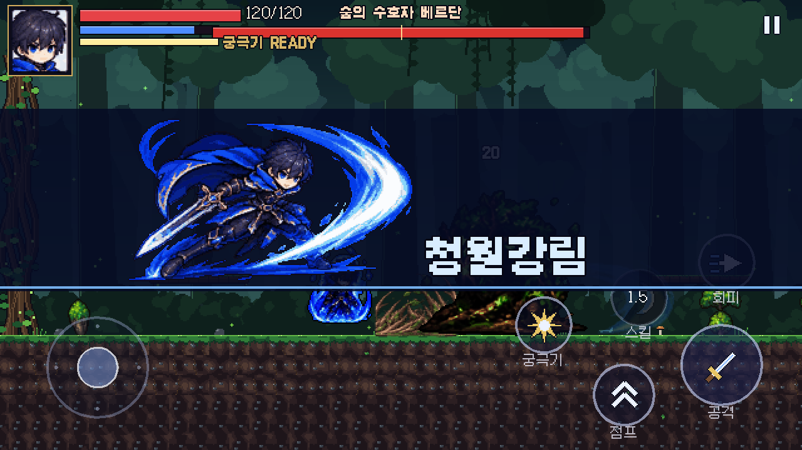
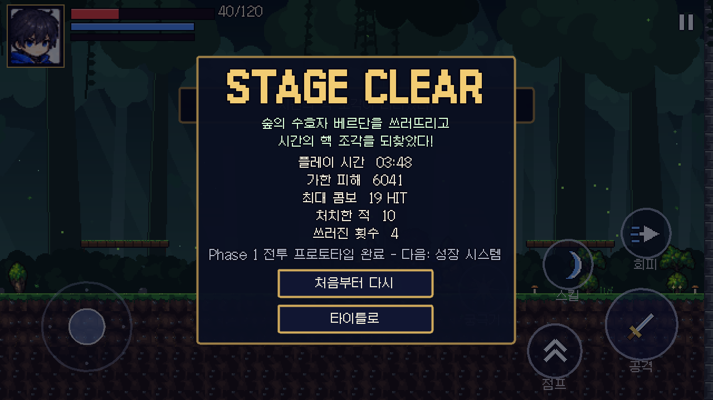
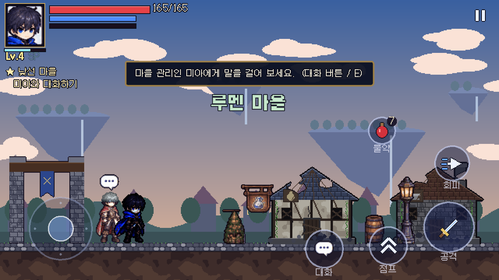
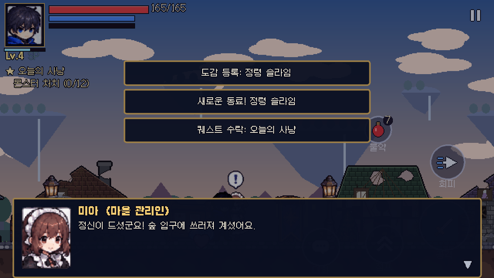
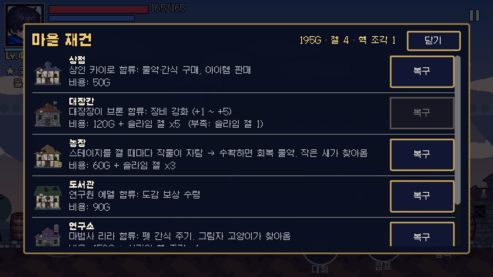
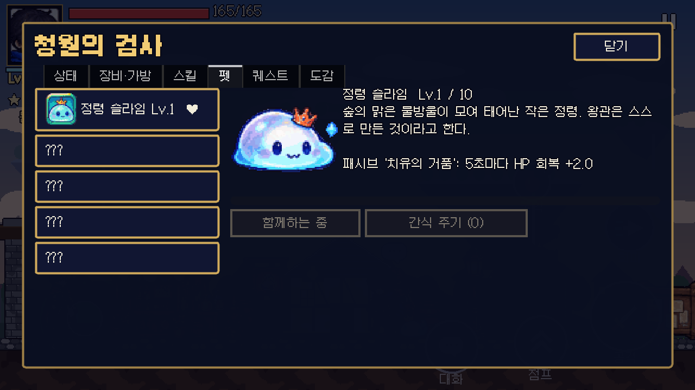
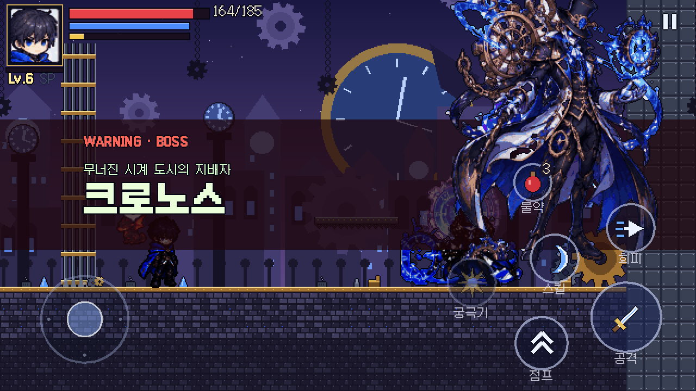
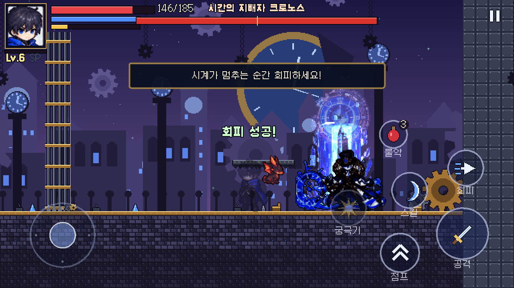
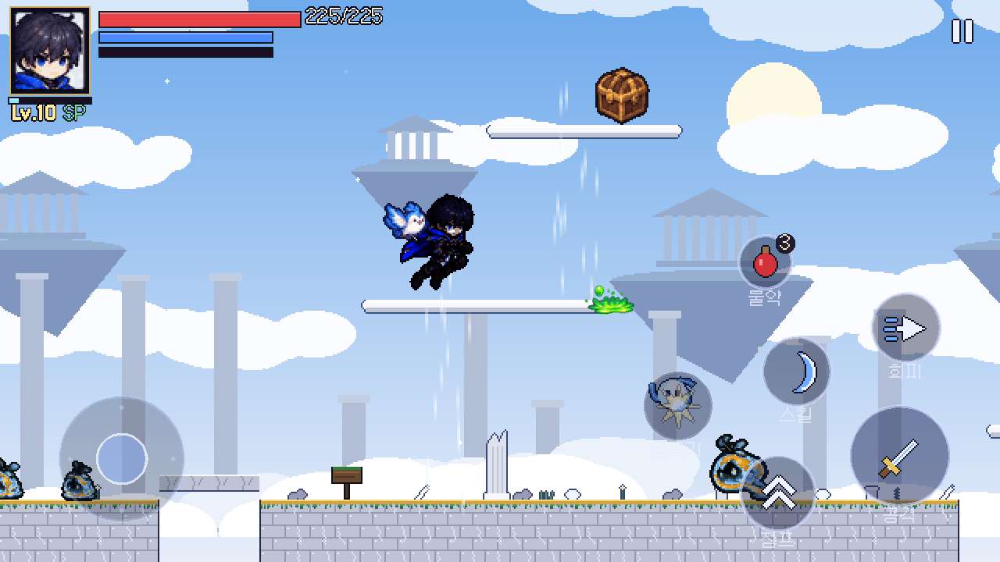
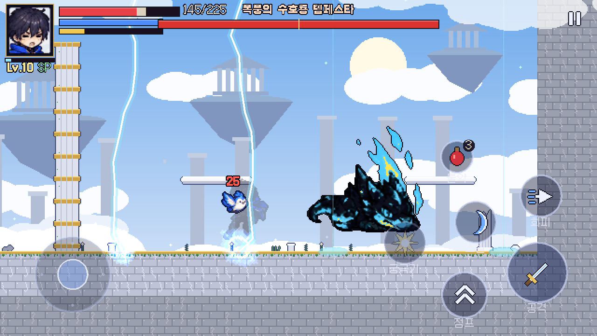
</p>

## 실행

1. [Godot 4.7](https://godotengine.org/download) (표준판, .NET 아님) 설치 — 4.7.2에서 개발·테스트했습니다.
2. Godot에서 이 `chronicle/` 폴더의 `project.godot`를 엽니다.
3. F5로 실행 (메인 씬: `scenes/boot/title.tscn`).

PC에서는 마우스 클릭이 터치로 처리되어 화면의 터치 버튼도 그대로 시험할 수 있습니다.

| 동작 | 터치 | 키보드 | 게임패드 |
|---|---|---|---|
| 이동 (살짝: 걷기 / 끝까지: 달리기) | 왼쪽 가상 조이스틱 | A/D, ←/→ | 왼쪽 스틱 |
| 점프 (길게 누르면 더 높이) | 점프 | Space, K | A |
| 공격 (연타: 3단 콤보, 꾹 눌렀다 떼기: 강공격) | 공격 | J, Z | X |
| 회피 (무적 시간) | 회피 | L, X, Shift | B, RB |
| 스킬 '청월참' (마나 15) | 스킬 | U, C | Y |
| 궁극기 '청월강림' (게이지 100%) | 궁극기 | I, V | LB |
| 회복 물약 (HP +40, 가방에 있을 때만) | 물약 | Q, R | 십자키 ↑ |
| 대화 · 이용 (마을, 가까이 가면 나타남) | 대화 | E, F | 십자키 ↓ |
| 일시정지·설정 | 우측 상단 ‖ | Esc, P | Start |
| 캐릭터·펫·퀘스트·도감 화면 | 일시정지 → 캐릭터 · 펫 · 퀘스트 · 도감 | | |

## 폰에서 바로 해보기 (웹 빌드)

`web/`에 Godot 웹 내보내기 결과(스레드 미사용, 약 42MB)가 들어 있습니다. 저장소 Settings → Pages에서
브랜치를 고르고 `/ (root)`로 배포하면 폰 브라우저에서 `https://<계정>.github.io/<저장소>/chronicle/web/` 주소로 바로 플레이할 수 있습니다.
(첫 로딩에 수십 초, 가로 화면 권장.) 다시 만들기: `godot --headless --path . --export-release Web web/index.html`
(웹 내보내기 템플릿 필요). 터치·화면 배치만 확인하는 용도이며 Android 실기기 성능 검증은 아닙니다.

## Phase 3-3 구현 내용 (지역 3 · 템페스타 · 숨겨진 장소)

- **스테이지 3-1 '하늘의 폐허'**: 크로노스 퀘스트를 마치면 열림. 떠다니는 섬, **상승 기류**, **무너지는 발판**, 구름 발판.
- **새 몬스터**: 구름 슬라임(+소형), 돌진하는 바람 정령, 내려찍는 폐허 수호상. 새 재료 하늘 깃털.
- **보스 템페스타**: 폭풍 구슬, 그림자를 따라오는 **급강하**(착지 후 반격 기회), **낙뢰**, 2페이즈 **강풍**.
  참고 이미지에 지역 3 보스가 없어 펫 시트의 드래곤 디자인을 폭풍 색으로 바꾼 **임시 디자인**입니다.
- **숨겨진 보물**: 세 지역에 하나씩, 한 번만 열림(저장). 메인 퀘스트 7·8로 1부 마무리, 서브·업적 추가, 도감 20종.

## Phase 3-2 구현 내용 (지역 2 · 크로노스)

- **스테이지 2-1 '무너진 시계 도시'**: 메인 퀘스트 '다음 여정'을 마치면 월드맵에서 열립니다. 레일 위를 오가는 회전 톱니 함정, 철제 들보 발판, 구덩이.
- **새 몬스터**: 태엽 슬라임(+소형), 공중에서 톱니를 쏘는 톱니 파수꾼. 새 재료 태엽 부품.
- **보스 크로노스**: 지팡이 돌진, 시계 톱니 발사, **시간 정지**(좁혀지는 시계 고리가 닫힐 때 회피 못 하면 멈춤), **시간 역행**(잔상을 치지 않으면 되돌아가 회복), **푸른 시간 폭발**. HP 50%에서 보라색 2페이즈(배너·이펙트·속도·탄 수 변경).
- **구조**: 스테이지를 데이터(`data/stages/*.tres`) 기반으로 일반화. 지역 퀘스트 4개, 도감 4종, 고유 장신구 '크로노스의 회중시계'.

## Phase 3-1 구현 내용 (마을·NPC·퀘스트·복구·펫·도감)

- **흐름**: 타이틀 → 1-1 → 클리어 → 루멘 마을 ↔ 월드맵 → 스테이지. 이어하기는 마지막 장소(마을/체크포인트)에서 시작합니다.
- **마을**: 걸어 다니는 허브. 가까이 가면 대화/이용 버튼이 뜨고, 대화창(초상화·선택지)이 열립니다. 머리 위 ! / ? 로 퀘스트를 표시합니다.
- **NPC 8명**: 미아(관리인), 가렛(경비병), 그림자 여행자, 카이로(상인), 브론(대장장이), 에델 박사(연구원), 리라(마법사), 세레나(사제).
  뒤의 다섯 명은 시설을 복구하면 합류합니다.
- **마을 복구 6곳**: 상점·대장간·농장·도서관·연구소·훈련장. 골드와 재료(슬라임 젤, 시간의 핵 조각)로 되살리면 건물 그림이 바뀌고 NPC·기능·펫이 해금됩니다.
- **상점·강화·농장·축복**: 물약/마나 결정/펫 간식 구매와 판매, 장비 강화 +1~+5, 스테이지마다 자라는 작물 수확, 다음 스테이지 EXP +20% 축복, 스킬 초기화.
- **퀘스트 17개**: 메인 5, 서브 5, 일일 1(날짜가 바뀌면 다시 열림), 업적 6. HUD에 추적 중인 퀘스트 표시.
- **펫 5종**: 정령 슬라임·설원 여우·작은 새·그림자 고양이·아기 드래곤. 따라오기·대기·잠자기·감정 표현, 레벨 1~10 성장, 고유 패시브(회복, 회피, 골드·아이템 끌어오기, 치명타, 불덩이). 펫 화면에서 선택·교체·간식.
- **도감**: 몬스터·보스·무기·펫·유물. 처치/획득 시 기록, 처치 횟수, 도서관 보상.
- **저장 v2**: 퀘스트·마을·펫·도감·위치 추가, v1 저장 자동 변환.

## Phase 2 구현 내용 (성장)

- **레벨·경험치**: 몬스터 처치 시 EXP·골드 획득(떠오르는 숫자), 레벨당 HP +10 · 공격력 +2 · MP +4, 레벨업마다 스킬 포인트 1, 레벨업 시 완전 회복 연출, 최대 30레벨.
- **아이템·가방**: 데이터 리소스(`data/items/*.tres`) 8종 — 무기 2, 방어구 2, 장신구 1, 소비 2, 재료 1. 30칸 가방, 겹치기(최대 수량), 몬스터 확률 드롭(고유 장비는 중복 드롭 안 함), 바닥에서 줍기, 가방이 가득 차면 안내.
- **장비**: 무기·방어구·장신구 3칸, 장착하면 즉시 능력치(최대 HP·공격력·피해 감소·치명타·스킬 쿨다운 등)에 반영, 무기는 공격 방식 자체(`WeaponData`)를 바꿈.
- **스킬 트리**: 5개 노드 × 3랭크(연격 숙련, 청월참 숙련, 청월강림 각성, 시간의 가호, 바람 걸음), 요구 레벨, 스킬 포인트로 강화.
- **물약 퀵슬롯**: 터치 버튼(남은 개수 표시)·키보드 Q/R, 사용 쿨다운, 체력이 가득하면 아끼기.
- **캐릭터 화면**: 일시정지 → 상태 / 장비·가방 / 스킬 탭. 아이템 설명·장착·해제·사용, 스킬 강화.
- **저장**: `user://save_slot1.json`에 버전·체크섬(SHA-256)과 함께 저장. 임시 파일에 쓰고 검증한 뒤 교체(원자적 저장),
  이전 저장은 `.bak.json`으로 보관, 손상·변조된 파일은 백업으로 복구, 옛 형식은 버전별 마이그레이션, 불러올 때 값 검증·보정.
  체크포인트·스테이지 클리어·타이틀로 나갈 때 자동 저장, 일시정지 메뉴에서 수동 저장. 타이틀에 **이어하기**(마지막 체크포인트부터).

## Phase 1 구현 내용

- **주인공 (청월의 검사)**: 상태 머신(지상·공중·공격·충전·강공격·회피·스킬·궁극기·피격·사망), 가속/감속, 가변 점프, 코요테 타임, 입력 버퍼, 3단 콤보, 공중 베기, 충전 강공격, 무적 회피와 잔상, 초승달 검기 스킬(마나·쿨다운), 컷인 연출 궁극기(4연타 광역), 피격 넉백·무적 깜빡임, 구덩이 낙하 시 피해 후 복귀.
- **숲의 정령 슬라임**: 일반(슬라임 탄 + 범위 튀김) / 소형(빠름, 근접만) / 강화형(자수정 슬라임: 3방향 탄, 넓은 튀김, 슈퍼아머). 대기 → 순찰 → 추격 → 공격 / 점프 추격 / 피격 / 사망 상태 머신, 회복 구슬 드롭.
- **중간 보스 베르단**: 등장 연출 후 나무 던지기·뿌리 돌진·숲의 분노 3패턴. **모든 공격에 예고(주황 섬광 + 바닥 경고)** 를 넣어 피할 수 있게 했고, 경직(그로기) 시스템, HP 50%에서 2페이즈(포효, 빨라진 예고, 2연속 통나무, 양방향 뿌리, 2파 분출), 사망 연출.
- **스테이지 1-1 잊혀진 숲**: 텍스트 레벨 데이터(`data/levels/forest_stage_01.txt`) → 자동 타일링, 일방향 발판, 구덩이, 튜토리얼 표지판 7개, 체크포인트(시간 결정), 보스 경기장(문이 닫힘), 시간의 핵 조각 → 클리어 화면.
- **모바일 조작**: 손가락마다 컨트롤 하나에 고정되는 멀티터치(버튼 간 간섭 없음), 아날로그 조이스틱(유동/고정 선택), 큰 버튼, 쿨다운·마나 부족·궁극기 준비 표시, UI 크기 80~140%, 디스플레이 안전 영역 대응, 가로 화면, 어떤 화면 비율에서도 확장(expand) 레이아웃.
- **연출**: 히트스톱, 화면 흔들림, 피격 섬광 셰이더, 피해 숫자, 콤보 카운터, 4단 패럴랙스 배경, 반딧불·낙엽 파티클, 진동(설정에서 끔).
- **UI**: HUD(초상화·HP·MP·궁극기·보스 바), 보스 등장 배너, 토스트, 일시정지·설정, 게임오버(체크포인트 재도전)·클리어 화면, 타이틀.

## 폴더 구조

```
chronicle/
├── project.godot
├── scenes/   boot/ world/ village/ player/ enemies/ bosses/ ui/
├── scripts/  core/ player/ combat/ enemies/ bosses/ world/ village/ ui/ effects/ inventory/
│             progression/ quests/ pets/ save/
├── assets/   characters/ enemies/ bosses/ npcs/ pets/ effects/ environments/ ui/ (weapons/ audio/: 다음 단계)
├── data/     items/ skills/(tree/) enemies/ player/ levels/ quests/ pets/ npcs/ village/
├── tests/    자동 테스트 (test_*.gd)
├── docs/     ASSET_ANALYSIS.md, PHASE1~3 보고서 (PHASE3_2_REPORT.md 포함), screenshots/
├── tools/    에셋 파이프라인 (Python + Godot 스크립트)
└── art_source/  original/ (첨부 원본, 수정 금지) cleaned/ preview/
```

수치(능력치, 공격 판정·타이밍, 몬스터 스탯)는 모두 `data/`의 `.tres` 리소스에 있어 코드 수정 없이 조정할 수 있습니다.
무기는 `WeaponData`(콤보·공중·강공격·스킬·궁극기 묶음)로 정의되어 있어, 무기를 바꾸면 공격 방식이 통째로 바뀌는 구조입니다.

## 에셋 파이프라인

첨부 이미지 6장의 분석 결과와 프레임 매핑은 [docs/ASSET_ANALYSIS.md](docs/ASSET_ANALYSIS.md)에 있습니다.

```bash
pip install pillow numpy opencv-python-headless
python3 tools/clean_sheets.py        # 1. 라벨·가짜 배경 제거 → art_source/cleaned/
python3 tools/build_sprites.py       # 2. 프레임 추출·축소·팔레트·외곽선·정렬 → assets/**/_atlas.png + _sprites.json
python3 tools/build_environment.py   # 3. 타일·배경·소품·UI 아이콘 (절차 생성)
python3 tools/build_village.py       #    마을 건물·땅·배경 (절차 생성)
python3 tools/build_clock_city.py    #    시계 도시 타일·배경·함정·톱니 파수꾼, 태엽 슬라임 색 변환
python3 tools/build_sky_ruins.py     #    하늘의 폐허 아트, 템페스타·구름 슬라임 색 변환 (build_sprites 다음에)
python3 tools/build_npc_variants.py  #    경비병(시트에 없음) = 주인공형 NPC 색 변형
godot --headless --path . --import
godot --headless --path . -s res://tools/build_sprite_frames.gd   # 4. JSON → SpriteFrames(.tres)
```

## 테스트

```bash
# 자동 테스트 (94개)
godot --headless --path . --fixed-fps 60 res://tests/test_runner.tscn

# 자동 플레이 봇: 타이틀 → 1-1 클리어 → 마을(대화·복구·상점·메뉴·월드맵)까지 진행 (성공 시 종료 코드 0)
godot --headless --path . --fixed-fps 60 -- --bot

# 시계 도시만: Lv7 중반 영웅으로 2-1을 바로 시작해 크로노스를 쓰러뜨림
godot --headless --path . --fixed-fps 60 -- --bot --stage=clock_1
# 하늘의 폐허만: Lv11 영웅으로 3-1을 바로 시작해 템페스타를 쓰러뜨림
godot --headless --path . --fixed-fps 60 -- --bot --stage=sky_1

# 화면 캡처 포함 (렌더러 필요, 리눅스 서버에서는 xvfb-run)
godot --path . --fixed-fps 60 -- --bot --screenshots=/tmp/shots
```

## 라이선스 / 크레딧

- 캐릭터·몬스터·보스·NPC·펫 디자인: 프로젝트 제공 참고 이미지 (`art_source/original/`).
- 폰트: [Galmuri](https://github.com/quiple/galmuri) by Lee Minseo — SIL Open Font License 1.1 (`assets/ui/fonts/OFL-Galmuri.md`).
- 지형·배경·UI 아이콘·마을 건물: `tools/build_environment.py`, `tools/build_village.py`로 생성한 임시 아트 (Phase 4에서 교체 예정).
- 경비병 NPC: 참고 시트에 디자인이 없어 주인공형 NPC를 색만 바꾼 임시 디자인.
- 지역 3 보스 템페스타: 참고 시트에 디자인이 없어 펫 시트의 드래곤을 보스 크기·폭풍 색으로 바꾼 임시 디자인.
