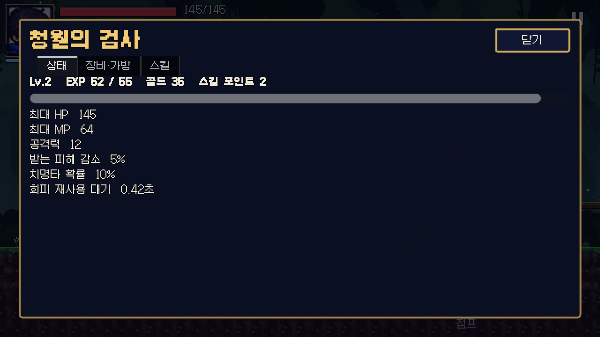
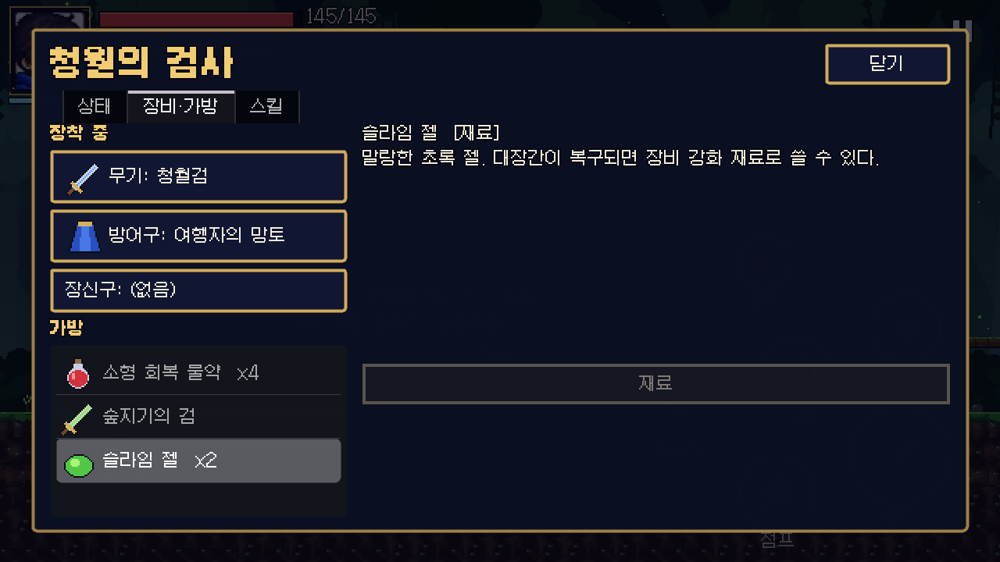
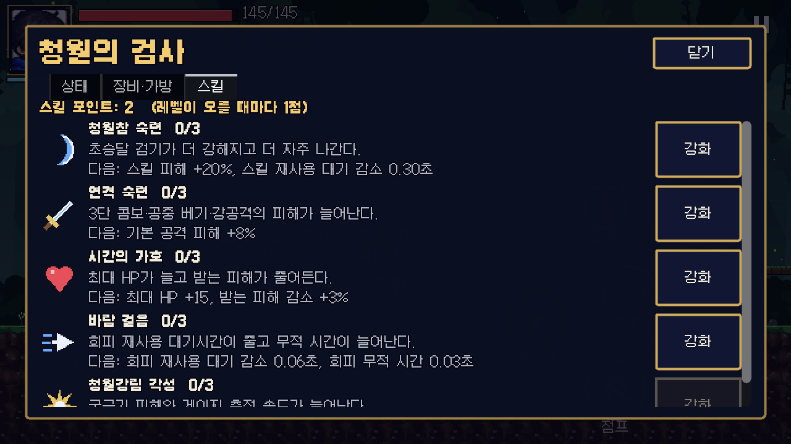

# Phase 2 보고서 — 성장 시스템

Phase 1(전투 프로토타입) 위에 레벨·경험치, 아이템·가방, 장비, 스킬 트리, 회복 물약, JSON 저장/이어하기를 올렸습니다.
같은 커밋 묶음에서 플레이 피드백("보스가 너무 강하다")에 따라 베르단 난이도도 낮췄습니다(아래 1절).

## 1. 보스 난이도 조정 (베르단)

| 항목 | 이전 | 현재 |
|---|---|---|
| 최대 HP | 1300 | 1000 |
| 공격력 / 접촉 피해 | 18 / 10 | 12 / 6 |
| 경직 내성(poise) | 100 | 80 |
| 공격 예고 시간 | 1.0배 / 2페이즈 0.78배 | 1.25배 / 2페이즈 1.05배 |
| 동작 속도 | 1.0배 / 2페이즈 1.3배 | 0.85배 / 2페이즈 1.0배 |
| 패턴 사이 대기 | 0.7~1.2초 (2페이즈 ×0.6) | 1.0~1.6초 (2페이즈 ×0.8) |
| 숲의 분노 분출 수 | 4 (2파 3) | 3 (2파 2) |
| 뿌리 돌진 / 숲의 분노 추가 피해 | +2 / +4 | +1 / +2 |
| 경직 시 회복 구슬 | 없음 | 60% 확률 |
| 주인공 피격 후 무적 | 1.0초 | 1.2초 |

수치는 `scripts/bosses/verdan.gd` 상단 상수와 `data/enemies/verdan.tres`에 있습니다.

## 2. 구현 내용

### 레벨·경험치 (`scripts/progression/profile.gd`, 오토로드 `Profile`)
- 필요 EXP: `30 + 25 × (레벨 − 1)` (Lv1→2 30, Lv2→3 55 …), 최대 30레벨. 남는 EXP는 이월, 한 번에 여러 레벨 가능.
- 레벨당 최대 HP +10, 공격력 +2, MP +4, 스킬 포인트 +1. 레벨업 시 HP·MP 완전 회복 + 빛기둥 연출 + "LEVEL UP!".
- 처치 보상(`EnemyStats.exp_reward / gold_reward`): 소형 슬라임 5/2, 슬라임 8/3, 강화형 30/15, 베르단 150/80.
  스테이지 1-1을 한 번 깨면 대략 Lv4, 골드 110 안팎.
- HUD: 초상화 아래 Lv와 EXP 바, 스킬 포인트가 남아 있으면 "SP" 깜빡임.

### 아이템·가방 (`scripts/inventory/`, `data/items/`)
| 아이템 | 종류 | 효과 | 얻는 곳 |
|---|---|---|---|
| 청월검 | 무기 | 기본 무기(청월의 검사 공격 세트) | 시작 장비 |
| 숲지기의 검 | 무기 | 공격력 +4, 치명타 +3% | 강화형 슬라임 (100%, 1회) |
| 여행자의 망토 | 방어구 | 최대 HP +15, 피해 감소 5% | 시작 장비 |
| 수호목 갑옷 | 방어구 | 최대 HP +40, 피해 감소 12% | 베르단 (100%, 1회) |
| 시간 결정 반지 | 장신구 | 최대 MP +10, 치명타 +5%, 스킬 쿨다운 −0.3초 | 베르단 (100%, 1회) |
| 소형 회복 물약 | 소비 | HP +40 | 시작 3개, 강화형 60%, 베르단 2개 |
| 마나 결정 | 소비 | MP +30 | (Phase 3 상점용, 현재 드롭 없음) |
| 슬라임 젤 | 재료 | — | 슬라임류 (Phase 3 대장간 재료) |

- 가방 30칸, 아이템별 최대 겹치기 수(물약 9, 젤 99, 장비 1). 가방이 가득 차면 줍지 못하고 안내 토스트.
- 고유(unique) 장비는 이미 가지고 있으면 다시 떨어지지 않습니다.
- 스테이지가 끝날 때 바닥에 남은 아이템은 자동으로 가방에 들어갑니다(시간의 핵이 보스 전리품 위에 나타나기 때문).
- 아이템 아이콘 24px 8종은 `tools/build_environment.py`가 생성합니다(임시 아트).

### 장비
- 무기·방어구·장신구 3칸. 장착/해제 즉시 플레이어 능력치를 다시 계산하고, 최대 HP가 늘면 늘어난 만큼 현재 HP도 채웁니다.
- 무기는 `WeaponData`를 통째로 바꾸므로 무기별 공격 세트가 가능합니다(현재 두 검은 같은 세트, 수치만 다름).
- 무기 칸은 비울 수 없습니다(맨손 공격 애니메이션이 없음).
- 피해 감소는 최대 60%로 제한, 낙하 피해에는 적용하지 않습니다.

### 스킬 트리 (`data/skills/tree/`)
| 노드 | 요구 레벨 | 랭크당 효과 (최대 3랭크) |
|---|---|---|
| 연격 숙련 | 1 | 기본 공격(콤보·공중·강공격) 피해 +8% |
| 청월참 숙련 | 1 | 스킬 피해 +20%, 쿨다운 −0.3초 |
| 시간의 가호 | 1 | 최대 HP +15, 피해 감소 +3% |
| 바람 걸음 | 2 | 회피 쿨다운 −0.06초, 회피 무적 +0.03초 |
| 청월강림 각성 | 3 | 궁극기 피해 +15%, 궁극기 게이지 획득 +10% |

장비 보너스와 스킬 효과는 같은 능력치 키(`max_hp`, `attack`, `defense_pct`, `crit_chance`, `skill_cooldown` …)를 쓰므로
`Profile.modifiers()` 한 곳에서 합산됩니다. 새 장비·노드는 `.tres` 파일만 추가하면 됩니다.

### 회복 물약 퀵슬롯
- 터치 버튼(조이스틱 반대편, 스킬 버튼 위)에 남은 개수 표시, 물약이 없으면 비활성. 키보드 Q/R, 패드 십자키 ↑.
- 사용 쿨다운 0.8초, 체력이 가득하면 사용하지 않고 안내만 합니다.

### 캐릭터 화면 (`scenes/ui/character_menu.tscn`)
- 일시정지 메뉴 → "캐릭터 · 장비 · 스킬". 탭 3개: **상태**(레벨, EXP, 능력치, 골드), **장비·가방**(장착 칸, 가방 목록, 설명, 장착/해제/사용), **스킬**(노드별 랭크·효과·강화 버튼).
- 게임은 멈춘 상태로 열리며 Esc/뒤로가기로 닫힙니다.

### 저장 시스템 (`scripts/save/save_system.gd`, 오토로드 `SaveSystem`)
- 파일: `user://save_slot1.json` (웹 빌드에서는 브라우저 저장소). 형식:
  `{"version": 1, "saved_at": …, "checksum": "<payload의 SHA-256>", "payload": {"profile": {…}, "stage": {"stage_id", "checkpoint_id"}}}`
- **원자적 저장**: `*.tmp`에 쓰기 → 다시 읽어 검증 → 기존 파일을 `*.bak.json`으로 보관 → tmp를 본 파일로 교체.
- **손상 대비**: JSON 파싱 실패·체크섬 불일치·필수 항목 누락이면 그 파일을 버리고 백업에서 복구.
- **버전 관리**: 더 새로운 버전 파일은 거부, 옛 버전은 `_migrate()`가 한 단계씩 변환(v0 → v1 예시 포함: `xp`→`exp`, 아이템 맵 → 슬롯 배열).
- **값 검증**: 불러올 때 레벨·EXP·골드·스킬 랭크를 범위로 보정, 없는 아이템은 버림, 잘못된 칸의 장비는 기본 장비로 교체.
- 자동 저장: 체크포인트 도달, 스테이지 클리어, 타이틀로 나갈 때. 수동 저장: 일시정지 → "저장하기".
- 타이틀: 저장이 있으면 **이어하기**(마지막 체크포인트, 없으면 스테이지 처음부터), **새 게임**은 한 번 더 눌러야 덮어씁니다.
- 설정(`user://settings.cfg`)은 저장 파일과 별도라 새 게임을 해도 유지됩니다.

## 3. 테스트 결과

| 항목 | 결과 |
|---|---|
| 자동 테스트 | **63개 테스트 / 716개 검사 전부 통과** (Phase 2 신규 17개: `test_progression.gd` 8, `test_save.gd` 8, `test_stage.gd` 보스 드롭 1) |
| 자동 플레이 봇 (헤드리스) | 반복 실행 모두 클리어, 사망 0, 약 57~67초. 저장 파일에 Lv4, 골드 112~115, 물약, 젤, 숲지기의 검, 수호목 갑옷, 시간 결정 반지, `forest_1` 클리어 기록 확인 |
| 렌더링 실행 (xvfb + OpenGL) | 체크포인트에서 캐릭터 화면 3개 탭 캡처, 클리어까지 정상 |
| 웹 빌드 | 다시 내보내고 브라우저(Playwright, 가로 모바일 화면)에서 타이틀·게임 진입 확인 |

테스트가 다루는 것: EXP 곡선·다중 레벨업·최대 레벨, 레벨별 능력치(원본 리소스 불변), 가방 겹치기·제한·가득 참,
장비 장착 시 살아있는 플레이어 능력치·피해 감소 반영, 스킬 강화·랭크 제한·쿨다운 반영, 물약 사용 조건,
처치 보상·드롭·줍기·고유 아이템 중복 방지, 보스 드롭과 클리어 시 자동 수집, 저장 왕복(프로필 완전 일치),
파일 형식, 백업 보관, 손상 파일 → 백업 복구, 변조 파일 거부, v0 마이그레이션, 새 버전 거부·잘못된 값 보정, 체크포인트 자동 저장.

## 4. 발견하고 고친 문제

- 시간의 핵이 보스 전리품과 같은 자리에 나타나, 핵을 먼저 만지면 스테이지가 끝나 갑옷·반지를 잃을 수 있었음
  → 클리어 시 남은 아이템 자동 수집 + 봇도 전리품을 먼저 줍도록 수정, 테스트 추가.
- `exp`라는 변수명이 GDScript 내장 함수와 겹쳐 경고 → `xp`로 변경(저장 파일 키는 `exp` 유지).
- 정수/실수가 JSON 왕복 후 다르게 문자열화되어 체크섬이 어긋남 → 체크섬 계산 전에 JSON 왕복으로 정규화.
- `JSON.parse_string`이 손상 파일에서 오류 로그를 쏟아냄 → `JSON.new().parse()` + 경고 한 줄.

## 5. 한계 · 남은 작업

- Android 실기기에서는 아직 시험하지 못했습니다(웹 빌드와 데스크톱에서만 확인).
- 밸런스(EXP 곡선, 드롭률, 장비 수치)는 자동 봇 플레이 기준이며 사람 플레이로 다듬어야 합니다.
- 골드와 슬라임 젤, 마나 결정은 쓸 곳이 아직 없습니다 → Phase 3 마을 상점·대장간.
- 저장 슬롯은 1개입니다. 이어하기는 마지막 체크포인트에서 시작합니다(스테이지 중간 상태는 저장하지 않음).
- 아이템 아이콘은 절차 생성 임시 아트입니다.

## 6. 다음 단계 (Phase 3 제안)

1. 마을 씬과 NPC(참고 이미지의 마을 NPC 시트) — 대화, 상점(골드 → 물약·마나 결정), 대장간(젤로 장비 강화).
2. 스테이지 선택(월드맵) + 스테이지 1-2, 퀘스트 데이터(`data/quests/`).
3. 펫 시스템 기초(참고 이미지의 펫 5종) — 따라다니기, 아이템 자동 줍기.
4. 사운드(효과음·BGM)와 Android 실기기 빌드 검증.
