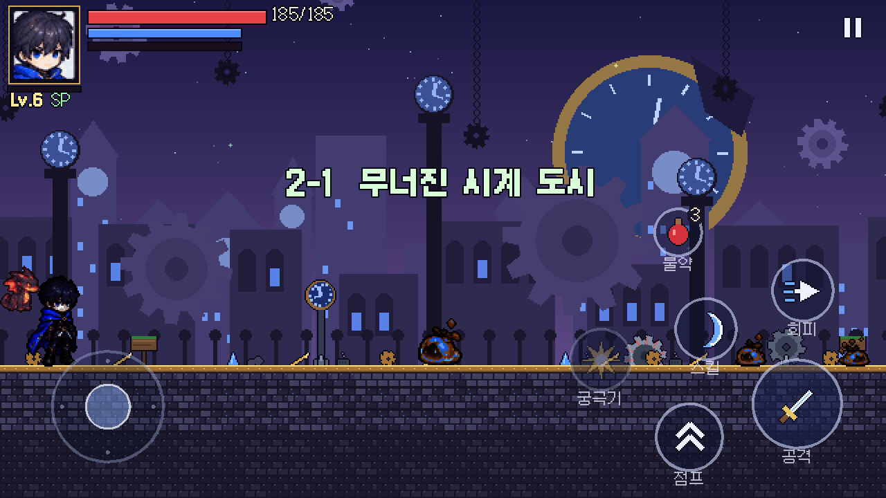
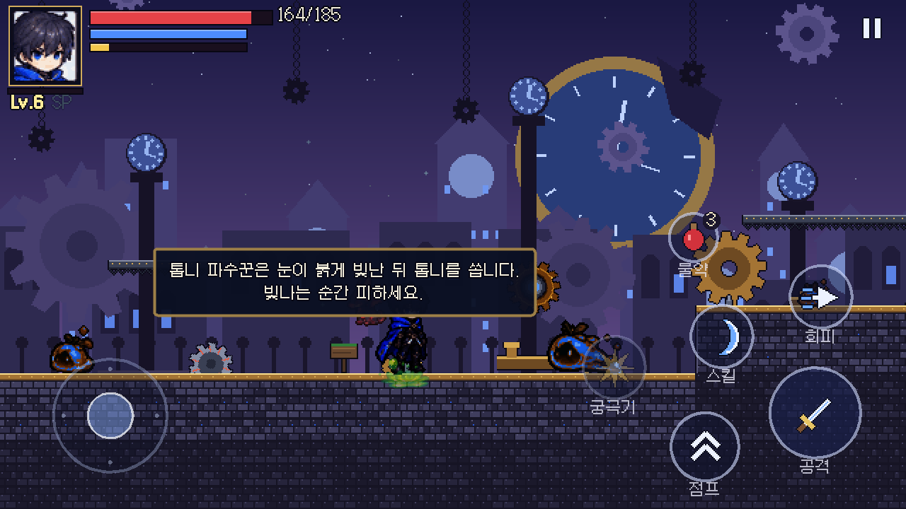
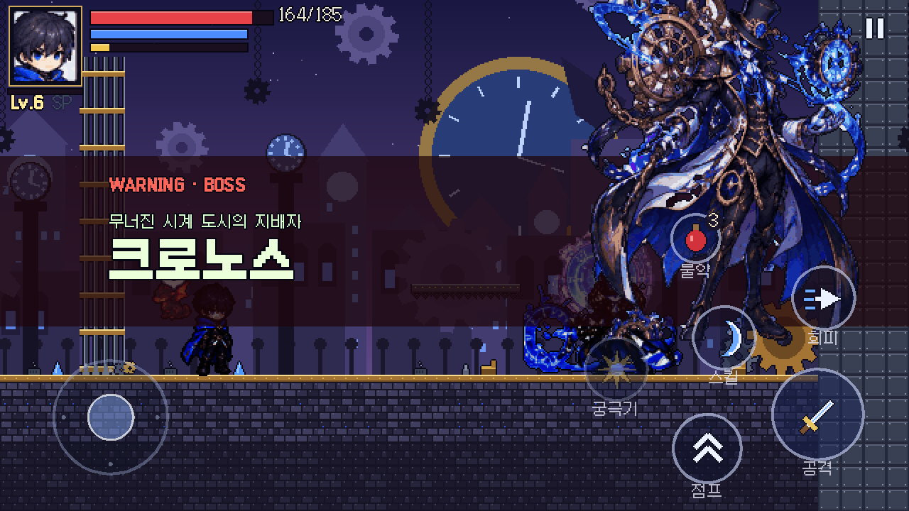
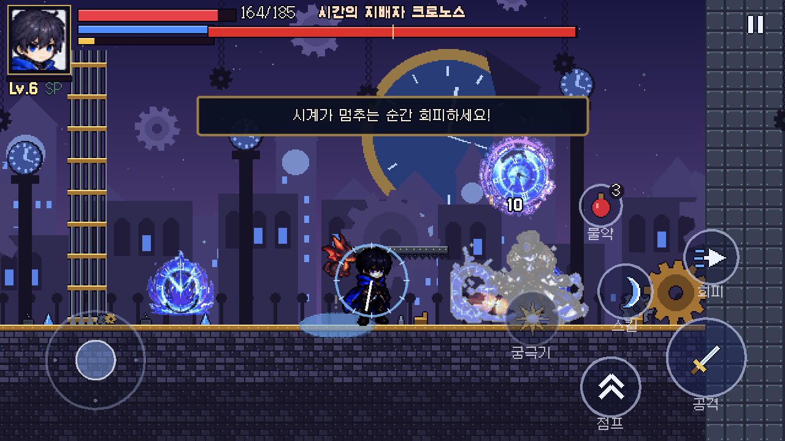
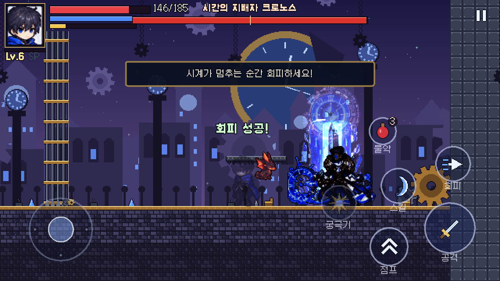
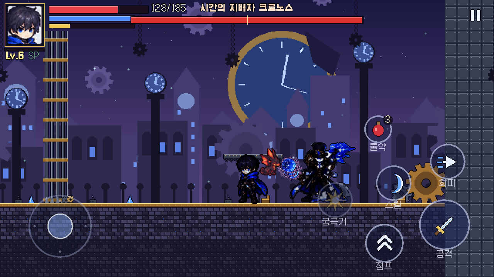
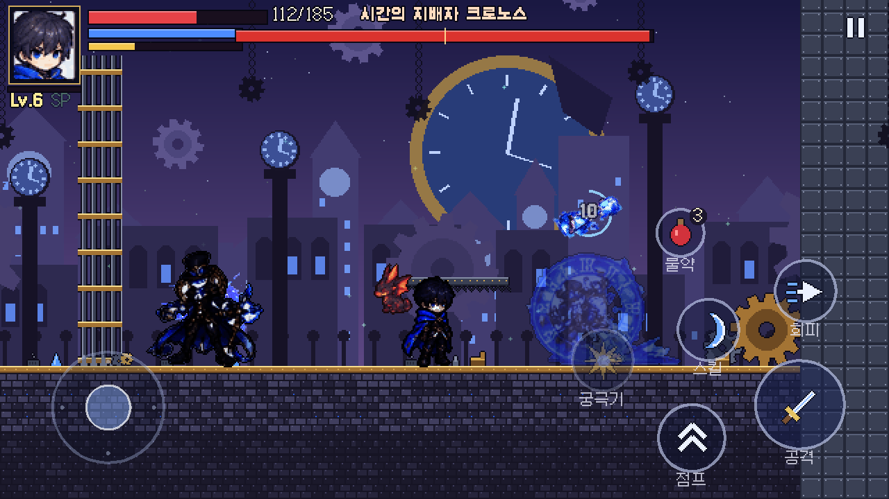
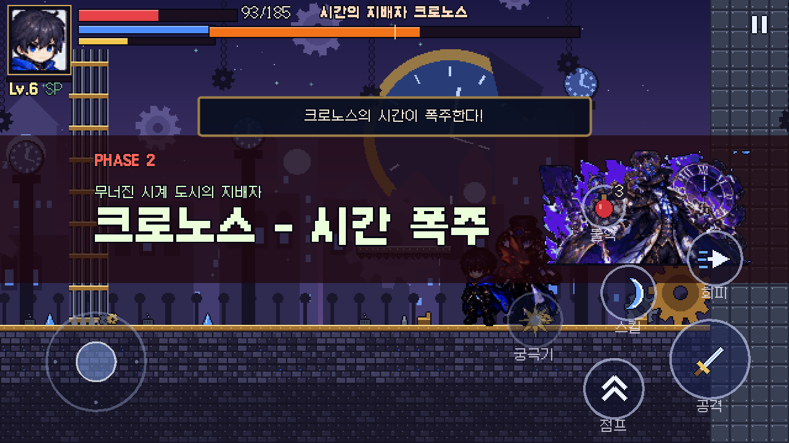
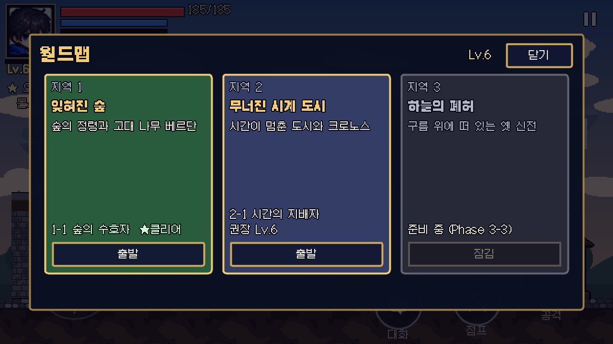

# Phase 3 보고서 (2부) — 지역 2 '무너진 시계 도시'와 보스 크로노스

| 단계 | 내용 | 상태 |
|---|---|---|
| 3-1 | 마을, NPC, 퀘스트, 마을 복구, 펫, 도감 ([보고서](PHASE3_REPORT.md)) | 완료 |
| **3-2 (이번)** | 지역 2 스테이지 2-1, 새 몬스터 2종(+소형), 함정, 보스 크로노스(2페이즈), 지역 해금·퀘스트 | **완료** |
| 3-3 | 지역 3 '하늘의 폐허' | 다음 |

## 1. 지역 해금과 흐름

- 월드맵의 **무너진 시계 도시**는 메인 퀘스트 5 '다음 여정'(레벨 6 + 그림자 여행자와 대화)을 마치면 열립니다. 권장 레벨 6.
- 이어서 메인 퀘스트 6 '멈춰버린 시계탑'(크로노스 처치)을 그림자 여행자가 줍니다.
- 처음 클리어하면 두 번째 **시간의 핵 조각**을 얻고, 크로노스는 고유 장신구 **크로노스의 회중시계**(MP +15, 치명타 +6%, 스킬 대기 −0.4초)를 떨어뜨립니다.
- 하늘의 폐허는 아직 "준비 중 (Phase 3-3)"입니다.

## 2. 스테이지 2-1 '무너진 시계 도시'

- 길이 약 3,200px. 구성: 놋쇠 테두리 벽돌길, 철제 들보 발판, 구덩이 2개, 높은 블록, 표지판 4개(지역 소개·함정·몬스터 힌트·보스 경고), 체크포인트, 크로노스의 시계탑 경기장(철문이 닫힘).
- **회전 톱니 함정**(5개): 레일 위를 오가며 닿으면 피해를 줍니다(10). 점프로 넘거나 회피로 뚫고 지나갈 수 있습니다.
- 배경: 부서진 거대 시계가 걸린 보랏빛 밤하늘, 시계탑 실루엣, 떠다니는 톱니, 아치 건물, 난간과 시계 가로등, 매달린 사슬. 파란 시간 입자가 떠다닙니다.
- 캐릭터가 묻히지 않도록 배경 명도를 한 단계 올렸습니다(주인공·크로노스 모두 어두운 옷).

### 새 몬스터

| 몬스터 | 특징 | 보상 |
|---|---|---|
| 태엽 슬라임 | 청동빛 슬라임. 숲 슬라임보다 단단하고(HP 70) 푸른 시간 탄을 쏩니다 | EXP 16, 6G, 태엽 부품 50% |
| 꼬마 태엽 슬라임 | 작고 빠름, 근접 튀김만 | EXP 10, 4G |
| 톱니 파수꾼 | 외눈 톱니바퀴, 공중에 떠서 일정 거리를 유지합니다. 눈이 붉어지고 톱니가 빨라지면(0.85초) 회전 톱니를 쏩니다. 맞으면 살짝 밀리고, 부서지면 떨어져 산산조각 납니다 | EXP 18, 7G, 태엽 부품 60% |

새 재료 **태엽 부품**은 서브 퀘스트(브론)에 쓰이고 상점에 팔 수 있습니다.

## 3. 보스 — 시간의 지배자 크로노스 (HP 2400)

모든 공격에 예고가 있습니다.

| 공격 | 예고 | 내용 | 2페이즈 |
|---|---|---|---|
| 지팡이 돌진 | 지팡이를 끌어당기는 자세 + 바닥 화살표 줄 | 150px 돌진 베기 + 초승달 이펙트 | 돌아서서 한 번 더 |
| 시계 톱니 발사 | 지팡이 겨눔 + 조준선 | 회중시계 톱니 3개를 부채꼴로 발사 | 5개 + 추가 2개, 보라색 |
| **시간 정지** | 머리 위 큰 시계 + **주인공 위에서 좁혀지는 시계 고리** | 고리가 닫히는 순간 회피 중(무적)이 아니면 1.1초 동안 멈춤 → 그 사이 톱니 발사(맞으면 바로 풀림). 제때 회피하면 "회피 성공!" | 1.3초 |
| **시간 역행** | 모래시계가 달린 반투명 잔상 + 원형 타이머 | 잔상을 남기고 순간이동. 4초 안에 잔상을 한 번 치면 "역행 저지!", 못 치면 잔상 위치로 돌아가 그동안 잃은 체력 일부(최대 8%) 회복 | 3.5초, 더 자주 |
| **푸른 시간 폭발** | 파란 원 3개(하나는 주인공 발밑) | 시계 문양 폭발 | 보라색, 2파 |
| 이동 | – | 걷기 또는 별빛과 함께 순간이동 | 더 빠름 |

- **2페이즈(HP 50% 이하)**: 시간 기둥 + 보라 폭발 연출, 몸이 보랏빛으로 바뀜, "PHASE 2 · 크로노스 - 시간 폭주" 배너(시트의 보라색 2페이즈 일러스트 사용). 예고 1.2배 → 1.0배, 대기 시간 단축, 탄 수 증가.
- 경직(그로기): 누적 피해로 1.2초 경직(받는 피해 +30%), 50% 확률로 회복 구슬.
- 처치: 시간 감속, 산산조각 이펙트, 부서진 시계 일러스트.
- 처음 시간 정지를 쓸 때 "시계가 멈추는 순간 회피하세요!" 안내가 나옵니다.

## 4. 구조 개선 (재사용)

- `scripts/world/stage.gd` + `StageData`(`data/stages/*.tres`): 숲 전용이던 스테이지 스크립트를 데이터 기반으로 바꿨습니다. 맵·타일·배경 4층·전경·소품·입자·보스·클리어 문구를 데이터로 정합니다. 1-1과 2-1이 같은 스크립트를 쓰고, 지역 3도 데이터만 추가하면 됩니다.
- 보스 배너·보스 바 이름을 보스 노드에서 읽고, 퀘스트의 '보스 처치' 판정을 `boss` 그룹으로 일반화했습니다.
- 주인공 `freeze()`(시간 정지): 회피 무적 중이면 걸리지 않고, 피격 시 즉시 풀립니다.

## 5. 퀘스트 · 도감 추가

- 메인 6 '멈춰버린 시계탑', 서브 '정밀한 부품'(태엽 부품 10개, 브론), '파수꾼 정리'(톱니 파수꾼 8대, 가렛), 업적 '시간을 되돌린 자'(크로노스 처치). 총 21개.
- 도감: 태엽 슬라임, 꼬마 태엽 슬라임, 톱니 파수꾼, 크로노스(이제 기록 가능). 기록 가능 15종.

## 6. 에셋

| 대상 | 출처 | 처리 |
|---|---|---|
| 크로노스 31프레임 | 시트 06: 대기 10, 걷기 9, 지팡이 공격 5, 시전 4, 소환·시간 정지 3 | 0.72배(키 약 85px), 공용 64색, 외곽선 |
| 크로노스 이펙트 11종 | 시트 06: 결정 가시, 별빛 폭발, 파편, 시계 폭발 2, 시간 기둥, 초승달, 시계판, 톱니 회중시계, 모래시계, 보라 폭발 | 0.5배, 부드러운 4단계 알파 |
| 일러스트 5종 | 시트 06: 전신, 초상, 2페이즈(보라), 부서진 시계, 회중시계 | 등장·2페이즈 배너, 도감, 처치 연출, 아이템 아이콘 |
| 시계 도시 타일·배경·함정·소품 | 참고 이미지 없음 | `tools/build_clock_city.py` 절차 생성 (크로노스 팔레트) |
| 톱니 파수꾼 | 참고 이미지 없음 | 같은 도구로 절차 생성 (링·눈·충전 눈·파편) |
| 태엽 슬라임 | 시트 02 슬라임 | 색상 변환(초록 → 청동, 빛 → 파랑) |

## 7. 테스트 결과

| 항목 | 결과 |
|---|---|
| 자동 테스트 | **83개 테스트 / 948개 검사 전부 통과** (신규 `test_clock.gd` 8개) |
| 시계 도시 봇 (`-- --bot --stage=clock_1`, Lv7 중반 영웅) | 3회 모두 클리어, 사망 0, 보스전 약 23~26초, 받은 피해 70~130 |
| 기존 봇 (1-1 → 마을 투어) | 성공 (스테이지 구조 변경 후에도 동일) |
| 웹 빌드 | 다시 내보낸 웹 빌드 안에서(Chromium, 휴대폰 가로 크기) 시계 도시 봇 실행 → 클리어, 사망 0, 보스전 약 29초 |

테스트 내용: 스테이지 생성(태엽 슬라임·파수꾼 4·톱니 함정 5·제목), 톱니 함정 피해, 파수꾼 비행·사격·파괴, 크로노스의 모든 공격 상태 진입·종료, 시간 정지(이동 불가, 피격 시 해제, 무적이면 무효), 잔상 파괴·역행 회복(이전 체력 초과 안 함), 2페이즈 전환·처치·회중시계 드롭·도감·업적, 지역 해금과 지역 퀘스트.

## 8. 고친 문제

- 첫 버전 크로노스(HP 1500)는 Lv7 봇에게 16초 만에 쓰러짐 → HP 2400, 공격력 17, 경직 내성 140으로 조정.
- 2페이즈 배너 그림이 이전 그림 크기로 늘어나 화면 밖으로 나감 → 그림이 바뀔 때 크기 재설정.
- 배열 리터럴을 타입 지정 배열 인자로 넘길 때 생기는 GDScript 런타임 오류 → 인자 타입 완화.

## 9. 한계 · 남은 작업

- 크로노스 피격 전용 프레임이 시트에 없어 걷기 프레임 + 섬광으로 대신합니다.
- 시계 도시 지형·배경·톱니 파수꾼은 절차 생성 임시 아트입니다.
- 밸런스는 봇 기준입니다. 사람이 하면 시간 정지 타이밍이 어려울 수 있으니 피드백을 받아 조정이 필요합니다.
- 지역 3(하늘의 폐허)은 다음 단계입니다. Android 실기기 테스트는 아직 못 했습니다.
