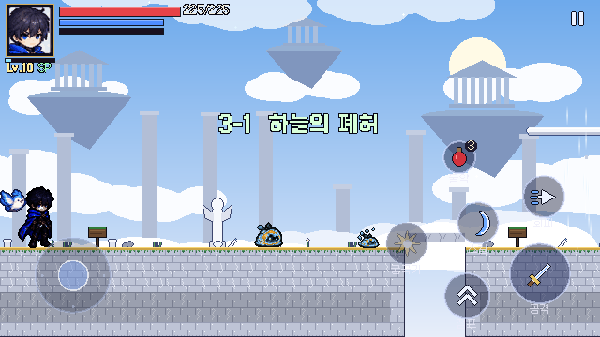
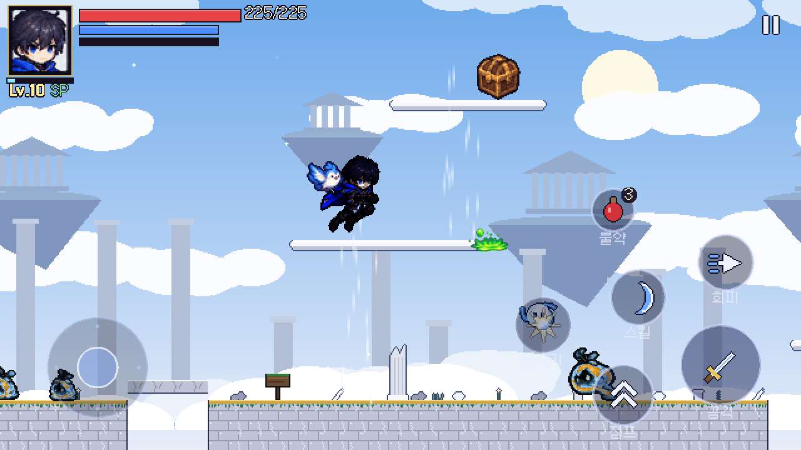
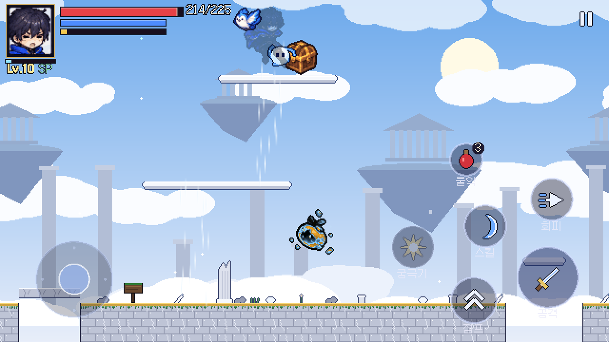
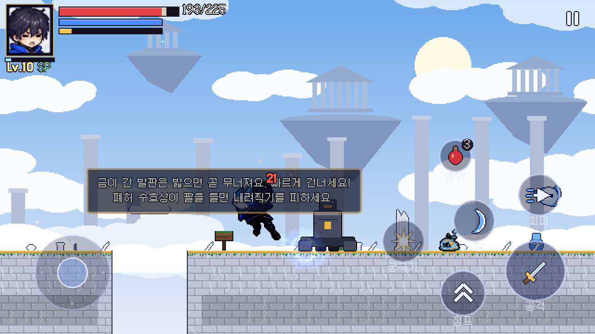
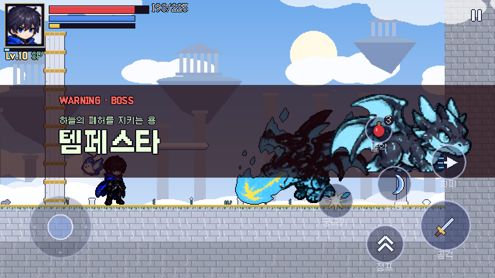
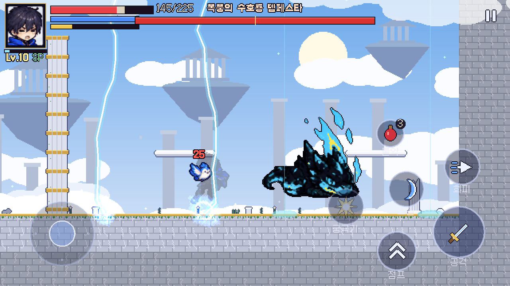
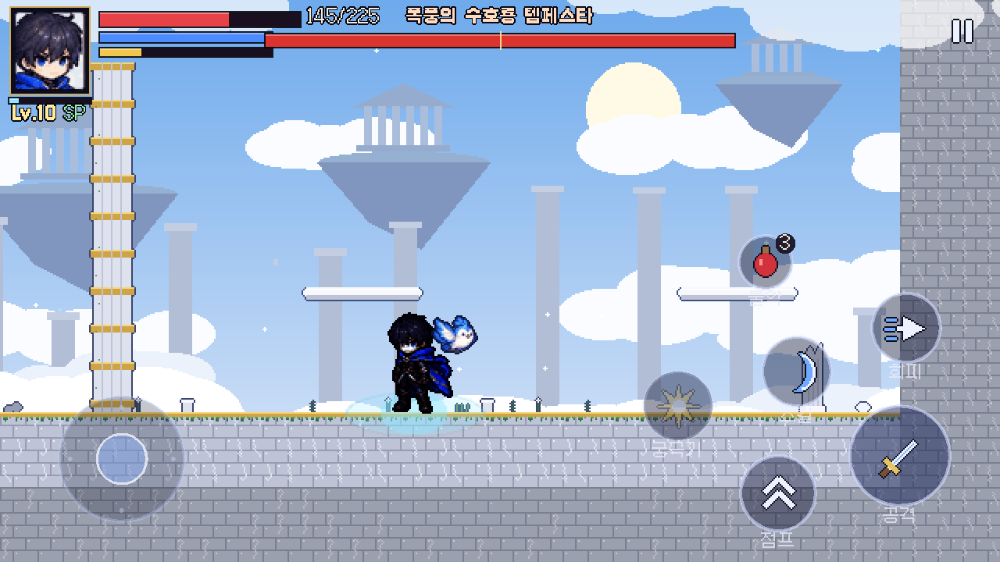
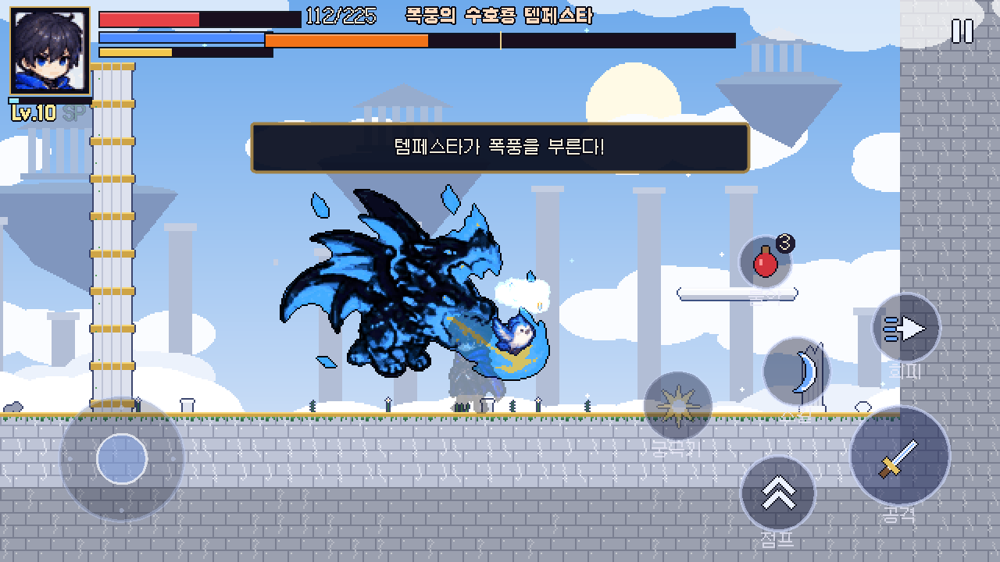

# Phase 3 보고서 (3부) — 지역 3 '하늘의 폐허', 숨겨진 장소, Phase 3 마무리

| 단계 | 내용 | 상태 |
|---|---|---|
| 3-1 | 마을, NPC, 퀘스트, 마을 복구, 펫, 도감 ([보고서](PHASE3_REPORT.md)) | 완료 |
| 3-2 | 지역 2 '무너진 시계 도시', 보스 크로노스 ([보고서](PHASE3_2_REPORT.md)) | 완료 |
| **3-3 (이번)** | 지역 3 '하늘의 폐허', 보스 템페스타, 새 몬스터 3종, 상승 기류·무너지는 발판, 지역마다 숨겨진 보물, 메인 이야기 1부 마무리 | **완료** |

이로써 명세 Phase 3 항목(**3개 지역, NPC, 퀘스트, 마을 복구, 펫, 도감**)이 모두 들어갔습니다.

## 1. 중요: 지역 3 보스 디자인

참고 이미지 6장에는 **하늘의 폐허 보스가 없습니다.** 그래서 펫 시트(05)의 **아기 드래곤 디자인을 보스 크기(0.8배)로 다시 추출하고, 불꽃 색을 폭풍 색(청록·남색)으로 바꿔** '폭풍의 수호룡 템페스타'로 만들었습니다(`tools/build_sky_ruins.py`).

- 원본 디자인(형태·포즈)은 그대로 유지했고 색만 바꿨습니다. 펫 아기 드래곤과는 색과 크기로 구분됩니다.
- **정식 보스 디자인이 생기면 교체해야 하는 임시 디자인**입니다(도감 설명에도 적어 두었습니다).

## 2. 지역 해금과 이야기

- 월드맵의 **하늘의 폐허**는 메인 퀘스트 6 '멈춰버린 시계탑'(크로노스 처치)을 마치면 열립니다. 권장 레벨 10.
- 메인 퀘스트 7 '폭풍의 수호자'(템페스타 처치)와 메인 퀘스트 8 '세 개의 조각'(미아에게 보고)으로 **1부 이야기가 마무리**됩니다. 퀘스트 설명에 "이야기는 다음 장에서 계속됩니다"라고 표시합니다.
- 템페스타는 고유 방어구 **폭풍룡의 비늘 갑옷**(최대 HP +70, 피해 감소 15%, 회피 대기 −0.05초)을 떨어뜨립니다. 첫 클리어 때 세 번째 시간의 핵 조각을 얻습니다.

## 3. 스테이지 3-1 '하늘의 폐허'

- 떠다니는 섬 5개. 섬 사이에 구멍이 있어 떨어지면 낙하 피해를 입고 마지막 발판으로 돌아옵니다.
- **상승 기류**(`^`): 바람 기둥 안에 들어가면 위로 떠오릅니다. 위쪽 구름 발판으로 가는 길이고, 두 번 갈아타면 숨겨진 보물에 닿습니다.
- **무너지는 대리석 발판**(`~`): 밟으면 0.55초 흔들린 뒤 떨어지고, 3초 뒤 다시 생깁니다.
- 구름 발판(한 방향), 표지판 4개, 체크포인트, 기둥이 늘어선 신전 경기장.
- 배경: 밝은 하늘·구름, 신전이 얹힌 떠다니는 섬, 부서진 기둥, 앞쪽 구름. 밝은 배경이라 어두운 옷의 주인공과 템페스타가 잘 보입니다.

### 새 몬스터

| 몬스터 | 특징 | 보상 |
|---|---|---|
| 구름 슬라임 (+소형) | 하얀·하늘색 슬라임. 가장 단단함(HP 110) | EXP 24, 9G, 하늘 깃털 |
| 바람 정령 | 공중에 떠다니다가 붉은 눈으로 몸을 떤 뒤(0.7초) 직선 돌진 | EXP 26, 10G |
| 폐허 수호상 | 가까이 가면 깨어나는 돌 수호상. 천천히 다가와 두 팔을 들고(바닥 경고 원 0.85초) 내려찍어 충격파. 슈퍼아머, 잘 밀리지 않음 | EXP 50, 20G |

새 재료 **하늘 깃털**(상점에 판매 가능).

## 4. 보스 — 폭풍의 수호룡 템페스타 (HP 4800)

경기장 바닥 바로 위를 낮게 날아다녀서 근접 공격이 닿습니다.

| 공격 | 예고 | 내용 | 2페이즈 |
|---|---|---|---|
| 폭풍 구슬 | 몸을 일으킴 + 조준선 | 구슬 3개 부채꼴 | 5개 + 추가 2개 |
| 급강하 | 하늘로 사라짐 → **주인공을 따라오는 그림자 원**이 멈춘 뒤 0.35초 | 그림자 위치로 추락(큰 피해). 이후 1.6초 동안 땅에 앉아 있음 → **반격 기회**(받는 피해 +30%) | 착지 시간 짧아짐 |
| 낙뢰 | 날개에 번개를 모음 + 가는 원 4개(하나는 주인공 발밑)와 희미한 기둥선 | 하늘에서 번개가 내리꽂힘 | 5개 + 2파 |
| 강풍 | 포효 + "강풍!" | 주인공을 벽 쪽으로 밀고 구슬이 바람을 타고 날아옴 | 2페이즈 전용 |
| 이동 | – | 좌우로 날아서 자리 이동 | – |

- 2페이즈(HP 50% 이하): 번개 3줄기 연출, 몸이 보랏빛 폭풍색, "템페스타가 폭풍을 부른다!", 예고 1.2배 → 1.0배.
- 경직(그로기): 누적 피해로 땅에 내려앉아 1.3초 경직.

## 5. 숨겨진 장소 (명세: "숨겨진 장소")

각 지역에 **숨겨진 보물 상자**를 하나씩 두었습니다(`$`). 한 번만 열리고 열었다는 기록이 저장됩니다.

| 지역 | 위치 | 보상 |
|---|---|---|
| 잊혀진 숲 1-1 | 높은 나무 발판 위 | 60G, 마나 결정 2 |
| 무너진 시계 도시 2-1 | 높은 블록 위 철제 발판 | 120G, 펫 간식 2, 마나 결정 1 |
| 하늘의 폐허 3-1 | 상승 기류 두 번을 타야 닿는 구름 위 | 200G, 하늘 깃털 3, 펫 간식 2 |

- 서브 퀘스트 '구름 위의 보물'(3-1 보물 찾기), 업적 '보물 사냥꾼'(3개 모두 찾기).

## 6. 퀘스트 · 도감

- 추가 퀘스트 6개: 메인 7·8, 서브 '바람 길들이기'(바람 정령 10), '구름 위의 보물', 업적 '폭풍을 잠재운 자', '보물 사냥꾼'. **총 27개**(메인 8, 서브 9, 일일 1, 업적 9).
- 도감 추가: 구름 슬라임, 꼬마 구름 슬라임, 바람 정령, 폐허 수호상, 템페스타. **기록 가능 20종**(몬스터 10, 보스 3, 무기 2, 펫 5). 무기 4종·유물은 Phase 4에서 추가할 예정이라 "준비 중"으로 표시됩니다.

## 7. 구조

- 슬라임 '테마'(forest / clockwork / cloud): 지역별 색·능력치·탄 색을 데이터로 지정합니다(`StageData.slime_theme`).
- `StageData`에 숨겨진 보물 보상(`chest_gold`, `chest_items`)을 추가했습니다.
- 새 맵 기호: `w` 바람 정령, `r` 폐허 수호상, `~` 무너지는 발판(가로로 이어 쓰기), `^` 상승 기류(세로로 쌓아 높이 지정), `$` 보물 상자.
- 보스가 순간이동·급강하 같은 숨는 동작 중 다른 상태로 바뀌어도 다시 보이고 맞을 수 있게 하는 처리를 넣었습니다.
- 퀘스트 목표 종류 추가: 보물(이벤트), 보물 개수(상태).

## 8. 에셋

| 대상 | 출처 | 처리 |
|---|---|---|
| 템페스타 10프레임 | 시트 05 아기 드래곤(앉기 3, 웅크림, 브레스, 비행, 일어섬, 번개 모으기(불꽃 오라), 포효(불꽃 브레스), 몸 말기) | 0.8배 추출 후 불꽃 → 폭풍 색 변환 |
| 템페스타 일러스트 | 시트 05 드래곤 전신 | 0.75배, 같은 색 변환 (등장 배너·도감) |
| 폭풍 구슬 | 펫 불덩이 이펙트 | 색 변환 |
| 구름 슬라임 | 시트 02 슬라임 | 색 변환(초록 → 하양·하늘색, 빛 → 금색) |
| 보물 상자 | 시트 03 아이콘의 보물상자 | 0.42배 |
| 바람 정령, 폐허 수호상, 타일, 배경 4층, 전경 구름, 경기장 기둥, 기둥·꽃병·천사상, 무너지는 발판, 바람 줄기, 아이템 아이콘 2종 | 참고 이미지 없음 | `tools/build_sky_ruins.py` 절차 생성 |
| 낙뢰 | – | 게임 안에서 지그재그 선으로 그림 |

## 9. 테스트 결과

| 항목 | 결과 |
|---|---|
| 자동 테스트 | **94개 테스트 / 1022개 검사 전부 통과** (신규 `test_sky.gd` 11개) |
| 하늘의 폐허 봇 (`-- --bot --stage=sky_1`, Lv11 영웅) | 6회 모두 클리어, 사망 0, 보스전 약 24~26초 |
| 시계 도시 봇 | 8회 모두 클리어 (아래 '고친 문제' 반영 후) |
| 1-1 → 마을 투어 봇 | 3회 모두 성공 |
| 웹 빌드 | 다시 내보낸 웹 빌드 안에서(Chromium, 휴대폰 가로 크기) 하늘의 폐허 봇 실행 → 클리어, 사망 0 |

테스트 내용: 스테이지 생성(구름 슬라임 7·바람 정령 4·수호상 2·상승 기류 2·무너지는 다리 2·보물 1·제목), 상승 기류가 띄워 올림, 무너지는 발판(무너짐·통과·재생성), 보물(한 번만 지급, 퀘스트 목표, 저장, 3개 모두 → 업적), 숲·시계 도시에도 보물 하나씩, 바람 정령 돌진, 수호상 깨어남·내려찍기 피해, 템페스타의 모든 공격 상태 진입·종료, 급강하가 그림자 위치에 착지, 2페이즈·처치·드롭·도감·업적, 지역 3 해금과 메인 7·8.

## 10. 고친 문제

- **시간의 핵이 경기장 발판 위에 걸림**: 크로노스가 발판 아래에서 쓰러지면 핵이 위에서 떨어지다가 발판(주인공보다 70px 위)에 걸렸습니다. 사람은 점프로 닿지만 어색하고, 봇은 자주 막혔습니다(6번 중 2번) → 핵을 보스 발밑에 생성.
- 봇이 구멍 위에 떠 있는 톱니 파수꾼을 쫓다가 구멍에 빠짐 → 아래에 땅이 없는 비행 몬스터는 쫓지 않음.
- 무너지는 발판 바로 아래에 서 있으면 머리가 감지 영역에 닿아 발판이 무너짐 → 발이 발판 위에 있을 때만 반응.
- 첫 템페스타(HP 3400)는 Lv11 봇에게 22초 만에 쓰러짐 → HP 4800, 공격력 24.

## 11. 한계 · 남은 작업

- **템페스타는 임시 디자인**입니다(위 1절). 바람 정령·폐허 수호상·지형·배경도 절차 생성 임시 아트입니다.
- 밸런스는 봇 기준입니다(봇은 회피를 아주 잘합니다). 사람 플레이 피드백으로 조정해야 합니다.
- Android 실기기 테스트는 아직 못 했습니다.

## 12. 다음 단계 (Phase 4 — 콘텐츠 완성)

1. **무기 4종**: 대검·쌍검·지팡이·창. 무기마다 공격 방식과 스킬이 다르게(이미 `WeaponData` 구조가 있음). 참고 이미지가 없어 공격 모션 제작 방법을 정해야 합니다.
2. **유물**(목표 30개)과 **전직**.
3. **사운드**: 효과음·지역별 배경음악.
4. **그래픽 개선**: 절차 생성 임시 아트 교체, 보스 3 정식 디자인.
5. 보스 추가(명세 목표 3종은 채웠지만 2부 이야기용).
