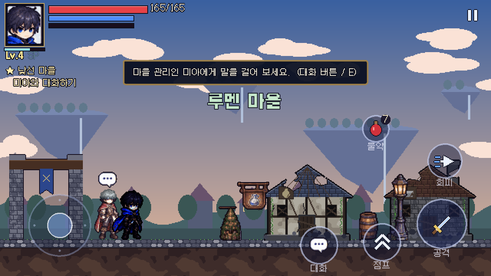
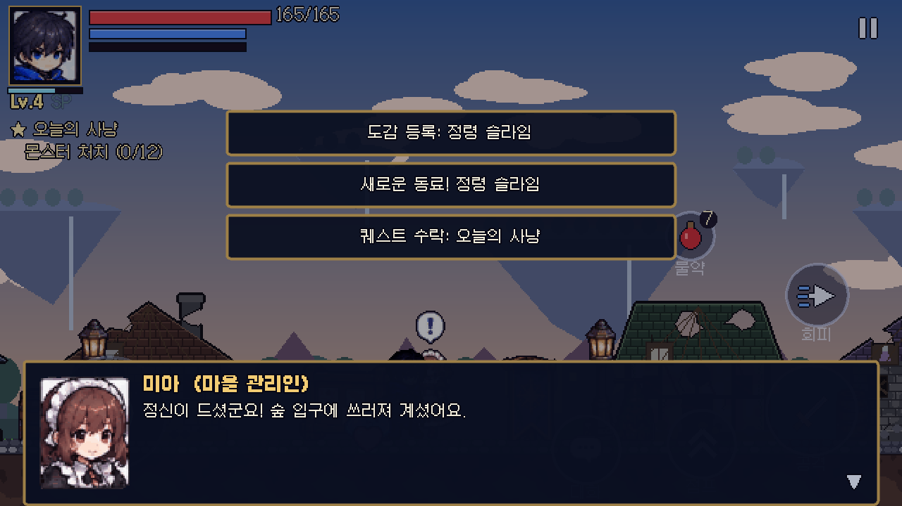
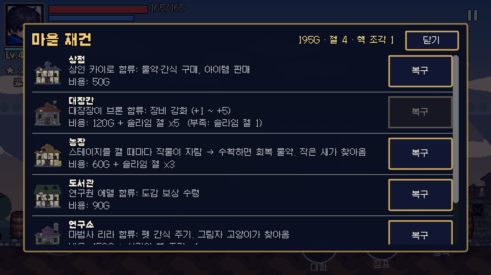
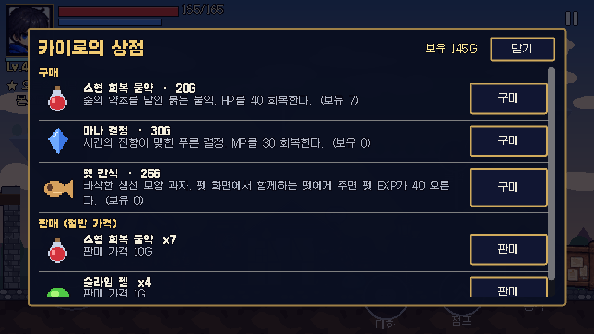
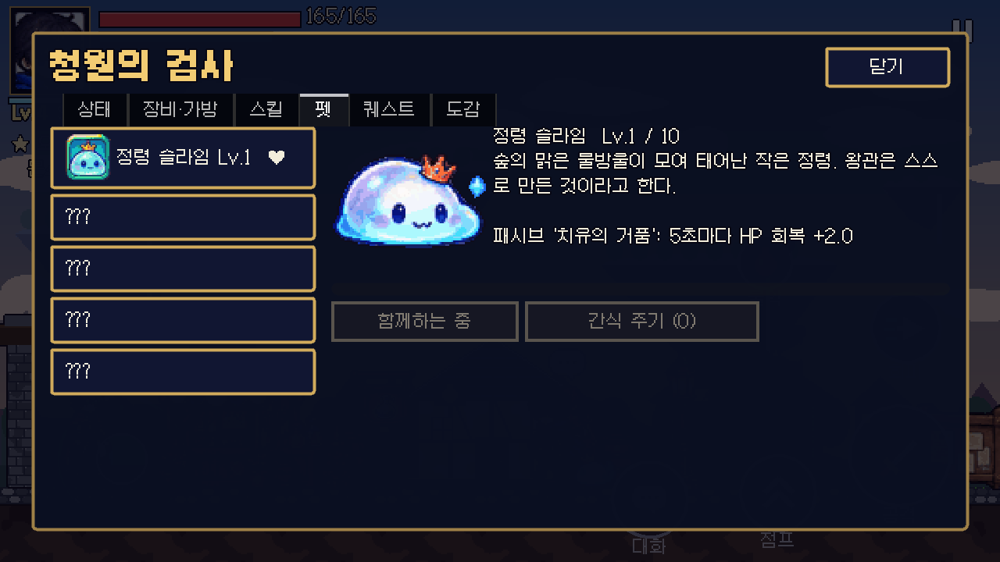
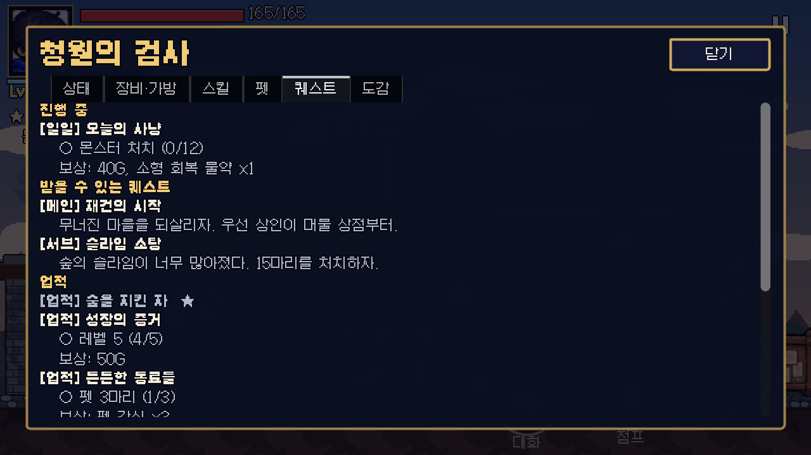
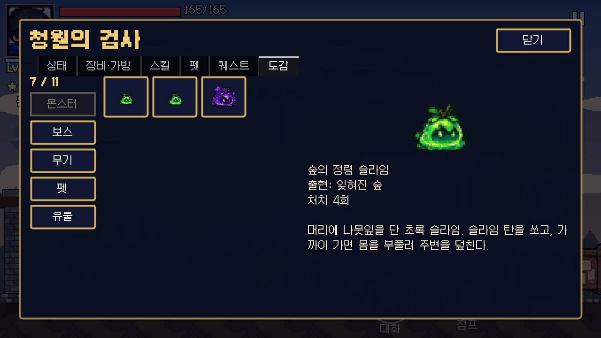
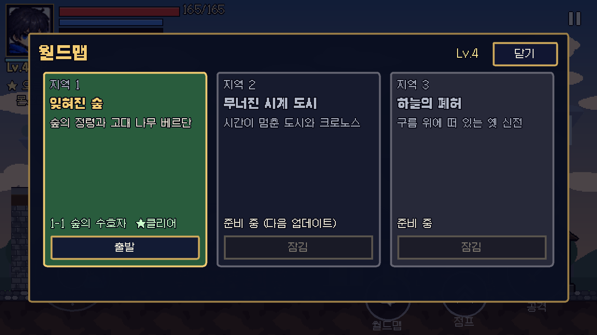

# Phase 3 보고서 (1부) — 마을 · NPC · 퀘스트 · 마을 복구 · 펫 · 도감

명세의 Phase 3 항목은 **3개 지역, NPC, 퀘스트, 마을 복구, 펫, 도감**입니다. 범위가 커서 나눠 진행합니다.

| 단계 | 내용 | 상태 |
|---|---|---|
| **3-1 (이번)** | 마을(허브), NPC 8명, 대화, 퀘스트, 마을 복구 6시설, 펫 5종, 도감, 월드맵, 저장 v2 | **완료** |
| 3-2 | 지역 2 '무너진 시계 도시' 스테이지 + 보스 크로노스(2페이즈) | 다음 |
| 3-3 | 지역 3 '하늘의 폐허' | 그다음 |

월드맵에는 세 지역이 모두 보이지만, 지역 2·3은 "준비 중"으로 잠겨 있습니다.

<p>








</p>

## 1. 게임 흐름

```
타이틀 ─ 새 게임 ─▶ 스테이지 1-1 (튜토리얼 겸 첫 보스)
                      │ 클리어
                      ▼
   ┌───────────▶ 루멘 마을 (허브) ◀──────────┐
   │   NPC 대화 · 퀘스트 · 재건 · 상점 · 강화 · 펫  │
   │                  │ 마을 문 / 경비병           │
   │                  ▼                           │
   │              월드맵 ── 1-1 출발 ──▶ 스테이지 ──┘ (클리어 / 쓰러짐 → 마을로)
   └── 이어하기: 마지막 장소(마을 또는 체크포인트)에서 시작
```

- 처음 스테이지를 깨면 **시간의 핵 조각** 1개를 얻습니다(연구소 복구 재료). 다시 깨도 더 주지 않습니다.
- 결과 화면은 클리어 시 "마을로 가기 / 다시 도전 / 타이틀로"입니다. 쓰러졌을 때는 마을에 와 본 적이 있으면 "마을로 돌아가기"가 추가됩니다.

## 2. 마을 '루멘'

- 가로로 걸어 다니는 마을(약 1700px)입니다. 왼쪽부터 마을 문, 상점, 대장간, 광장(재건 게시판·미아), 도서관, 연구소, 농장, 훈련장 순서입니다.
- 가까이 가면 **대화/이용 버튼**(터치, 점프 버튼 왼쪽)이 나타납니다. 키보드는 E/F, 패드는 십자키 ↓입니다. 마을에서는 스킬·궁극기 버튼을 숨깁니다.
- NPC 머리 위 표시: **!** 받을 퀘스트, **?** 보고할 퀘스트, 말풍선은 대화 가능입니다.
- 대화창은 초상화, 이름, 한 글자씩 나오는 글, 선택지로 되어 있고 대화 중에는 게임이 멈춥니다.

### NPC 8명

| NPC | 역할 | 등장 조건 | 기능 |
|---|---|---|---|
| 미아 | 마을 관리인 (시트의 메이드) | 처음부터 | 메인 퀘스트, 마을 재건, 작물 수확 |
| 가렛 | 경비병 | 처음부터 | 월드맵(마을 밖), 서브 퀘스트 |
| 그림자 여행자 | 여행자 | 처음부터 | 이야기, 서브·메인 퀘스트 |
| 카이로 | 상인 | 상점 복구 | 물약·마나 결정·펫 간식 구매, 재료 판매 |
| 브론 | 대장장이 | 대장간 복구 | 장비 강화 +1~+5, 서브 퀘스트 |
| 에델 박사 | 연구원 | 도서관 복구 | 도감 보상, 도감 보기, 서브 퀘스트 |
| 리라 | 마법사 | 연구소 복구 | 펫 돌보기(간식) |
| 세레나 | 사제 | 훈련장 복구 | 축복(다음 스테이지 EXP +20%), 스킬 초기화 |

NPC마다 고유한 초상화, 첫 만남 대사, 평소 대사가 있습니다(`data/npcs/*.tres`).

### 마을 복구 (6시설)

| 시설 | 비용 | 해금 |
|---|---|---|
| 상점 | 50G | 상인 카이로 |
| 대장간 | 120G + 슬라임 젤 5 | 대장장이 브론, 장비 강화 |
| 농장 | 60G + 슬라임 젤 3 | 스테이지를 깰 때마다 작물이 자람(최대 3) → 수확하면 회복 물약, 펫 '작은 새' |
| 도서관 | 90G | 연구원 에델, 도감 보상 |
| 연구소 | 150G + 시간의 핵 조각 1 | 마법사 리라, 펫 '그림자 고양이' |
| 훈련장 | 110G | 사제 세레나 |

- 무너진 건물 / 복구된 건물 그림이 따로 있고, 복구하면 그 자리에서 바로 바뀝니다.
- 재건 게시판(광장), 미아, 무너진 건물을 살펴보는 것 중 어느 쪽으로든 복구 창을 열 수 있습니다.

### 상점 · 대장간

- **상점**: 소형 회복 물약 20G, 마나 결정 30G, 펫 간식 25G를 팝니다. 판매는 절반 가격이고, 고유 장비는 팔 수 없습니다.
- **강화**: 무기 +공격력 2, 방어구 +최대 HP 8·피해 감소 1%, 장신구 +MP 3·치명타 1% (단계당). 비용은 다음 단계 × 40G + 젤 × 2입니다. 항상 성공하고 최대 +5까지입니다. 이름에 "+N"이 붙습니다.

## 3. 퀘스트 (`data/quests/*.tres`, 17개)

| 종류 | 퀘스트 |
|---|---|
| 메인 5 | 낯선 마을 → 재건의 시작(상점) → 검을 벼리다(대장간+강화) → 마을의 심장(시설 4곳) → 다음 여정(레벨 6, 여행자) |
| 서브 5 | 슬라임 소탕(15마리), 대장장이의 부탁(젤 8개 납품), 숲의 수호자 다시(베르단), 첫 수확(2회), 기록하는 자(도감 6종) |
| 일일 1 | 오늘의 사냥(12마리) — 날짜가 바뀌면 다시 열림 |
| 업적 6 | 숲을 지킨 자, 성장의 증거(Lv5), 든든한 동료들(펫 3), 살아있는 도감(10종), 마을의 부활(6곳), 숲의 사냥꾼(100마리) |

- 목표 종류: 처치, 보스 처치, 스테이지 클리어, 대화, 강화, 수확(일어난 일을 셈) / 레벨, 시설 복구, 복구 수, 펫 수, 도감 수, 아이템 모으기(현재 상태를 읽음).
- 상태: 잠김 → 받을 수 있음 → 진행 중 → 보고 가능 → 완료. 보상은 EXP, 골드, 아이템, 펫입니다.
- HUD 왼쪽 위에 추적 중인 퀘스트와 다음 목표가 나옵니다. 메뉴의 '퀘스트' 탭에서 진행 중·받을 수 있음·업적·완료 목록을 봅니다.

## 4. 펫 5종 (`data/pets/*.tres`)

| 펫 | 패시브 (Lv1 → 레벨당) | 고유 행동 | 얻는 법 |
|---|---|---|---|
| 정령 슬라임 | 5초마다 HP 2 회복 (+0.5) | 체력 회복 | 메인 '낯선 마을' |
| 설원 여우 | 회피 대기 −0.04초, 무적 +0.02초 (+0.008 / +0.004) | – | 서브 '슬라임 소탕' |
| 작은 새 | 골드 +10% (+3%), 끌어오기 40px (+6) | 떨어진 아이템·회복 구슬 끌어오기 | 농장 복구 |
| 그림자 고양이 | 치명타 +4% (+0.6%) | – | 연구소 복구 |
| 아기 드래곤 | 공격력 +2 (+0.6) | 6초마다 가까운 적에게 불덩이 | 메인 '마을의 심장' |

- 함께하는 펫 1마리가 마을과 스테이지에서 주인공을 따라옵니다(나는 펫은 위에 떠서 따라감). 멈춰 있으면 대기하고, 8초가 지나면 잠들어 "z"가 뜹니다.
- 감정 표현: 주인공 레벨업(하트), 펫 레벨업(별), 보스 등장(!).
- 성장: 주인공이 몬스터에게서 얻는 EXP의 절반과 펫 간식(+40)으로 레벨이 오릅니다(최대 10). 패시브가 레벨에 따라 커집니다.
- 메뉴의 '펫' 탭: 목록(없는 펫은 ???와 얻는 법), 전신 그림, 레벨·EXP, 패시브 설명, 함께하기·간식 주기.

## 5. 도감 (메뉴 '도감' 탭)

- 분류: 몬스터 3, 보스 2, 무기 6, 펫 5, 유물 1. 지금 기록할 수 있는 것은 11종이고, 크로노스·대검·쌍검·지팡이·창·유물은 "준비 중"입니다.
- 몬스터·보스는 처치하면, 무기·펫은 얻으면 기록됩니다. 처치 횟수와 출현 지역도 보여 줍니다.
- 도서관 복구 후 에델 박사에게서 기록 1종당 10G를 받습니다.

## 6. 저장 v2

- `payload`에 `quests`, `village`, `pets`, `codex`가 추가되었고, `stage`에 `location`(village/stage)이 들어갑니다.
- v1 → v2 마이그레이션: 숲을 이미 깬 저장이면 마을에 도착한 것으로 처리하고 마을에서 이어합니다.
- 마을에서는 창이나 대화를 닫을 때, 복구·퀘스트 보고·구매 때마다 자동 저장합니다.
- 불러올 때 값을 검증합니다(없는 펫·퀘스트·시설 제거, 레벨·진행도 범위 보정).

## 7. 에셋

| 대상 | 원본 | 처리 |
|---|---|---|
| NPC 7명 서 있는 모습 | 시트 03 1행 전신 일러스트 | 0.22배 축소(키 약 66px, 주인공과 비슷), 외곽선, 숨쉬기 애니메이션은 코드로 |
| NPC 초상화 | 시트 03 4행 기본 초상 카드 | 0.62배 |
| **경비병** | **시트에 디자인 없음** | 시트 03 1열(주인공형 NPC)을 색만 바꿈: 푸른 망토 → 진홍, 검은 머리 → 은색 투구 톤 (`tools/build_npc_variants.py`). **임시**이고 정식 디자인이 나오면 교체해야 함 |
| 말풍선·! ? · 코인·상자 등 | 시트 03 아이콘 | 0.34배 |
| 노점·물약 간판·깃발·게시판·가로등·통·덤불 | 시트 03 소품 | 0.42배 |
| 펫 5종 애니메이션 | 시트 05 | 고양이(이동 6, 앉기, 잠, 놀람, 애정, 돌진), 여우(이동 4, 앉기, 잠, 애정), 드래곤(대기 3, 비행, 잠, 날개), 슬라임(튀기 4, 웅크림, 놀람, 기쁨), 새(날갯짓 4, 활공, 기쁨). 떠 있는 Z·!·하트는 지우고 게임에서 다시 그림 |
| 펫 전신·아이콘 | 시트 05 | 펫 화면·도감용 |
| 드래곤 불덩이 | 시트 05 화염 브레스 끝부분 | 펫 투사체 |
| 건물 6종 × 무너짐/복구, 마을 문, 땅, 하늘·떠다니는 섬·원경, 밭 | **참고 이미지 없음** | `tools/build_village.py`로 절차 생성(임시 아트) |
| 펫 간식·시간의 핵 조각 아이콘 | 없음 | `tools/build_environment.py`에 추가 |

## 8. 테스트 결과

| 항목 | 결과 |
|---|---|
| 자동 테스트 | **75개 테스트 / 885개 검사 전부 통과** (Phase 3 신규 `test_village.gd` 12개) |
| 자동 플레이 봇 | 타이틀 → 1-1 클리어(사망 0) → 마을 이동 → 미아와 대화(첫 퀘스트 완료, 정령 슬라임 획득) → 재건 창에서 상점 복구 → 상인 등장·상점 열기 → 메뉴 펫·퀘스트·도감 탭 → 마을 문에서 월드맵 열기까지 모두 성공 |
| 렌더링 실행 | 위 스크린샷(xvfb + OpenGL) |
| 웹 빌드 | 다시 내보내 브라우저에서 확인 |

테스트 내용: 복구 비용·부족 표시·핵 조각·시설 보상 펫, 농장 성장·수확, 메인 퀘스트 연쇄(자동 수락 → 대화 → 보고 표시 → 보상), 처치·납품·일일 초기화, 업적, 펫 레벨·패시브·간식·교체, 펫 따라오기·잠들기, 강화 수치·비용·상한, 도감 기록·미래 항목 거부·보상 1회, 저장 v2 왕복, v1 마이그레이션, 마을 장면(NPC 등장 조건, 대화 → 재건 창 → 상인 등장, 상호작용 키), 클리어 후 마을 이동과 핵 조각 1회 지급.

## 9. 발견하고 고친 문제

- 마을 장면의 최상위 노드 이름 `Village`가 같은 이름의 오토로드와 겹쳐 엔진이 이름을 바꿔 버림 → `VillageScene`으로 변경(봇이 마을을 찾지 못하던 원인).
- 코드로 만든 전체 화면 창(대화창, 상점 등)이 CanvasLayer 아래에서 크기 0으로 남아 화면에 안 보이거나 위로 치우침 → `set_anchors_and_offsets_preset` 사용.
- 퀘스트 완료·도감·펫 획득 알림이 한꺼번에 쌓여 창을 가림 → 알림은 최근 3개까지만.
- 첫 펫을 마을에서 얻었을 때 바로 나타나지 않음 → 펫이 생기면 그 자리에 소환.
- 저장 검증 테스트: 레벨 30으로 보정된 영웅이 불러오자마자 '성장의 증거' 업적 보상(50G)을 받음 → 의도한 동작이라 테스트 기대값 수정.

## 10. 한계 · 남은 작업

- **지역 2·3이 아직 없습니다.** 월드맵에서 잠겨 있고, 메인 퀘스트 5번 '다음 여정'은 시계 도시 이야기를 예고하는 데서 끝납니다 → Phase 3-2/3-3.
- 경비병은 색만 바꾼 임시 디자인입니다.
- 건물·마을 배경은 절차 생성 임시 아트입니다(Phase 4 그래픽 개선 대상).
- NPC 서 있는 모습은 일러스트 1장에 숨쉬기 효과만 있습니다(걷기 애니메이션 없음, 시트의 치비 포즈는 아직 안 씀).
- 펫 '잠자기'는 고양이·여우·드래곤·슬라임만 전용 그림이 있고, 새는 평소 그림에 z만 뜹니다(시트에 새 잠자기 포즈 없음).
- Android 실기기 테스트는 아직 못 했습니다. 밸런스(복구 비용, 펫 수치)는 자동 봇 기준입니다.

## 11. 다음 단계

1. **Phase 3-2**: 무너진 시계 도시 스테이지(시계 톱니 함정, 새 몬스터)와 보스 크로노스(시간 정지, 톱니 발사, 시간 역행, 푸른 시간 폭발, 2페이즈 보라 연출). 시트 06 에셋 추출.
2. **Phase 3-3**: 하늘의 폐허 스테이지와 지역 퀘스트, 숨겨진 장소.
3. 그다음 Phase 4: 무기 4종(대검·쌍검·지팡이·창), 유물, 전직, 사운드, 그래픽 개선.
