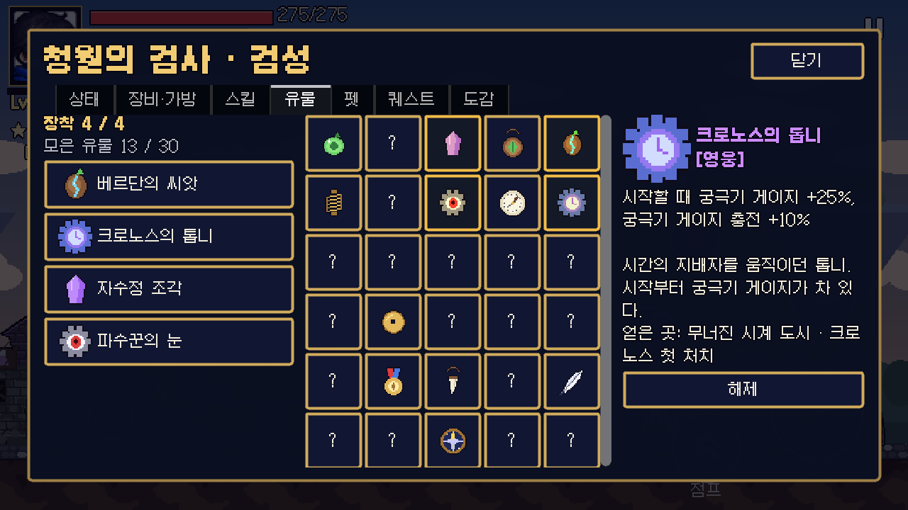
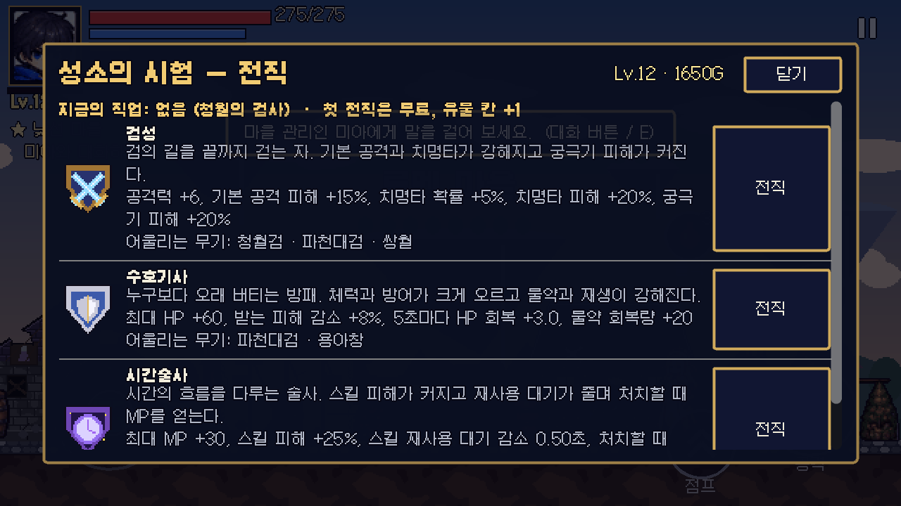
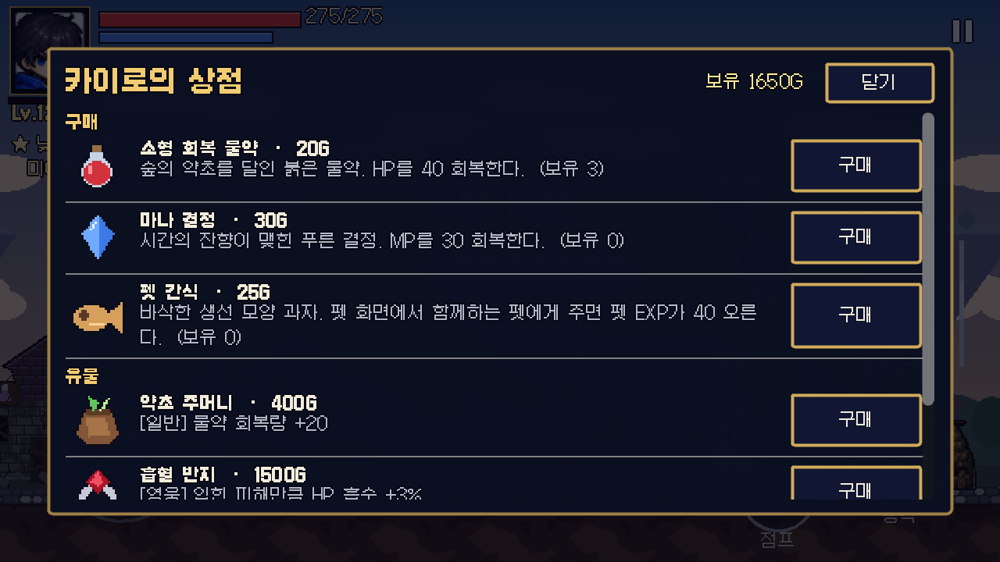
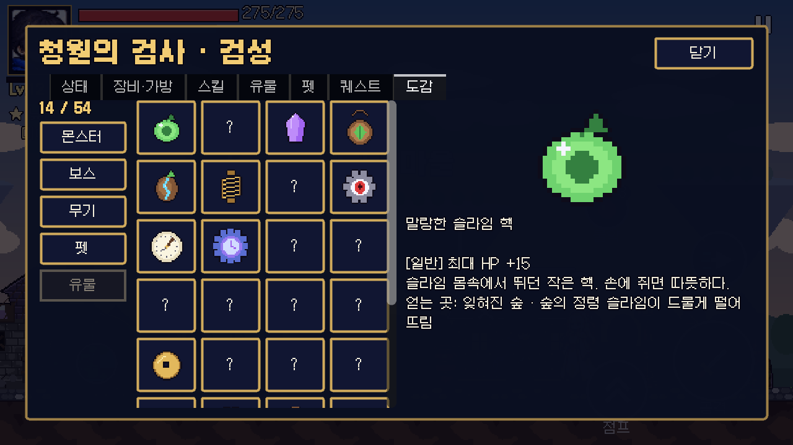
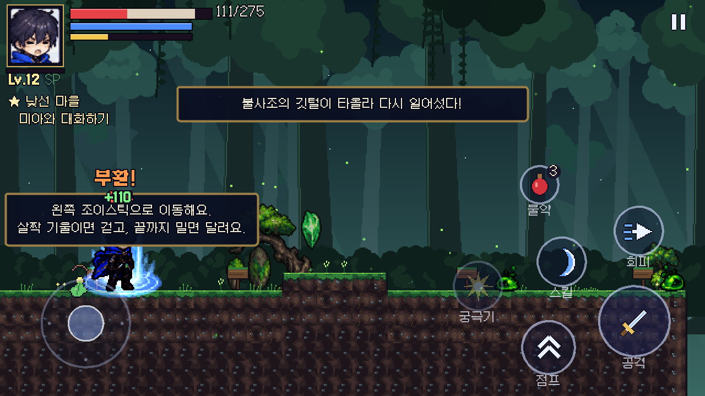
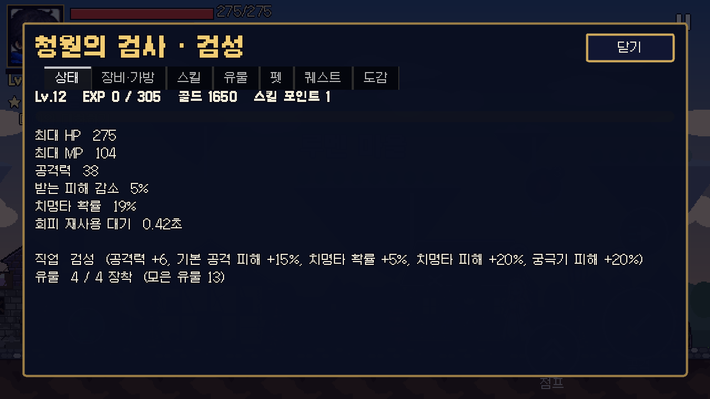

# Phase 4 보고서 (2부) — 유물 30종과 전직

| 단계 | 내용 | 상태 |
|---|---|---|
| 4-1 | 무기 4종(대검·쌍검·지팡이·창), 대장간 제작 — [1부 보고서](PHASE4_REPORT.md) | 완료 |
| **4-2 (이번)** | **유물 30종, 전직 3직업** | **완료** |
| 4-3 | 사운드(효과음·배경음) | 다음 |
| 4-4 | 그래픽 개선(임시 아트 교체), 보스 추가 | 그다음 |

## 1. 유물

- **가방과 따로 모으는 패시브 장신구**입니다. 장착한 유물의 효과만 적용됩니다.
- **유물 칸 3개**(전직하면 **4개**). 칸이 비어 있으면 얻는 즉시 자동 장착되고, 캐릭터 화면 **'유물' 탭**에서 바꿔 낄 수 있습니다.
- 등급 4단계(일반·희귀·영웅·전설)는 이름 색으로 표시됩니다.
- 이미 가진 유물을 다시 얻으면(같은 유물이 두 번 떨어진 경우 등) 골드로 바뀝니다(최소 50G).
- 몬스터가 떨어뜨린 유물은 바닥에서 등급 색으로 깜빡이고, 가진 유물은 다시 떨어지지 않습니다.
- 도감 '유물' 칸이 실제 30종으로 채워졌습니다("준비 중" 제거). 못 찾은 유물은 **얻는 곳**이 보입니다. 도감 전체는 54종이 되었습니다.

### 30종 목록

| 지역 / 출처 | 유물 (등급) — 효과 |
|---|---|
| **잊혀진 숲** | 말랑한 슬라임 핵(일반) 최대 HP +15 · 새싹 부적(일반) 5초마다 HP +1 · 자수정 조각(희귀) 치명타 +4% · 숲의 수호 부적(희귀, 보물 상자) 피해 감소 +4% · **베르단의 씨앗**(영웅, 베르단) 최대 HP +30, 5초마다 HP +2 |
| **무너진 시계 도시** | 놋쇠 태엽(일반) 회피 대기 −0.04초 · 꼬마 톱니(일반) 처치 시 MP +2 · 파수꾼의 눈(희귀) 치명타 피해 +15% · 멈춘 시곗바늘(희귀, 보물 상자) 스킬 대기 −0.25초 · **크로노스의 톱니**(영웅, 크로노스) 시작 궁극기 게이지 25%, 충전 +10% |
| **하늘의 폐허** | 구름 방울(일반) 최대 MP +12 · 솜털 뭉치(일반) 처치 시 HP +2 · 바람의 핵(희귀) 회피 무적 +0.05초 · 수호상의 룬(희귀) 피해 감소 +5% · 폭풍 깃털(희귀, 보물 상자) 스킬 피해 +12% · **폭풍의 비늘**(영웅, 템페스타) 공격력 +6, 치명타 +3% |
| **퀘스트** | 여행자의 동전(일반, '다음 여정') 골드 +15% · 브론의 망치 장식(희귀, '정밀한 부품') 공격력 +4 · 미아의 리본(희귀, '세 개의 조각') EXP·골드 +10% · 시간술의 모래시계(영웅, '새로운 길') 스킬 대기 −0.3초, MP +20 · **불사조의 깃털**(전설, '폭풍의 수호자') 쓰러질 때 스테이지마다 1번 부활(HP 40%) |
| **업적** | 첫 승리의 훈장(일반, '숲을 지킨 자') 공격력 +2, HP +10 · 사냥꾼의 송곳니(희귀, '숲의 사냥꾼') 기본 공격 피해 +10% · 펫 방울(희귀, '든든한 동료들') 5초마다 HP +2 · 학자의 깃펜(희귀, '살아있는 도감') EXP +15% · 낡은 보물 지도(희귀, '보물 사냥꾼') 골드 +25% · 마을의 열쇠(영웅, '마을의 부활') HP +25, MP +15, 물약 회복 +20 · **별의 나침반**(전설, 새 업적 '유물 수집가'=유물 10개) 공격력 +5, 치명타 +5%, 스킬 피해 +10% |
| **상점(카이로)** | 약초 주머니(일반, 400G) 물약 회복량 +20 · 흡혈 반지(영웅, 1500G) 입힌 피해의 3%를 HP로 흡수 |

- 일반 몬스터 드롭 확률: 일반 슬라임류 4%, 톱니 파수꾼·바람 정령 5%, 폐허 수호상 8%, 자수정 슬라임 25%. 보스 유물은 첫 처치 때 확정.
- 업적 '잃어버린 세계의 보물'(유물 30개) → 1000G, EXP 500.

## 2. 전직

- 조건: **크로노스를 쓰러뜨린 뒤(메인 퀘스트 '멈춰버린 시계탑' 완료) 훈련장의 사제 세레나**가 서브 퀘스트 **'새로운 길'**을 줍니다. **레벨 12**가 되면 세레나 대화의 '전직(직업 선택)'에서 고릅니다.
  - 1부 보고서에는 "레벨 15"라고 적었지만, 크로노스를 깬 시점의 레벨이 보통 10~12라서 레벨 노가다 없이 3지역 전에 전직할 수 있게 **12로 정했습니다.**
- **첫 전직은 무료**, 이후 직업 바꾸기는 **500G**. 어떤 직업이든 **유물 칸 +1**.
- 퀘스트 보상: 유물 '시간술의 모래시계', EXP 200.
- 직업은 무기를 가리지 않습니다(어울리는 무기만 안내).

| 직업 | 보너스 | 어울리는 무기 |
|---|---|---|
| **검성** | 공격력 +6, 기본 공격 피해 +15%, 치명타 +5%, 치명타 피해 +20%, 궁극기 피해 +20% | 청월검 · 파천대검 · 쌍월 |
| **수호기사** | 최대 HP +60, 피해 감소 +8%, 5초마다 HP +3, 물약 회복량 +20 | 파천대검 · 용아창 |
| **시간술사** | 최대 MP +30, 스킬 피해 +25%, 스킬 대기 −0.5초, 처치 시 MP +4 | 성운 지팡이 · 청월검 |

- 캐릭터 화면 제목이 "청월의 검사 · 검성"처럼 바뀌고, 상태 탭에 직업 보너스와 유물 장착 수가 나옵니다.

## 3. 한계 (중요)

- **유물 아이콘 30개와 직업 문장 3개는 참고 이미지에 없어서 `tools/build_relics.py`로 그린 임시 픽셀 아트**입니다.
- **전직은 능력치·패시브 보너스입니다.** 직업마다 새 기술이나 외형(의상) 변화는 없습니다. 주인공 시트가 하나뿐이라 직업별 외형은 Phase 4-4(그래픽 개선) 후보입니다.
- 유물 효과는 모두 능력치/패시브(회복·흡수·부활·시작 게이지 등)이고, 공격 모양을 바꾸는 유물은 없습니다.

## 4. 시스템 변경

- 새 리소스: `RelicData`(+`RelicDB`, `data/relics/` 30개), `JobData`(`data/jobs/` 3개).
- 새 능력치 키: 치명타 피해, 피해 흡수, 처치 시 HP/MP, 물약 회복량, 시작 궁극기 게이지, 부활. 장비·스킬·펫과 같은 표 하나로 합산됩니다.
- `Profile`: 유물 보유·장착·칸 수, 직업, `give()`(아이템/유물 구분해서 지급 — 퀘스트 보상, 보물 상자, 드롭, 상점이 모두 사용), 저장(`relics`, `relic_equipped`, `job`; 옛 저장은 빈 값으로 그대로 불러옴).
- `Player`: 5초 HP 재생(펫 전용이던 것을 주인공으로 옮겨 유물·직업에도 적용), 흡혈, 처치 시 회복, 부활(무적 2초 + 연출), 시작 궁극기 게이지.
- 퀘스트 목표 추가: `job`(전직), `relic_count`(유물 수). 퀘스트는 총 31개.
- 봇 옵션 `--job=…`, `--relics=a,b,c` 추가, 결과에 얻은 유물 출력.

## 5. 테스트 결과

| 항목 | 결과 |
|---|---|
| 자동 테스트 | **113개 테스트 / 1379개 검사 전부 통과** (신규 `test_relics.gd` 9개) |
| 기본 봇 | 1-1 → 마을 2회, 시계 도시, 하늘의 폐허 모두 성공(사망 0). 보스·몬스터 유물 드롭 → 줍기 확인 |
| 직업·유물 조합 봇 | 지팡이+시간술사+흡혈 반지 등(1-1→마을), 수호기사+재생 유물(시계 도시), 검성+공격 유물(하늘의 폐허) 모두 성공(사망 0) |
| 웹 빌드 | 다시 내보내 확인 |

테스트 내용: 30종 데이터(아이콘·효과 키·등급 4종·모든 유물이 실제로 얻을 수 있는 곳이 있는지), 자동 장착·칸 제한·해제·중복 → 골드, 흡혈·부활(1번만)·시작 게이지, 처치 시 HP/MP·5초 재생(펫 없이)·물약 보너스, 몬스터 드롭(아이콘, 가진 유물은 다시 안 떨어짐)·업적 보상·유물 10개 업적, 전직(잠금 조건·레벨·무료·칸 +1·보너스·퀘스트 보상·500G 변경), 저장/불러오기, 도감 54종, 마을에서 세레나 → 전직 창, 상점 유물 구매(1번만), 캐릭터 화면 유물 탭.

## 6. 만들면서 고친 문제

- 펫 '정령 슬라임'의 회복이 회복 숫자를 두 번 띄움(펫이 숫자를 한 번 더 그림) → 회복을 주인공 쪽으로 옮기며 한 번만 표시.
- 유물 탭 상단 글자가 옆 칸과 겹침 → 두 줄로 나눔.

## 7. 다음 단계

- **4-3 사운드**: 효과음(공격·피격·스킬·UI)과 지역·보스 배경음.
- 4-4 그래픽 개선(임시 아트 교체, 직업 외형 후보), 보스 추가.
