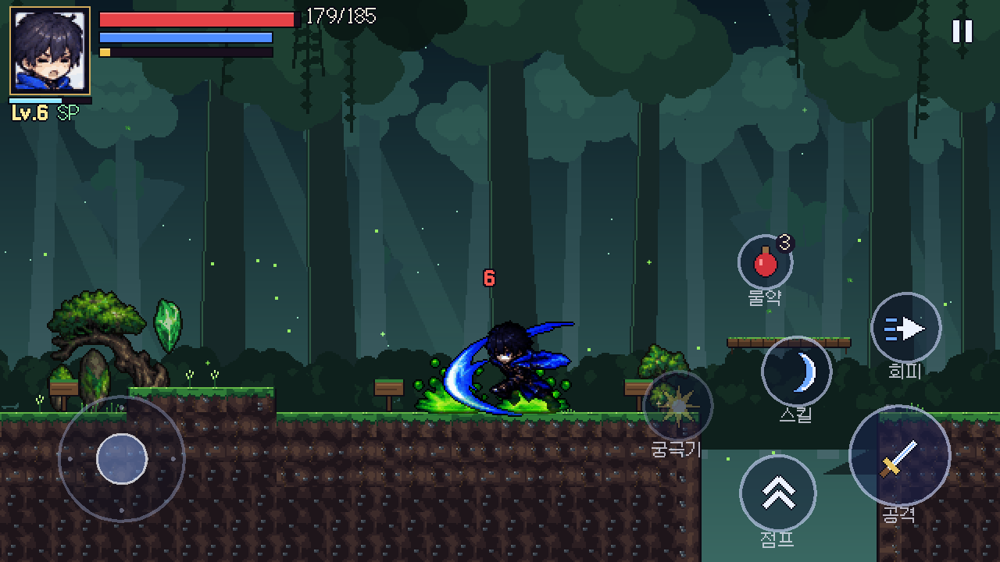
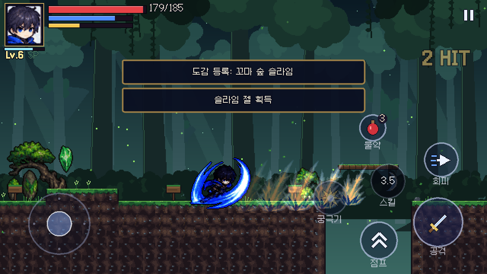
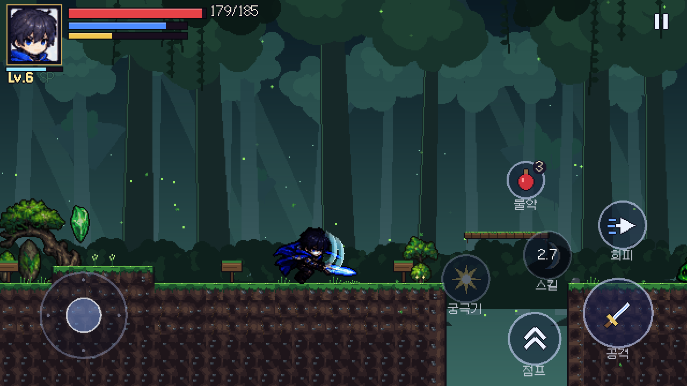
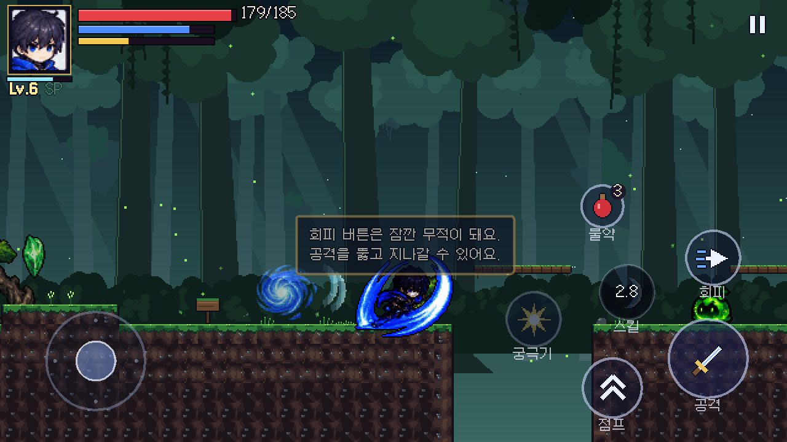
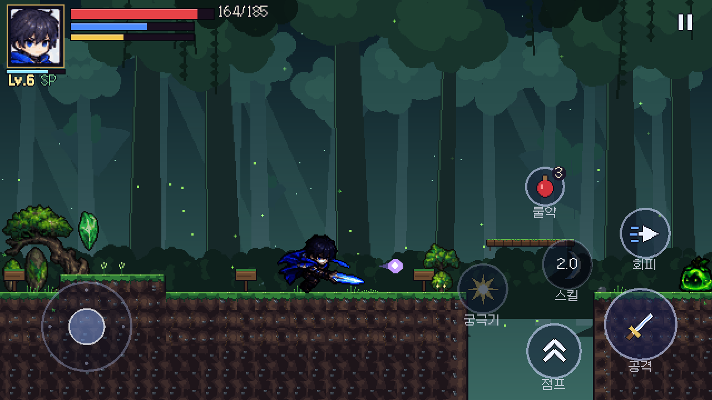
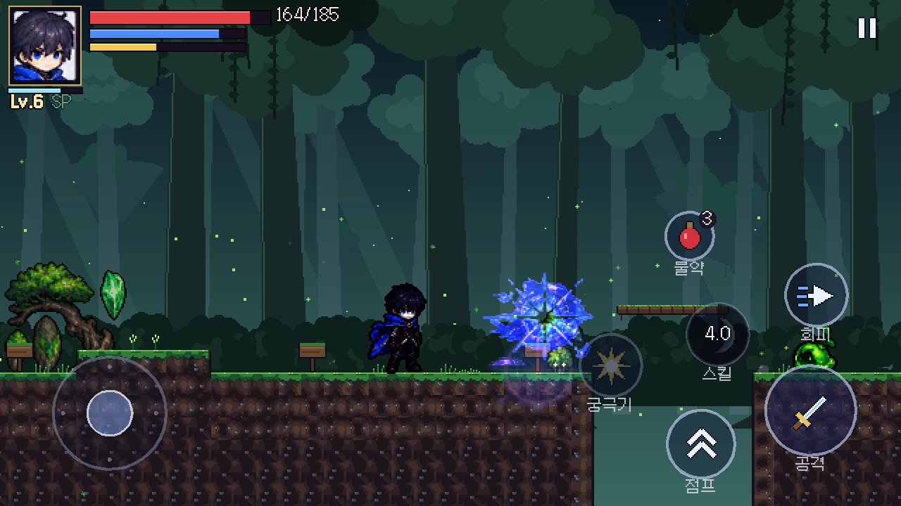
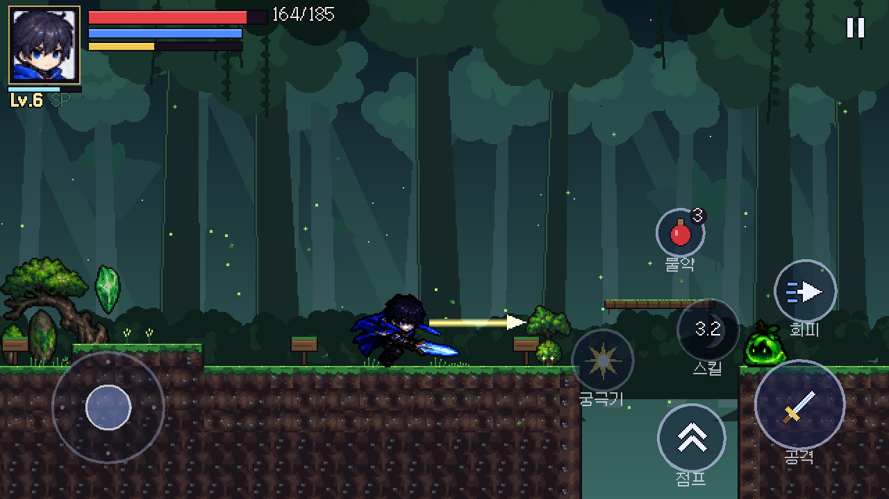
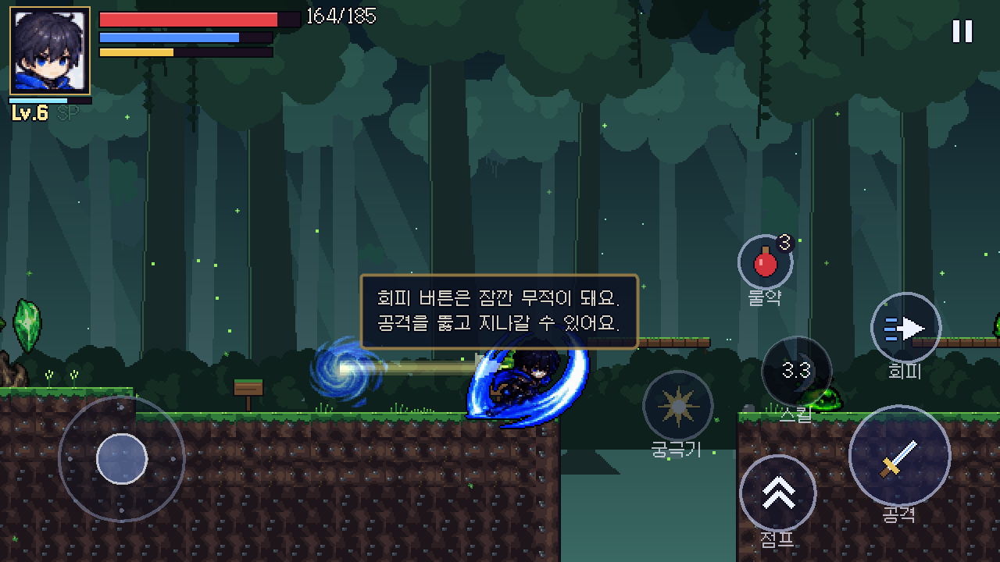
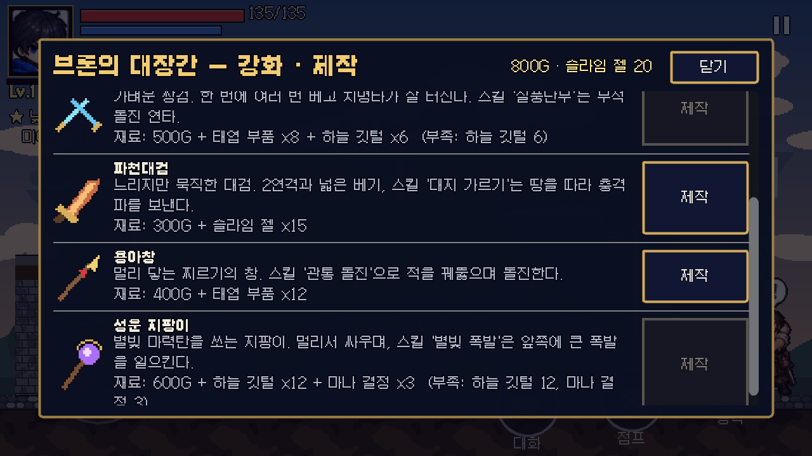

# Phase 4 보고서 (1부) — 무기 4종

명세 Phase 4(콘텐츠 완성) 항목: **보스 추가, 무기 추가, 유물, 전직, 사운드, 그래픽 개선**. 나눠서 진행합니다.

| 단계 | 내용 | 상태 |
|---|---|---|
| **4-1 (이번)** | 무기 4종(대검·쌍검·지팡이·창): 무기마다 다른 공격 방식과 스킬, 대장간 제작 | **완료** |
| 4-2 | 유물 30종, 전직 — [2부 보고서](PHASE4_2_REPORT.md) | 완료 |
| 4-3 | 사운드(효과음·배경음) | 그다음 |
| 4-4 | 그래픽 개선(임시 아트 교체), 보스 추가 | 그다음 |

## 1. 무기 6종 한눈에

명세: "무기마다 공격 방식과 스킬이 달라야 한다."

| 무기 | 콤보 | 특징 | 강공격 | 스킬 (MP / 대기) | 장착 보너스 |
|---|---|---|---|---|---|
| 청월검 (시작) | 3연격 | 균형형, 초승달 검기 | 청월 대참 | 청월참: 관통 검기 (15 / 2.5초) | – |
| 숲지기의 검 | 3연격 | 청월검과 같은 동작, 능력치↑ | 〃 | 〃 | 공격 +4, 치명 +3% |
| **파천대검** | **2연격** | 느린 휘두르기(애니 0.65배), 넓은 범위, 큰 피해·넉백·경직 | 천붕참 (×4.6) | **대지 가르기**: 땅을 따라 충격파 6연발 (18 / 4초) | 공격 +10 |
| **쌍월** | 3단 (한 입력에 2~3타) | 매우 빠름(1.5배), 타마다 치명 +15% | 회오리 베기 5타 | **질풍난무**: 무적 돌진 5연타 (15 / 3초) | 공격 +6, 치명 +8%, 회피 대기 −0.05초 |
| **성운 지팡이** | 3단 원거리 | 별빛 마력탄 발사(조준 보조), 2발 확산, 관통탄 | 성운구 3발 관통 | **별빛 폭발**: 앞쪽 마법진 → 큰 폭발 (20 / 4.5초) | 공격 +5, MP +30, 스킬 피해 +25% |
| **용아창** | 3단 | 사거리 약 100px 찌르기, 2연 찌르기, 돌격 찌르기 | 용미 휩쓸기 (앞뒤 180px) | **관통 돌진**: 무적 돌진 3연타 (16 / 3.5초) | 공격 +8, 치명 +4% |

- 궁극기 '청월강림'은 주인공 고유기라 모든 무기가 같이 씁니다.
- 스킬 트리의 '연격 숙련'(기본 공격 피해), '청월참 숙련'(스킬 피해·대기)은 어느 무기에든 적용됩니다.
- 무기를 바꿔도 스킬 대기 시간은 이어집니다(바꿔 끼우며 스킬을 연속으로 쓰는 것 방지).

## 2. 얻는 방법 — 대장간 '제작'

대장간(브론)에 **강화 · 제작** 창이 생겼습니다. 지역 재료가 쓰이는 곳이 생겼습니다.

| 무기 | 재료 | 사실상 열리는 시점 |
|---|---|---|
| 파천대검 | 300G + 슬라임 젤 15 | 대장간 복구 직후 (지역 1) |
| 용아창 | 400G + 태엽 부품 12 | 지역 2 |
| 쌍월 | 500G + 태엽 부품 8 + 하늘 깃털 6 | 지역 3 |
| 성운 지팡이 | 600G + 하늘 깃털 12 + 마나 결정 3 | 지역 3 |

- 무기는 고유 아이템이라 하나씩만 만들 수 있고, 만든 뒤 가방에서 장착합니다. 강화(+1~+5)도 그대로 됩니다.
- 서브 퀘스트 **'새 무기의 탄생'**(브론, 무기 1개 제작 → 150G, EXP 80, 젤 5) 추가. 퀘스트는 총 28개입니다.
- 도감 '무기'에 4종이 실제 항목으로 들어갔습니다("준비 중" 제거). 기록 가능 24종.

## 3. 구현 방식과 한계 (중요)

- **참고 이미지에는 주인공의 검 동작만 있고 대검·쌍검·지팡이·창 그림이나 동작이 없습니다.** 그래서
  - 주인공의 동작 프레임(베기·찌르기·스킬 자세)은 모든 무기가 **같이 씁니다.** 화면 속 주인공 손에는 계속 푸른 검이 보입니다.
  - 무기마다 다른 점은 **판정 범위·속도(애니메이션 재생 속도)·콤보 수·연타·발사체·이펙트·스킬**입니다.
  - 무기별 이펙트(대검의 주황 큰 호, 쌍검의 하늘색 겹베기, 창의 금색 찌르기 선, 지팡이의 보라 마력탄)와 아이콘 4종은 `tools/build_weapons.py`로 그린 임시 아트입니다.
- 정식 무기 동작을 넣으려면 무기별 주인공 시트(또는 손 위치 데이터 + 무기 스프라이트)가 필요합니다 → Phase 4-4(그래픽 개선) 후보.

## 4. 시스템 변경

- `AttackData`에 추가: 애니메이션 속도, 다단히트(횟수·간격), 추가 치명타, 일반 공격 발사체(텍스처·개수·확산·관통), 공격 이펙트(텍스처·색·크기·위치), 스킬 종류(`projectile` / `dash` / `shockwave` / `nova`)와 그 값.
- `Player`: 다단히트(판정을 새로 켜서 같은 적을 다시 맞힘), 원거리 일반 공격, 지팡이 조준 보조(앞쪽 65° 안의 가장 가까운 적, 비행 몬스터 포함), 돌진 스킬(무적·몬스터 통과), 충격파(시간차 폭발 6개), 노바(마법진 0.3초 뒤 폭발).
- 피해 보너스 분류를 공격 id 규칙으로 일반화(`*_combo*`/`*_air`/`*_heavy` = 기본, `*_skill` = 스킬).
- `ItemData.recipe` + `Profile.craft()`(재료 부족 표시, 고유 1개), 퀘스트 목표 '제작'.
- 봇에 `--weapon=아이템ID` 옵션 추가.

## 5. 테스트 결과

| 항목 | 결과 |
|---|---|
| 자동 테스트 | **104개 테스트 / 1090개 검사 전부 통과** (신규 `test_weapons.gd` 9개) |
| 무기별 봇 (1-1 → 마을 투어) | 대검·쌍검·지팡이 각 1~2회, 창 3회 모두 성공(사망 0) |
| 기존 봇 | 1-1 → 마을, 시계 도시 3회(사망 0~1), 하늘의 폐허 3회(사망 0) 모두 성공 |
| 웹 빌드 | 다시 내보내 확인 |

테스트 내용: 4종 모두 동작 세트 완비·제작법·아이콘·공격 분류, 대검의 느린 애니메이션과 큰 한 방, 쌍검 한 입력 다단히트·치명 보너스, 지팡이 발사체가 160px 앞 슬라임 명중, 창이 90px 앞까지 닿음, 대검·지팡이·창 스킬이 120px 앞 적 명중 + 창 돌진 이동, 쌍검 돌진 중 무적, 제작(재료 소모·고유·장착·퀘스트·도감), 모든 근접 공격이 작은 슬라임 높이까지 닿음.

## 6. 만들면서 고친 문제

- **창 찌르기가 작은 슬라임 위로 지나감**: 판정이 지면에서 20~42px 높이에만 있어서 키 16px인 꼬마 슬라임을 못 맞히고, 일반 슬라임도 겨우 닿았습니다. 봇이 숲에서 4번 쓰러짐 → 판정을 지면까지 내림. 모든 무기 근접 공격이 작은 적에 닿는지 확인하는 테스트 추가.
- **지팡이 마력탄이 슬라임 머리 위로 지나감**: 발사 높이가 32px라 대부분 빗나감(봇 피해 0) → 발사 높이를 낮추고 조준 보조 추가. 높은 턱 위에서 아래 적을 쏘는 각도(약 57°)까지 맞도록 조준 범위를 65°로.
- 봇이 턱 위에서 아래쪽 적을 계속 공격만 하고 내려가지 않음 → 아래에 있는 적에게는 내려가서 싸우도록 수정.

## 7. 다음 단계

- **4-2 유물과 전직**: 유물(지역·보스·업적·보물에서 얻는 패시브 장신구형, 목표 30개, 도감 '유물' 채우기)과 전직(레벨 15 이상, 무기 계열별 전직 퀘스트와 전직 보너스).
- 4-3 사운드, 4-4 그래픽 개선.
