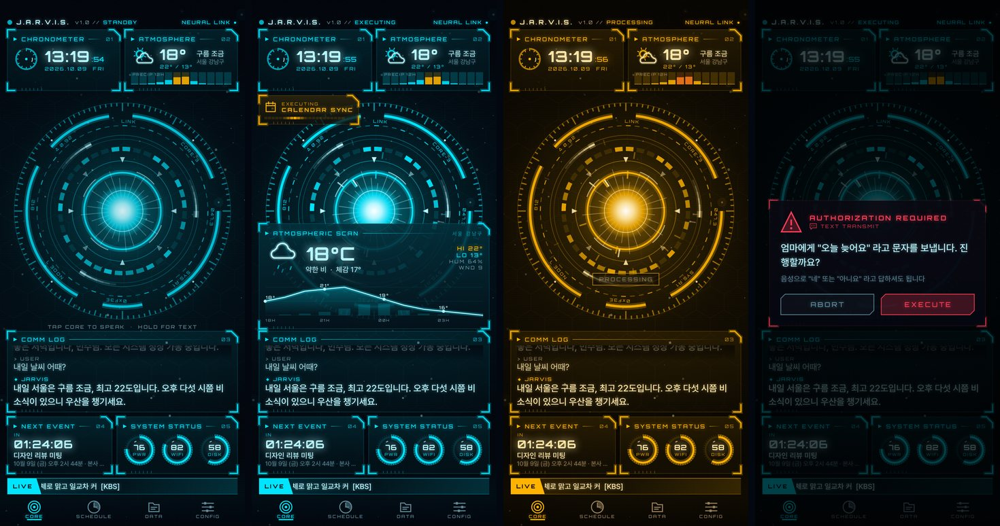

# J.A.R.V.I.S. — Android 개인 AI 비서

말로 부르면 한국어로 대화하고, 일정·알람·메모를 관리하고, 날씨·뉴스를 브리핑하고, 폰 기능을 대신 처리하는 비서 앱입니다.
두뇌는 **Claude API (`claude-sonnet-5-5`) tool use + 스트리밍**, 화면은 전부 Canvas/Compose 로 직접 그린 **홀로그램 HUD** 입니다.



<sub>CI 의 Robolectric 스크린샷 테스트로 렌더링한 화면</sub>


## 빠른 시작

1. **빌드** — Android Studio (Ladybug 이상) 로 `jarvis-android/` 를 열거나:
   ```bash
   cd jarvis-android
   ./gradlew assembleDebug          # app/build/outputs/apk/debug/app-debug.apk
   ```
   JDK 17, Android SDK 35 필요. GitHub Actions(`.github/workflows/jarvis-android.yml`)가 매 푸시마다 APK 를 빌드해 `jarvis-debug-apk` 아티팩트로 올립니다.
2. **설치** — 폰에서 개발자 옵션 → USB 디버깅을 켜고
   ```bash
   adb install -r app/build/outputs/apk/debug/app-debug.apk
   ```
3. **API 키** — 앱 하단 `CONFIG` → `NEURAL LINK // API KEY` 에 [Anthropic Console](https://console.anthropic.com/) 키 입력.
   키는 **코드나 빌드에 절대 들어가지 않고** Android Keystore 로 암호화된 EncryptedSharedPreferences 에만 저장됩니다.
4. 코어를 탭하고 말하세요. 길게 누르면 텍스트 입력.

> 실기기 요구사항: Android 8.0(API 26) 이상, Google 음성 인식(한국어) 과 한국어 TTS 데이터. 전체 수동 테스트 목록은 [TESTING.md](TESTING.md).

## 구조

```
app/src/main/java/com/jarvis/assistant/
├─ ai/            AssistantEngine (Claude tool-use 루프, 스트리밍), SystemPrompt
├─ tools/         JarvisTool · ToolProvider · ToolRegistry · ToolExecutor
│                 ProductivityTools(알람/타이머/리마인더/캘린더/메모/할 일)
│                 InfoTools(날씨/뉴스) · PhoneTools(앱/전화/문자/손전등/볼륨/웹/배터리/시각)
├─ interaction/   PermissionBroker(권한 설명→요청) · ConfirmationBroker(위험 작업 확인) · 컨텍스트
├─ services/      Location · Weather(Open-Meteo) · News(Google News RSS) · Calendar · Contacts · Apps · Device
├─ data/          Room(대화/메모/할 일/리마인더) · DataStore 설정 · SecureKeyStore
├─ voice/         SpeechInput(SpeechRecognizer ko-KR) · SpeechOutput(TTS + 음절 엔벨로프) · Vosk 호출어 서비스
├─ briefing/      아침 브리핑 (WorkManager) · reminders/ 정확 알람 + 재부팅 복구
├─ assistant/     VoiceInteractionService(기본 어시스턴트) · 빠른 설정 타일   widget/ 홈 위젯
├─ audio/         SfxPlayer(효과음 직접 합성) · Haptics(상태별 진동 패턴)
└─ ui/            theme · hud(배경/패널/텍스트 효과/게이지) · reactor(리액터 코어) · boot · main · schedule · files · settings · nav
```

### Claude tool-use 루프 (`ai/AssistantEngine.kt`)
1. 발화 + `<context>`(현재 시각·위치·오늘 일정·남은 할 일) 를 대화 기록과 함께 스트리밍 요청
2. 응답의 `tool_use` 블록을 `ToolExecutor` 로 실행 → 권한 확인(없으면 "권한이 없어 못 한다" tool_result) → 위험 작업은 확인 다이얼로그/음성 확인 → 결과를 하나의 user 메시지에 `tool_result` 로 반환
3. 최종 텍스트가 나올 때까지 반복(최대 8회) → 화면 타이핑 + TTS
- 시스템 프롬프트와 도구 목록은 고정 바이트(프롬프트 캐시), 변동 정보는 사용자 메시지에만.
- 대화 기록은 세션 동안 append-only. 길어지거나 오류/취소 시 텍스트 턴만으로 재구성.
- `effort: low`(음성 비서 지연 최소화), 서버 측 refusal fallback(`fallbacks: "default"`) 사용.

### 새 도구 묶음 추가 (예: PC 원격 제어)
```kotlin
@Singleton
class PcRemoteTools @Inject constructor(/* ... */) : ToolProvider {
    override val bundleId = "40_pc_remote"
    override val tools = listOf(
        SimpleTool("pc_lock", "PC 화면을 잠근다", Schema.empty, ToolCategory.DEVICE, "PC LOCK", alwaysConfirm = true) { _ ->
            /* ... */ ToolResult("잠금 완료")
        },
    )
}
// di/AppModule.kt 의 ToolBundlesModule 에 한 줄:
@Binds @IntoSet abstract fun pc(impl: PcRemoteTools): ToolProvider
```
권한, 확인, HUD 실행 카드, 설정의 확인 목록은 자동으로 따라옵니다.

## 비주얼 시스템
- 배경 `#03070F` + 육각 그리드 + 입자 90개 + 스캔라인/비네팅, 메인 `#00E5FF` / 보조 `#B8F6FF` / 경고 `#FFB300` / 위험 `#FF3D57`
- 리액터 코어: 7겹 링(눈금·호 조각·점선+회전 라벨·스캐너·세그먼트·삼각 표식·발광 링), 상태별 연출(대기/듣기 스펙트럼/생각 역회전+흡입 입자/말하기 이퀄라이저/실행 카드/오류 글리치)
- 폰트: Orbitron(숫자·라벨), Rajdhani(테크), Pretendard(한글) — `CREDITS.md`
- 프레임 시계 하나를 그리기 단계에서만 읽어 재구성 없이 60/120fps 로 다시 그림. 라이트 모드는 30fps·입자 감소·발광 생략. 45초 대기 시 저전력 회전.

## 스크린샷 테스트
`app/src/test/.../HudScreenshotTest.kt` 가 Robolectric(네이티브 그래픽) + Roborazzi 로 주요 화면을 PNG 로 렌더링합니다.
```bash
./gradlew testDebugUnitTest --tests "com.jarvis.assistant.HudScreenshotTest"   # app/build/shots 아래 PNG
```

## 알려진 제약
- 호출어("자비스")는 Vosk 소형 한국어 모델(약 80MB, 첫 사용 시 다운로드)로 감지합니다. 앱이 닫혀 있을 때 화면을 띄우려면 "다른 앱 위에 표시" 권한이 필요하고, 없으면 헤드업 알림으로 대신합니다. Android 14+ 는 재부팅 후 자동 재개가 막혀 있어 앱을 한 번 열어야 합니다.
- 기본 어시스턴트로 지정하면 시스템 음성 입력 서비스 항목에 JARVIS 가 나타나지만, 자비스는 다른 앱(Google)의 인식기를 직접 골라 씁니다.
- 문자/전화는 기기 정책에 따라 기본 SMS 앱이 아니면 일부 제조사에서 제한될 수 있습니다.
