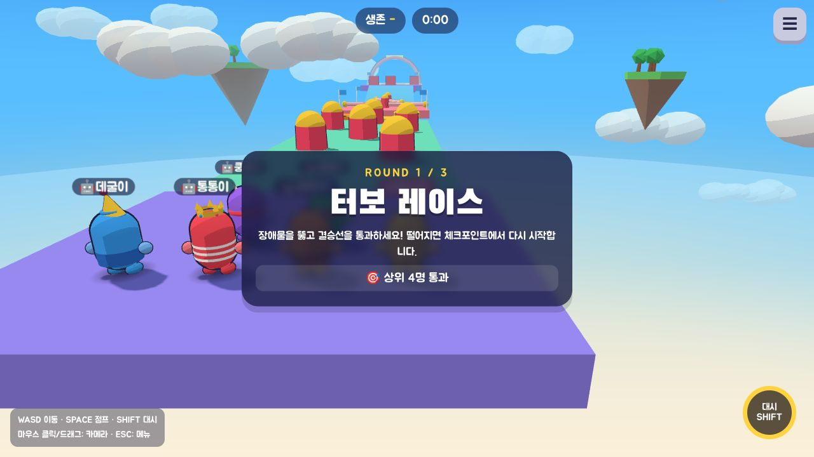
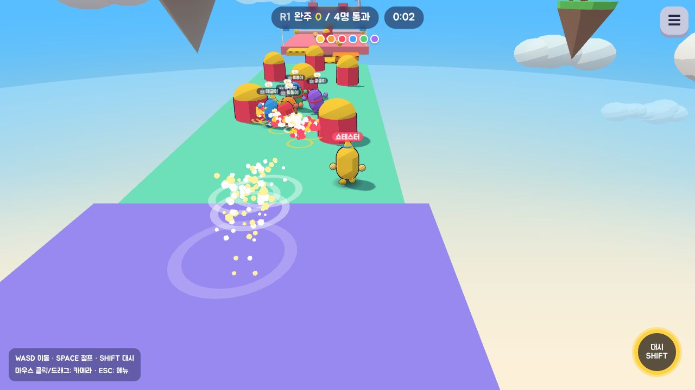
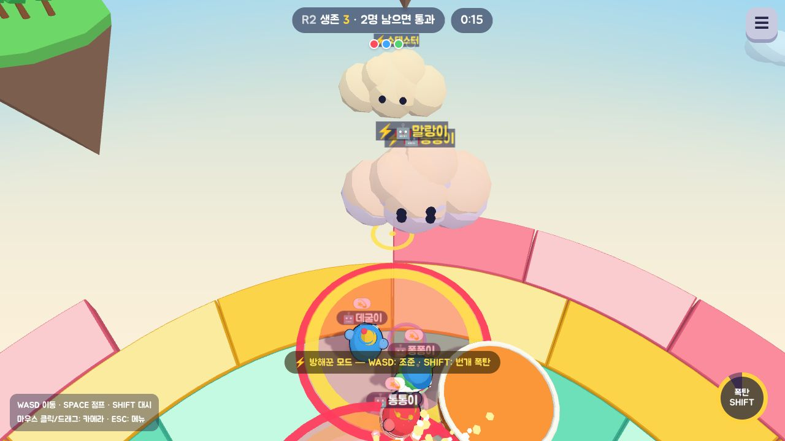
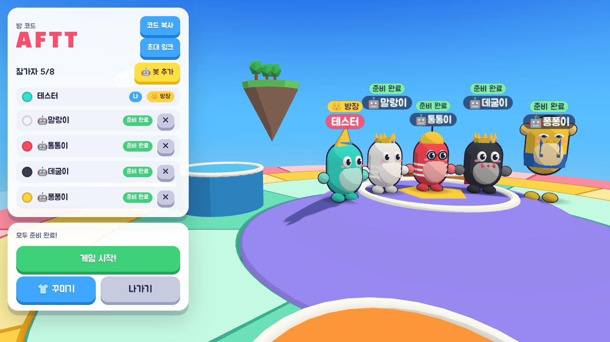
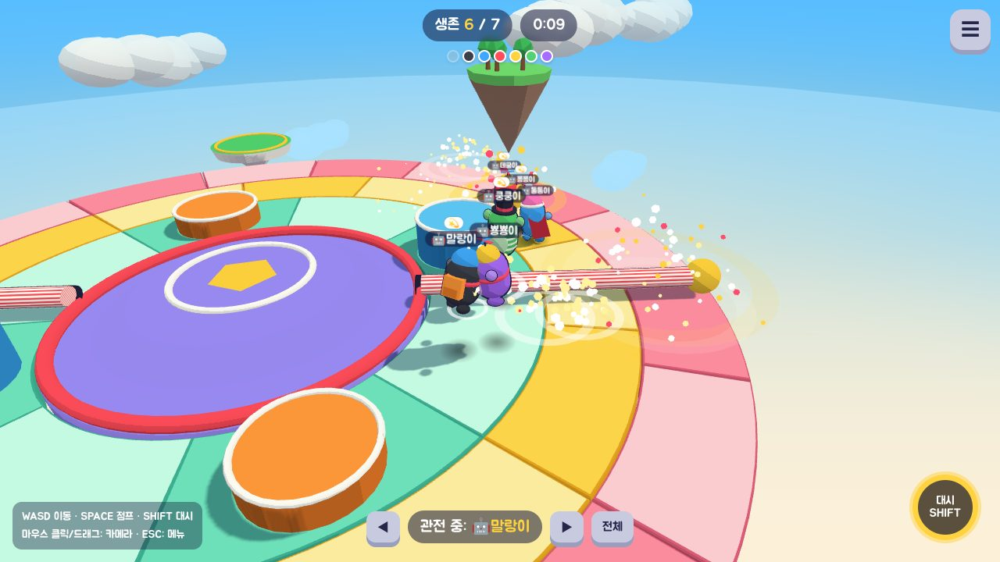
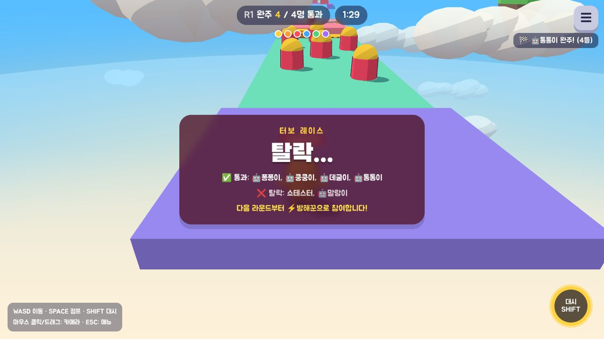
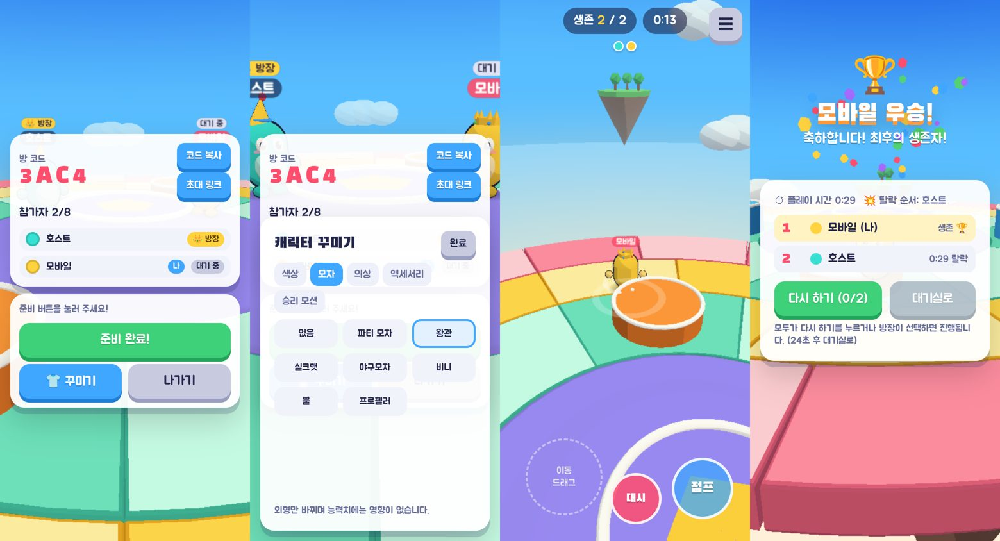

# KNOCKOUT — 3D 실시간 멀티플레이 넉백 서바이벌 파티 게임

2~8명이 참가하는 **3라운드 파티 쇼**입니다. 장애물 레이스를 뚫고, 넉백 아레나에서 버티고, 결승에서 마지막 한 명이 챔피언이 됩니다.
탈락해도 끝이 아닙니다. **⚡번개 구름 방해꾼**이 되어 남은 선수들 머리 위로 폭탄을 떨어뜨리며 계속 참여합니다.
PC(키보드·마우스)와 모바일(가상 조이스틱·터치 버튼)에서 모두 플레이할 수 있고, 방 코드를 공유해 다른 기기의 친구와 실시간으로 대전합니다.

| 라운드 소개 | 1라운드 터보 레이스 | ⚡방해꾼 번개 폭탄 |
|---|---|---|
|  |  |  |
| **PC 대기실** | **넉아웃 아레나** | **라운드 결과** |
|  |  |  |



---

## 0. 설치 없이 바로 해 보기

`knockout/KNOCKOUT-offline.html` 파일 하나를 내려받아 **더블클릭**하면 브라우저에서 바로 실행됩니다 (PC·휴대폰 모두).
게임 서버 로직을 브라우저 안에서 그대로 돌려 **봇과 대전**하는 오프라인 버전입니다. 친구와 방 코드로 하는 온라인 대전은 아래처럼 서버를 실행/배포해야 합니다.
파일 다시 만들기: `npm run build:standalone`

## 1. 빠른 시작

필요한 것: **Node.js 20 이상** (22 권장). 외부 유료 서비스나 API 키는 필요 없습니다.

```bash
cd knockout
npm install

# 개발 모드: 게임 서버(3001) + Vite 개발 서버(5173)를 함께 실행
npm run dev
# → 브라우저에서 http://localhost:5173 접속
```

같은 Wi-Fi의 휴대폰으로 테스트하려면 PC의 IP로 접속합니다 (예: `http://192.168.0.10:5173`). Vite가 `/ws` 웹소켓을 게임 서버로 프록시해 줍니다.

### 배포용 실행 (서버 하나로 게임 + 웹소켓 제공)

```bash
npm run build      # client/dist 생성
npm start          # http://localhost:3001 에서 게임과 웹소켓(/ws)을 함께 제공
```

### 혼자 해 보기
메인 메뉴의 **🤖 봇과 연습하기**를 누르면 봇 3명과 바로 경기가 시작됩니다. 대기실에서 방장은 **봇 추가**로 빈자리를 봇으로 채울 수 있습니다 (봇도 서버에서 사람과 똑같이 입력만 만들어 물리 시뮬레이션을 거칩니다).

---

## 2. 조작법

| | PC | 모바일 |
|---|---|---|
| 이동 | WASD / 방향키 | 화면 왼쪽 아무 곳이나 드래그 (가상 조이스틱) |
| 점프 | SPACE (길게 누르면 더 높이) | 오른쪽 **점프** 버튼 (길게 누르면 더 높이) |
| 대시 | SHIFT (쿨타임 2초, 오른쪽 아래 게이지) | 오른쪽 **대시** 버튼 (버튼 테두리에 쿨타임 표시) |
| 카메라 | 화면 클릭 후 마우스 이동(포인터 잠금) 또는 드래그 | 화면 오른쪽 빈 곳 드래그 |
| 메뉴 | ESC 또는 ☰ | ☰ |

**모바일은 항상 가로 화면**으로 플레이합니다. 휴대폰을 세로로 들고 있거나 화면 회전이 잠겨 있어도 게임 전체가 90° 돌아가 가로로 표시되므로, 휴대폰을 옆으로 눕혀 잡으면 됩니다(조이스틱·버튼 좌표도 함께 변환). 메뉴의 ⛶ 버튼은 지원 브라우저(안드로이드 크롬 등)에서 전체 화면 + 가로 고정을 시도합니다. 설정 → "모바일 화면"에서 "기기 방향 따름"으로 바꿀 수 있습니다.

---

## 3. 게임 모드

### 🏆 쇼 모드 (기본, 3라운드)
| 라운드 | 내용 | 통과 조건 |
|---|---|---|
| 1. 터보 레이스 | 범퍼 밭 → 좌우로 움직이는 발판 징검다리 → 회전 막대 2개 → 경사로 → 피스톤이 밀어내는 갑판 → 좁은 다리 3개 → 결승 아치. 떨어지면 마지막 **체크포인트**에서 다시 시작 | 상위 약 60% 완주 (150초 제한 시 진행 거리순) |
| 2. 넉아웃 아레나 | 원형 경기장에서 밀어내기 + 랜덤 이벤트 | 목표 인원만 남으면 생존자 통과 |
| 3. 결승: 최후의 섬 | 경기장이 더 빨리 무너지는 최종전 | 마지막 1명 = 챔피언 |

인원에 따라 자동 구성: 2명은 레이스 1판, 3명은 레이스→결승, 4명 이상은 3라운드 (예: 8명 → 5명 → 3명 → 1명).

**이 게임만의 차별점**
- **⚡ 번개 구름 방해꾼**: 탈락자와 레이스 완주자가 구름이 되어 경기장 위를 날아다니며 조준(이동 키/조이스틱) → 번개 폭탄(SHIFT/대시 버튼, 6초 쿨타임). 1.1초 동안 바닥에 붉은 원으로 예고된 뒤 폭발해 주변 선수를 날려 버립니다. 탈락해도 끝까지 경기에 영향을 줍니다.
- **넉백 물리가 중심**: 레이스 중에도 대시 몸통박치기로 경쟁자를 떨어뜨릴 수 있고, 서버가 충돌 방향·속도로 넉백을 계산합니다.
- **완주자의 딜레마**: 먼저 완주하면 남은 선수들을 방해하는 쪽이 됩니다.

### ⚔️ 클래식 모드
넉아웃 아레나 한 판, 마지막 생존자 우승. 대기실에서 방장이 모드를 선택합니다.

## 4. 게임 규칙과 시스템

- **목표**: 상대를 밀어 경기장 밖으로 떨어뜨리고 마지막까지 살아남기. 경기장 아래(y < -14)로 떨어지면 탈락입니다. 즉사 판정은 없고 모든 탈락은 실제 물리로 떨어져서만 발생합니다.
- **넉백**: 부딪힌 방향(두 캐릭터 중심을 잇는 법선)으로, 서로 다가온 속도(충돌 강도)에 비례해 밀려납니다. 대시로 부딪히면 추가 넉백, 공중에서 맞으면 1.2배. 맞으면 살짝 떠오르고 잠시 조작이 둔해지며(경직 💫), 마찰로 서서히 멈춘 뒤 조작이 회복됩니다. 같은 두 사람의 연속 충돌은 0.22초 쿨다운으로 폭주하지 않게 처리합니다.
  - 밸런스 기준(테스트로 고정): 대시 한 방 ≈ 5~10m, 걸으며 부딪힘 ≈ 3m 이내 → 중앙에서 한 방에 즉사하지 않고, 가장자리에서는 위험해집니다.
- **대시**: 0.2초 동안 19m/s로 돌진, 쿨타임 2초. 공중 대시 가능.
- **경기장**: 반지름 16m 원형 플랫폼(37개 타일), 경사로가 있는 중앙 단상, 높이가 다른 원기둥 플랫폼 4개(0.8m/1.5m), 바깥을 공전하며 위아래로 움직이는 발판 2개(올라타면 함께 이동).
- **랜덤 이벤트** (2.5초 전에 화면 배너 + 경고음 + 현장 연출로 예고, 한 번에 하나씩):
  - 🔴 **회전 막대**: 단상 둘레에서 두 팔이 회전. 점프로 넘거나 피해야 함.
  - 🌬 **돌풍**: 화면에 바람 방향 화살표와 바람 줄기, 공중에서는 더 강하게 밀림.
  - ⚠️ **바닥 붕괴**: 3~4개 타일이 붉게 깜빡이다 9초간 떨어졌다 복구.
- **경기장 축소 (서든데스)**: 70초·100초·130초에 바깥 링부터 영구 붕괴(130초에는 움직이는 발판도 철수), 180초에는 중앙 단상까지 무너져 경기가 반드시 끝납니다.
- **승패**: 마지막 1명이 우승. 마지막 생존자들이 같은 틱에 동시에 떨어지면 공동 우승(무승부)으로 처리하고, 같은 틱 탈락자는 같은 순위를 공유합니다.
- **경기 흐름**: 메뉴 → 방 만들기/코드로 참가 → 대기실(준비) → 3초 카운트다운 → 경기 → 결과(우승자, 최종 순위, 플레이 시간, 탈락 순서) → 다시 하기 / 대기실로. 결과 화면은 25초 뒤 자동으로 대기실로 돌아갑니다.
- **관전**: 탈락하면 OUT 표시 후 관전 모드(◀ ▶로 생존자 전환, 전체 보기). 경기 도중 들어온 사람도 다음 경기까지 관전합니다.
- **꾸미기**: 색상 10종, 모자 7종, 의상 5종, 액세서리 5종, 승리 모션 5종. 외형만 바뀌며 능력치는 동일합니다. 같은 방에서 색상은 겹치지 않게 서버가 조정합니다.

---

## 5. 기술 선택 (PHASE 1)

| 영역 | 선택 | 이유 |
|---|---|---|
| 3D 렌더링 | **Three.js** (r180) | 브라우저 표준 WebGL, 모바일 호환성이 좋고 툰 셰이딩/인스턴싱 등 필요한 기능이 모두 있음. 외부 3D 모델 파일 없이 코드로 캐릭터를 만들어 로딩이 빠름 (전체 gzip ≈ 170KB). |
| 언어 | **JavaScript (ES Modules)** | 서버·클라이언트가 **같은 물리 코드(`shared/`)를 빌드 없이** 그대로 실행해야 해서, 별도 트랜스파일이 필요 없는 순수 JS를 선택. |
| 물리 | **직접 구현한 결정적 물리** | 캐릭터 몇 명 + 원기둥/타일 지형뿐이라 범용 물리엔진(Cannon/Rapier)보다 단순하고 빠르며, 클라이언트 예측과 서버가 **완전히 같은 계산**을 해야 보정(reconciliation)이 정확해짐. 넉백 감각도 게임에 맞게 직접 튜닝 가능. |
| 서버 | **Node.js + `ws`** | 가볍고 빠른 WebSocket 서버. 서버 하나가 정적 파일과 `/ws`를 같이 제공해 배포가 단순함. |
| 개발 환경 | **Vite** | 빠른 HMR, `/ws` 프록시, 프로덕션 번들링. |
| 사운드 | **WebAudio 합성** | 효과음 파일 없이 코드로 합성 → 다운로드 0바이트, 저작권 문제 없음. |

### 프로젝트 구조

```
knockout/
├─ shared/src/            # 서버·클라이언트 공용 (같은 코드가 양쪽에서 실행됨)
│  ├─ constants.js        # 틱레이트, 물리/넉백/이벤트 수치
│  ├─ course.js           # 레이스 코스(박스·경사·이동 발판·피스톤·범퍼·회전 막대·체크포인트)
│  ├─ arena.js            # 경기장 정의(타일·단상·플랫폼·발판·회전막대·바람), 지면 질의
│  ├─ physics.js          # 이동·점프·대시·착지 + 플레이어 간 충돌/넉백
│  ├─ messages.js         # 네트워크 메시지 타입·플래그
│  ├─ looks.js, events.js # 커스터마이징 옵션, 이벤트 문구
├─ server/src/
│  ├─ index.js            # 진입점 (PORT, HOST)
│  ├─ network/GameServer.js  # HTTP 정적 제공 + WebSocket + 60Hz 고정 틱 루프 + 하트비트
│  ├─ rooms/RoomManager.js, Room.js  # 방 코드, 참가/재접속, 대기실·단계 진행, 브로드캐스트
│  ├─ players/Player.js   # 입력 큐(속도 조작 방지), 재접속 토큰
│  └─ game/Match.js, EventDirector.js, Bot.js  # 권위 시뮬레이션, 이벤트, AI
├─ client/src/
│  ├─ main.js             # 앱 흐름(로딩/메뉴/대기실/경기/결과) + 네트워크 연결
│  ├─ game/               # Game(3D 총괄), SceneSetup(하늘·구름·섬·조명), materials(툰)
│  ├─ arena/ArenaView.js  # 경기장 메쉬, 타일 붕괴·복구, 발판, 회전 막대, 바람 연출
│  ├─ characters/         # Character(모델+절차적 애니메이션), Cosmetics(모자/의상/액세서리)
│  ├─ camera/CameraRig.js # 3인칭 추적, 자동 줌, 낙하/가장자리 시야, 흔들림
│  ├─ controls/Input.js   # 키보드·마우스·포인터 잠금·터치 조이스틱/버튼
│  ├─ network/Net.js, NetSync.js  # 재연결/세션 복구, 예측·보정·보간
│  ├─ fx/Effects.js       # 인스턴싱 파티클, 충격파 링, 대시 잔상
│  ├─ audio/Sfx.js, ui/UI.js, settings.js, style.css
└─ tests/                 # 단위·서버 통합·브라우저 E2E 테스트
```

---

## 6. 온라인 멀티플레이 설계

- **서버 권위(authoritative)**: 서버가 60Hz로 모든 캐릭터의 물리, 충돌·넉백, 이벤트, **탈락·순위·승리 판정**을 계산합니다. 클라이언트는 입력(이동 방향, 점프, 대시)만 보냅니다. 각 브라우저가 따로 판정하는 구조가 아닙니다.
- **입력 검증**: 이동 벡터 길이는 1로 제한, 버튼 비트만 허용, 서버는 **틱당 입력 1개만** 소비하고 큐 길이를 제한하므로 입력을 몰아 보내 빨리 움직이는 조작이 불가능합니다(테스트로 확인).
- **스냅샷**: 20Hz로 모든 플레이어 상태를 압축 배열(JSON, 소수 둘째 자리 반올림)로 전송. 각 클라이언트에게는 마지막으로 처리된 입력 번호(ack)를 함께 보냅니다. 타일/이벤트/충돌 이펙트/탈락은 변할 때만 별도 메시지로 보냅니다.
- **지연 보상**
  - 내 캐릭터: **클라이언트 예측** — 입력 즉시 같은 물리 코드로 움직이고, 스냅샷이 오면 서버 상태에서 미확인 입력을 다시 시뮬레이션(**reconciliation**). 차이는 화면상 부드럽게 흡수합니다.
  - 다른 캐릭터: 100ms 지연 **보간(interpolation)** + 짧은 외삽, 움직이는 발판 위에 있으면 발판 위치에 맞춰 보정.
  - 시계 동기화: 스냅샷의 경기 시간과 RTT(2초마다 핑)로 서버 시각을 추정.
- **연결 끊김·재접속**: 방에 들어가면 탭별 재접속 토큰을 `sessionStorage`에 저장합니다. 연결이 끊기면 지수 백오프로 자동 재연결 후 같은 플레이어로 복귀하고, **새로고침해도** 같은 방·같은 캐릭터로 돌아갑니다. 서버는 30초간 자리를 유지하며, 경기 중 끊긴 캐릭터는 그 자리에 멈춰 서 있습니다(입력이 끊기면 서버가 마지막 입력을 0.13초만 유지). 방장이 나가거나 끊기면 다음 사람에게 방장이 넘어갑니다.

---

## 7. 테스트

```bash
npm test             # 단위 + 서버 통합 테스트 (node:test, 41개)
npm run build && npm run test:e2e   # 실제 브라우저로 클래식 + 쇼 모드 전체 흐름 검증 (Playwright 필요)
```

- `tests/physics.test.js` — 가속/감속, 점프·가변 점프·착지, 점프 1회 보장, 대시 속도·거리·쿨타임, 대시 충돌 넉백 방향·강도·경직, 정면/대각선/공중 충돌, 연속 충돌 쿨다운, 넉백 거리 밸런스, 경사로, 높은 플랫폼 막힘/점프 등반, 가장자리 낙하 탈락, 붕괴 타일, 움직이는 발판 운반, 회전 막대, 바람.
- `tests/server.test.js` — 실제 WebSocket으로: 방 생성·코드 참가·잘못된 코드·색상 중복 방지·준비 검사·방장 권한·카운트다운·탈락·우승·결과·다시 하기, 입력 몰아보내기 방지(ack), 재접속(로비·경기 중), 잘못된 토큰, 방장 위임, 봇 대전, 8명 제한, 동시 탈락 공동 우승, 8명 동시 탈락, 봇 6명 풀매치가 경기장 축소로 반드시 끝나는지, 입력 끊김 시 정지.
- 쇼 모드: 라운드 구성, 레이스 체크포인트 재시작, 결승선 완주→방해꾼 전환, 번개 폭탄 예고·폭발 넉백, 봇 7+사람 1의 레이스→서바이벌→결승 전체 진행, 코스 경사로/움직이는 발판/범퍼/틈 낙하.
- `tests/e2e/show.e2e.mjs` — 브라우저에서 쇼 모드 3라운드를 끝까지 진행하고, 레이스에서 탈락한 뒤 방해꾼으로 폭탄을 떨어뜨리는 것까지 확인.
- `tests/e2e/browser.e2e.mjs` — PC 브라우저(호스트) + 모바일 터치 에뮬레이션 브라우저(게스트)로: 방 생성 → 초대 링크 코드 자동 입력 → 참가 → 꾸미기 동기화 → 준비/시작 → 카운트다운 → 키보드 이동·점프·대시 → 다른 기기에서 본 위치 일치 → 가상 조이스틱 이동·점프 버튼 → **새로고침 후 같은 플레이어로 경기 복귀** → 탈락·우승·결과 화면 → 다시 하기 → 방장 위임 → 콘솔 에러 0. 스크린샷은 `test-results/`에 저장됩니다.

> 참고: 이 E2E는 GPU가 없는 환경의 소프트웨어 렌더링(초당 3~7프레임)에서도 통과하도록 작성되었습니다. 실제 휴대폰 기기, 실제 인터넷 지연 환경에서의 체감 품질은 직접 확인해 보시길 권장합니다.

---

## 8. 배포 방법

게임은 **Node 서버 하나**(정적 파일 + WebSocket `/ws`)로 동작하므로 WebSocket을 지원하는 Node 호스팅이면 어디든 됩니다. 정적 전용 호스팅(GitHub Pages 등)만으로는 서버를 돌릴 수 없습니다.

### A. Render.com (무료 플랜 가능, 가장 간단)
1. GitHub 저장소를 Render에 연결 → **New + → Blueprint** 선택 → 저장소 루트의 `render.yaml`이 자동 인식됩니다 (`rootDir: knockout`).
2. 또는 **New Web Service**로 직접 만들 경우: Root Directory `knockout`, Build `npm ci && npm run build`, Start `npm start`, Health Check Path `/health`.
3. 배포가 끝나면 `https://<서비스이름>.onrender.com` 주소를 친구에게 공유하면 됩니다. (HTTPS면 클라이언트가 자동으로 `wss://`로 접속)
   - 무료 플랜은 15분간 접속이 없으면 잠들어 첫 접속이 30초 정도 걸릴 수 있습니다.

### B. Docker (Fly.io, Railway, 자체 서버 등)
```bash
cd knockout
docker build -t knockout .
docker run -p 3001:3001 knockout
```
- **Railway**: 저장소 연결 → Root Directory를 `knockout`으로 설정 → Dockerfile 자동 인식. `PORT`는 Railway가 주입합니다.
- **Fly.io**: `cd knockout && fly launch` (Dockerfile 사용, 내부 포트 3001) → `fly deploy`.

### C. 클라이언트와 서버를 분리 배포 (선택)
클라이언트를 정적 호스팅(Netlify, Vercel, GitHub Pages)에 올리고 서버는 별도로 운영하려면, 빌드 시 서버 주소를 지정합니다.
```bash
VITE_SERVER_URL=wss://knockout-server.example.com npm run build   # client/dist 를 정적 호스팅에 업로드
```

### 환경 변수

| 변수 | 위치 | 기본값 | 설명 |
|---|---|---|---|
| `PORT` | 서버 | `3001` | HTTP/WebSocket 포트 (호스팅 서비스가 주입하면 자동 사용) |
| `HOST` | 서버 | `0.0.0.0` | 바인딩 주소 |
| `VITE_SERVER_URL` | 클라이언트 빌드 | (같은 주소) | 서버를 다른 도메인에 둘 때만 지정. `wss://…` 형식 |
| `SERVER_PORT` | 개발(`npm run dev`) | `3001` | Vite가 `/ws`를 프록시할 게임 서버 포트 |

`.env.example` 참고. **외부 서비스 가입·API 키·데이터베이스는 필요 없습니다.**

### 운영 시 참고
- 방 정보는 서버 메모리에 있으므로 서버가 재시작되면 진행 중인 방은 사라집니다(클라이언트는 메뉴로 돌아감).
- 인스턴스를 여러 대로 늘릴 경우 같은 방의 플레이어가 같은 인스턴스에 붙도록 해야 합니다(현재 설정은 단일 인스턴스 기준). 서버 1대(무료/소형 플랜)로 동시에 수십 개 방은 충분히 처리합니다.

---

## 9. 설정 화면

효과음 볼륨, 카메라 감도, 그래픽 품질(자동/낮음/보통/높음 — 낮음은 그림자·안티앨리어싱·파티클을 줄여 저사양 모바일 대응), 카메라 상하 반전, 화면 흔들림, FPS 표시. 설정과 닉네임·꾸미기는 브라우저에 저장됩니다.
